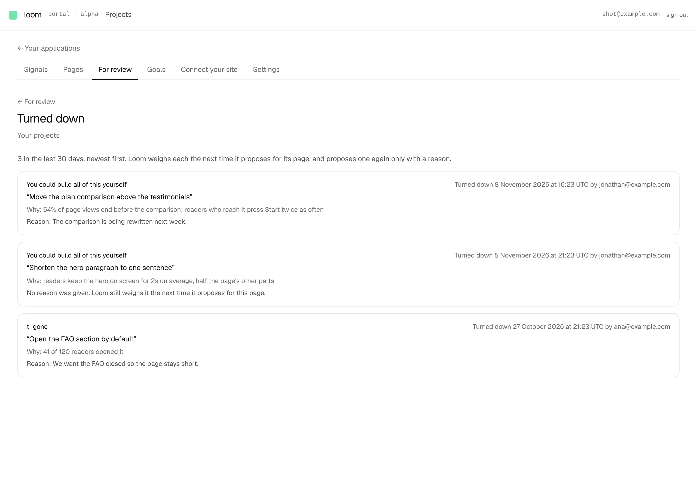

# *For review*: *Turned down recently*, and the list it opens

**Lane:** `Loom portal` · **Date:** 8 November 2026 ·
**Branch:** `claude/project-thread-fqwe8c` ·
**Records:** none new ·
**Plan:** [`docs/portal.md`](../docs/portal.md) row 8b ·
**Target:** [`docs/portal-wireframes.md`](../docs/portal-wireframes.md) *2 ·
For review*, *Turned down recently: N · see them*

Claimed by a portal run at 2026-11-08 21:20 UTC (#828).

## Why this, and why now

No portal-run pull request or branch had been pushed in the last three hours.
The two open pull requests that touch the portal, #825 (the Signals chart) and
#826 (publishing on deploy), came from their own threads; this run stayed off
their files. The last run (#827) named *Turned down recently* as the next free
piece of section 2, and its input, the turned-down changes 0341 keeps in
`loom_turned_down`, has been on `main` since #754.

## What shipped

- **The line under *For review***: *Turned down recently: 3 · see them*,
  counting the changes turned down on the project's pages in the last 30 days.
  *none* where there were none, with nothing to open; left out entirely where
  they could not be read, so it never says nought for a list it did not read.
  `review/_components/turned-down-line.tsx`.
- ***Turned down***, `/portal/<project>/review/turned-down`: those changes,
  newest first, fifty to a page with the last one shown in the address
  (`before`), as *Accepted* pages. Each card names its page (linked; by its id
  where the site no longer publishes it), when and by whom it was turned down,
  the change, the figure Loom gave for it (`Why:`), and the reason in the
  turner's words, or that none was given and Loom weighs it anyway.
  `review/turned-down/page.tsx`, `_components/turned-down-card.tsx`.
- **Reading every page's turned-down changes since a moment**: `since(at,
  limit)` on `TurnedDownStore`, newest first, in memory and Postgres, held by
  the contract both run. The Postgres read and `forPage` now share one row
  reader. It uses the table as it is: no column, no index, no `pnpm db:push`.
- **What the list says, pure**: `_lib/turned-down-list.ts` (the window, the
  count, and a row read back into change, figure and reason through
  `requestPartsOf`) and `_lib/turned-down-reading.ts` (the reads).
- **One pager for both lists**: `acceptedPage` in `going-live.ts` became
  `changesPage` in `_lib/changes-page.ts`, generic over anything with a
  proposal id, so *Accepted* and *Turned down* page the same way. Its tests
  moved with it.

No table, no column, no environment variable, no `pnpm db:push`.

## Decisions taken

- **"Recently" is 30 days.** It is the window the portal keeps a reader's
  events for (0349), so the list covers the same stretch as the signals the
  changes were proposed on. A reasonable reversible default; it is one constant
  (`RECENT_DAYS`).
- **A read stops at 500.** Far more than a month of daily proposals, and a
  bound on the query. A read that reaches it says *500 or more* rather than an
  exact figure.
- **No goal chip on a turned-down card.** Which goal a proposal served is kept
  by its intent id (0352), and 0341 keeps a turned-down change by its proposal
  id without the intent, so the goal cannot be joined honestly. Adding the
  intent to `loom_turned_down` is a column and a `pnpm db:push`; not taken in
  this piece.
- **No record.** This draws what 0341 keeps and decides nothing it leaves open.

## Tests

- `turned-down.contract.ts`, 1 new, run against memory and Postgres: every
  page's since a moment, newest first, at most as many as asked.
- `turned-down-list.test.ts`, 5 tests: the window, an exact count, a count
  that stopped at the limit, and a row read back with and without its figure
  and page name.
- `turned-down-card.test.tsx`, 2 tests; `turned-down-line.test.tsx`, 3 tests.
- `changes-page.test.ts`, 3 tests (two moved from `going-live.test.ts`).
- `pnpm verify` exits 0: the framework's 6,700 tests (2 skipped) and the
  app's 7,343 in 456 files.

## Seen working

Built and served against Postgres 16 (`next build` + `next start`), with one
published page (*Pricing*) and four changes turned down: two on it in the last
week (one with a reason, one without), one on a page the site no longer
publishes, and one 40 days ago, which neither the count nor the list includes.
*For review* says *Turned down recently: 3 · see them*, and the list shows the
three newest first, the page by the name its heading gives it and the gone page
by its id.

The line under *For review*:
[wide](2026-11-08-portal-turned-down-line-wide.webp). On a phone:
[phone](2026-11-08-portal-turned-down-phone.webp).

## Where the wireframe stands

*2 · For review* now has the renamed list, goal-led cards, the goal picker and
standing chips, the drawer with before and after, and *Turned down recently*.
Still missing: the predicted effect (new data, and a method the maintainer has
not chosen), and the next time Loom looks at the pages under the title (the
schedule lives in `vercel.json`; reading it into the screen without a second
copy of it is the open question).
