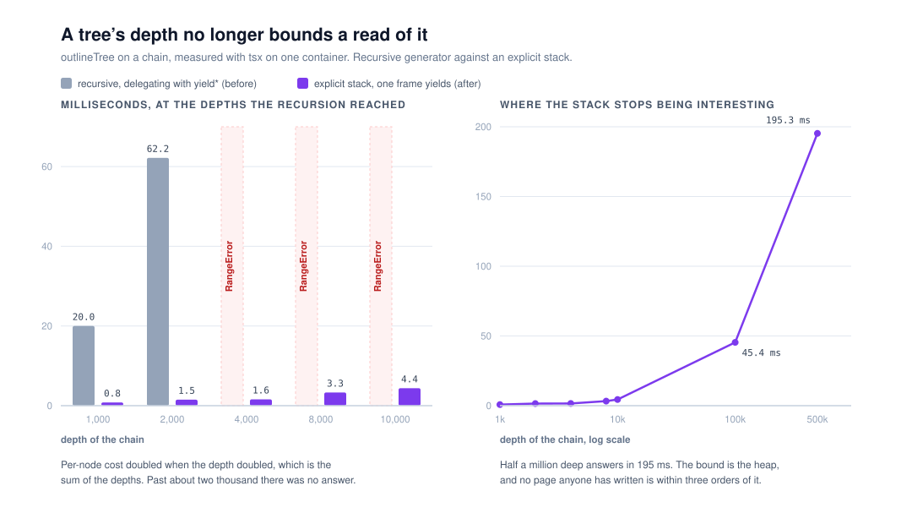

# A tree's depth no longer bounds a read of it

**`Loom daily build`, 8 November 2026, evening run.**
Branch `framework-tree-walks-iterative`. Record
[0370](../decisions/0370-every-read-of-a-tree-carries-an-explicit-stack-because-a-page-s-depth-is-data.md),
`Accepted`. `pnpm verify` **EXIT=0**, read out of the file.

## What this run completed

`Loom signals` filed a finding this morning saying that `outlineTree` is
quadratic in depth and throws above about two thousand. This run fixed it, and
fixed the same defect in `walkTree`, which the finding did not name and which
has six readers.

**What was wrong.** Every read of a tree in this repository was a recursive
generator. A delegated yield — `yield*` — passes each value back up through
every frame between the generator that produced it and the consumer, so a node
at depth *d* costs *d* and a walk costs the **sum of the depths** rather than
the number of nodes. Past a few thousand deep it does not cost anything, because
it does not return: `RangeError: Maximum call stack size exceeded`.

Measured on this container before the change, on a chain:

| depth | `outlineTree` | `collectNodeIds` | `textOf` | `nodePath` |
| --- | --- | --- | --- | --- |
| 1,000 | 20.0 ms | 16.8 ms | 13.9 ms | 12.1 ms |
| 2,000 | 62.2 ms | 48.4 ms | 49.1 ms | 28.7 ms |
| 4,000 | `RangeError` | 225.9 ms | 214.4 ms | 101.0 ms |
| 8,000 | `RangeError` | `RangeError` | `RangeError` | `RangeError` |

Per-node cost doubles when the depth doubles, which is the signature of the sum.
`outlineTree` gives up first because a delegated yield costs more frames per
level than a plain call does.

**What it does now.** Each walk pushes its root onto an array, pops, yields, and
pushes the popped node's children in reverse, so the pre-order and the sibling
order come out unchanged with one frame yielding and no frame delegating.
`nodePath` walks the same way over a link per node — a `Descent`, a node and the
step it was reached from — and reads the chain back off those links instead of
copying a path down the tree, which was itself the square of the depth in
allocation. `isDescendantOf` asks `walkTree` for the subtree under the ancestor
and skips the first node it yields, which is the ancestor, rather than recursing
and re-searching the tree at every level.

The same measurements after:

| depth | `outlineTree` | `collectNodeIds` | `textOf` | `nodePath` |
| --- | --- | --- | --- | --- |
| 1,000 | 0.8 ms | 0.3 ms | 0.3 ms | 1.4 ms |
| 2,000 | 1.5 ms | 0.6 ms | 0.5 ms | 1.6 ms |
| 4,000 | 1.6 ms | 0.3 ms | 1.1 ms | 0.7 ms |
| 8,000 | 3.3 ms | 0.3 ms | 0.6 ms | 0.6 ms |
| 10,000 | 4.4 ms | 0.5 ms | 0.3 ms | 1.4 ms |

And where it now stops being interesting: a chain of **100,000** outlines in
45.4 ms, and **500,000** in 195.3 ms, walks in 41.6 ms and gives a path in
57.6 ms. The bound is the heap. Width was never the subject and is not worse
for it: 6,000 siblings under one node outlined in 4.5 ms before and 2.4 ms
after.

**Every output is the same.** The existing suites for both modules pass
untouched: pre-order, sibling order, `depth`, `parentId`, `index`, the path's
direction and contents, `isDescendantOf`'s answer for a node asked about itself,
and `duplicateNodeIds` on a tree with a repeat in it.

**The guard.** `src/tree/depth.test.ts` reads a chain of ten thousand six ways —
the outline whole with the depth and parent of every row, every node walked, the
whole chain as a path root-first, the deepest node's parent, `isDescendantOf`
root to bottom, and `textOf`. All four of its cases throw `RangeError` against
the implementation this branch replaces, checked by stashing the two source
files and running them. That is how it is known to be a guard rather than a
decoration. It costs 81 ms.

## The section

§2 — Composition Runtime, the tree. This is framework depth behind the surfaces
rather than a surface: what it unblocks is a claim two modules in `src/signals/`
publish.

## Decisions taken that were not specified

**The finding named `outline.ts` and this branch also changed `navigation.ts`.**
`walkTree` has the identical defect and six readers — `collectNodeIds`,
`findNode`, `containsNode`, `findParent`, `textOf`, `duplicateNodeIds`. A branch
that fixed the outline and left the walk would have published a bound that reads
as removed, and the new test file would have had to name which reads were
excused. `nodePath` and `isDescendantOf` went with them because they carry the
same depth bound by plain recursion and a test asserting a depth of ten thousand
that skipped two functions in the module would be stating the opposite of what
it looks like it states.

**0370 was written rather than left as a line in this report.** The recursive
spelling is the shorter and tidier of the two to read, so it is what a later run
reaches for as a simplification. The record and the two module docblocks exist
to make that a decision somebody has to overturn rather than a tidy.

**The number is 0370 and not 0369.** 0369 is claimed by an open branch (#826)
that has not merged; `pnpm decisions:index` says so.

**`replaceNode` was left alone**, with numbers, as a finding. See below.

## Records

- **[0370](../decisions/0370-every-read-of-a-tree-carries-an-explicit-stack-because-a-page-s-depth-is-data.md)**
  — *Every read of a tree carries an explicit stack, because a page's depth is
  data.* `Accepted`. Nothing superseded.

## Findings

**Closed.** *`outlineTree` is quadratic in depth and throws above about two
thousand* (8 November, filed by `Loom signals`). Fixed as the entry recommends.
Its last paragraph asked for a deepest-tree test of ten thousand "which today
throws"; that test exists and no longer throws. The linearity claim
`pageReadingOf` and `insideReadingOf` publish now holds in a page's depth as
well as in its parts, with no change in `src/signals/`.

**Filed.** *The rebuild every accepted delta goes through throws at two thousand
deep.* `replaceNode` in `src/tree/mutation.ts` recurses to rebuild and calls
`containsNode` at every level, so it is `O(n·d)` and throws at 2,000 — against
23.6 ms at 1,000 and 7.2 ms at 500. It is now the shallowest bound in the tree
and it is on the path every accepted delta takes. Owned by this lane; it is the
obvious next unit. Not done here because a rebuild is a different shape of
change from a read, it is where a wrong answer is a wrong tree rather than a
slow one, and one pull request changing both is one nobody can review.

**Also fixed, from a `Loom docs` note on #778 rather than from `FINDINGS.md`.**
`src/cli/index.ts` opened by saying the module is "scaffolding a new project,
and driving a proposal from the terminal against the same runtime a server would
use". The second half is not true: `parseArguments` takes `init`,
`add primitive` and `--help`. The docs lane checked that the sentence reaches no
reader — the reference generator reads the sub-modules' docblocks and not the
index's — and recommended deleting the clause rather than widening the CLI. Done
as recommended.

## Open questions

**Should the terminal drive a proposal?** The deleted clause described something
somebody once meant to build. It is a real question about what `@jam-overture/loom/cli`
is for, and a docblock is not where it gets answered. Nothing is blocked on it.

**How deep is a tree allowed to be?** Nothing in the schema says, which is why
this was an engine's stack size standing in for a decision. 0370 removes the
accidental answer and deliberately does not write a deliberate one: a cap would
be a migration for trees already stored. Worth an answer only if a real page
ever approaches it, and none is within three orders of magnitude.

**Zod's `loomNodeSchema` recursion is untouched**, so `parseTree` keeps whatever
depth bound the parser has. Not measured, because nothing here depends on it.

## Test numbers

`pnpm install && pnpm verify` — **EXIT=0**, read out of `verify.exit` in its
own command. The harness's own completion notice for the gate also said exit
code 0, and that is not the evidence; the file is.

| | framework | application | total |
| --- | --- | --- | --- |
| this branch | 275 files, **6,706** tests | 452 files, **7,307** tests | **14,013** |

**+4 tests, all of them this lane's**, in one new file. No existing test file was
modified on this branch — `git diff --stat` names `FINDINGS.md`,
`decisions/README.md`, `src/cli/index.ts`, `src/tree/navigation.ts` and
`src/tree/outline.ts`, and nothing else — so the framework count on `main` is
274 files and 6,702 tests.

`prerender:check` reports 139 prerendered pages, 2,045 text junctions, 0 run
together, 3 metadata conventions, 0 unserved. `findings:check` reports 1,485
findings, 0 malformed.

Nothing failed. Nothing was skipped. No test was weakened, and no test was
touched other than by the new file: the existing `outline.test.ts` and
`navigation.test.ts` pass unchanged against the rewritten modules, which is the
whole of the evidence that the outputs did not move.
