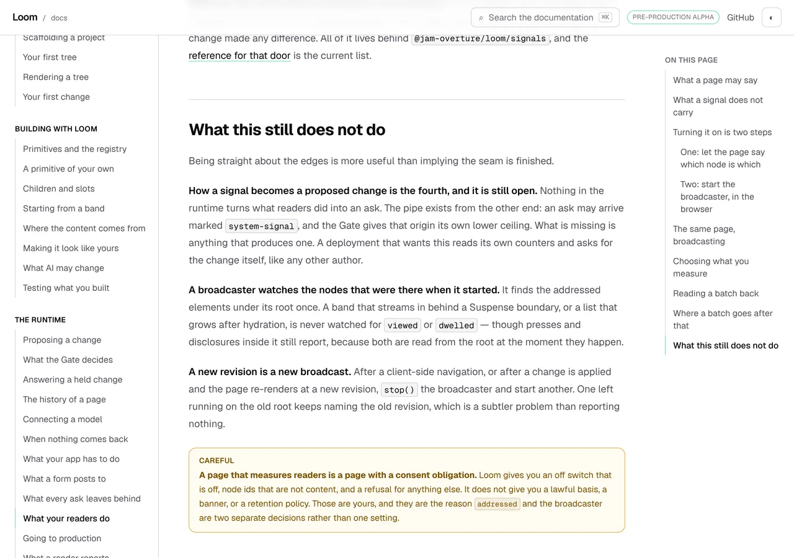
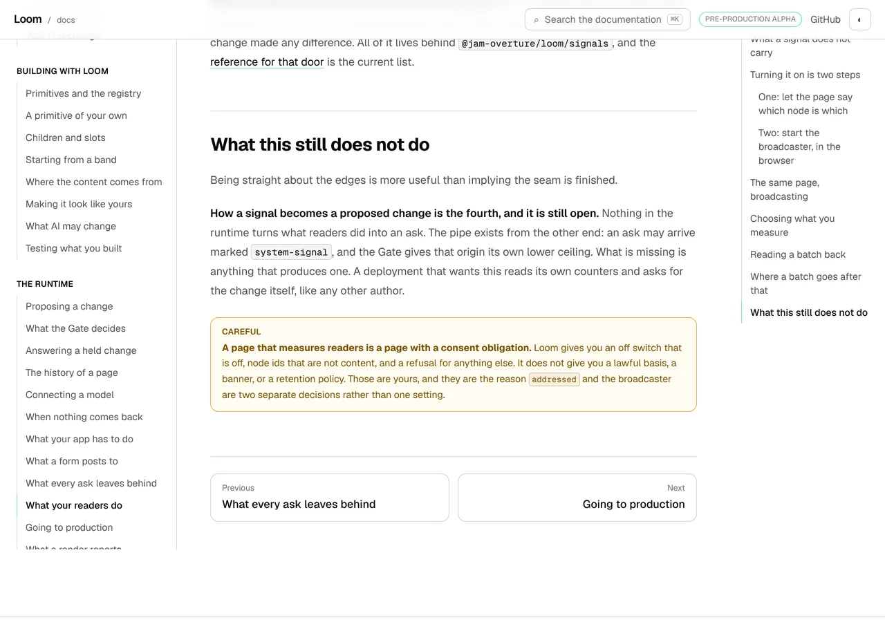
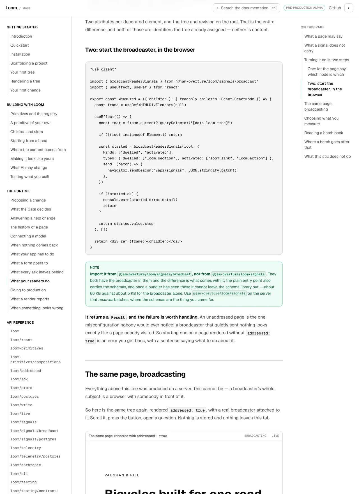
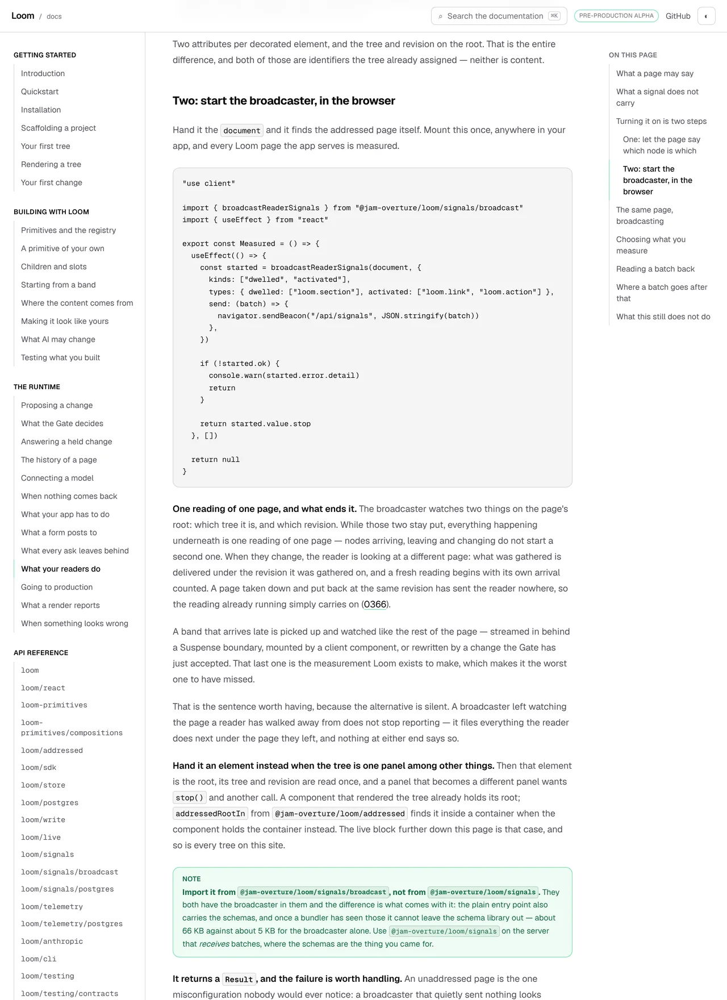
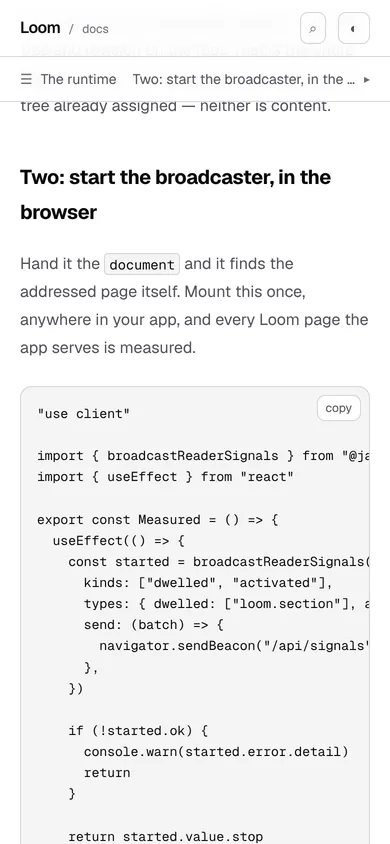

# 9 November 2026 — the page ended with two instructions the runtime had stopped needing, and a test held each of them in place

**Routine:** `Loom docs` · **Branch:** `docs-82-two-limits-the-runtime-no-longer-has` ·
**Section:** §4c

> **Read the gate section before anything else.** `pnpm verify` is **red**, on
> one test of 6,702, and **it is red on `origin/main` too** — a whole-repository
> sweep timing out at 5,402, 5,730 and 5,565 ms against a 5,000 ms default, and
> passing in 3,202 ms when run alone. Nothing was weakened and that test was not
> touched. The gate's six other steps were run individually, because `pnpm test`
> failing stops `pnpm verify` before it reaches the application, and all six are
> green: **468 files and 7,468 application tests, 0 failed.**

One open pull request from this lane at the start of the run — **#778**, opened
5 November, carrying `0353` as `Proposed`, **unanswered after four days**. Five
others were open: #839 (`Loom marketing`), #837 (`Loom signals`), #834 and #825
(project threads), #829 (`Loom framework`). None touches the `(docs)` route
group; checked file by file rather than by title.

**No maintainer comment is outstanding for this lane.** Every non-bot comment on
the open set and on last night's #820 is a routine's own, posted from the
maintainer's account; the rest is `vercel[bot]`.

Branch cut from `origin/main` at `638470e` after `git fetch origin main`. The
previous run's branch merged as part of that history (#820).

## The plain version

*What your readers do* is the page that teaches a reader how to measure a Loom
page. It ended with a section called **What this still does not do**, and two of
the things in it were instructions:

> **A broadcaster watches the nodes that were there when it started.** […] A
> band that streams in behind a Suspense boundary, or a list that grows after
> hydration, is never watched for `viewed` or `dwelled`.

> **A new revision is a new broadcast.** After a client-side navigation, or
> after a change is applied and the page re-renders at a new revision, `stop()`
> the broadcaster and start another.

**Both had stopped being true.** The broadcaster has run a `MutationObserver`
for addressed elements arriving and leaving since at or before 6 November, and
on 7 November [0366](../decisions/0366-a-broadcast-handed-a-document-follows-the-page-and-a-client-side-navigation-is-a-new-page-view.md)
gave `broadcastReaderSignals` a document form that follows the page by itself.

So a stranger working from this site was being told to write a workaround for
something the runtime does, and — worse — was being left believing that if they
forgot, they would lose data. They would not have lost data. They would have got
**wrong** data: every signal after a navigation filed under the page the reader
left, with nothing at either end saying so.

**And the suite was green the whole time**, because `claims.test.ts` asserted
that the page still said both sentences.

## The part worth reading sceptically

That file's own comment, four paragraphs above the two assertions, explains why
a sentence like *"nothing stores or interprets these"* was dangerous — nothing
could reach it — and then argues these two were the safe kind:

> *"each is a claim about **how the broadcaster behaves**, and the behaviour is
> in the runtime where a test can reach it. The one that was dangerous was a
> claim about what the runtime *lacked*, which nothing here could reach."*

Every clause of that is true, and it is why this is worth a report rather than a
line. **The argument was correct and nothing acted on it.** What the two
assertions did was read the page and check the sentence was still in it, which
is the same instrument the comment was warning about, pointed at a claim it had
decided was a different kind.

`_lib/absences.ts` could not have helped either, and for two separate reasons.
It sweeps written prose for a sentence saying **Loom lacks a name** and holds
each registered one against a measurement; neither of these says Loom lacks
anything. And its backstop regular expression looks for a dated word —
`not yet`, `so far`, `today` — and an imperative has none.

**An instruction is a third kind of dated claim**, and this site had no
instrument for one. That is the finding, and it is filed as open for the shape
with the cheap next step in it: count them before building anything.

## What shipped

**One page, one component, two test files, and a doc comment.**

### The fence a reader copies passes `document`

| | `main` | this branch |
| --- | --- | --- |
| the code block, rendered | **687 px** tall | **560 px** |
| what is in it | a ref, a `querySelector`, an `instanceof` guard, a wrapper element | the call |
| the code search index | 9,795 gz · 37,471 raw | **9,674 · 37,221** |

Both numbers are the harness's, measured off the page: `pre:has-text("querySelector")`
at `origin/main` is `702x687`, `pre:has-text("broadcastReaderSignals(document")`
here is `702x560`. The shorter fence gives **121 compressed bytes** back to the
code cap, which is the one budget on this surface this run improved.

The prose beside it says what to hand it and what the two arguments mean, and
then states the counting rule in words a reader can repeat:

> The broadcaster watches two things on the page's root: which tree it is, and
> which revision. While those two stay put, everything happening underneath is
> one reading of one page […] When they change, the reader is looking at a
> different page: what was gathered is delivered under the revision it was
> gathered on, and a fresh reading begins with its own arrival counted. A page
> taken down and put back at the same revision has sent the reader nowhere, so
> the reading already running simply carries on.

That is 0366's three clauses with no vocabulary in them, which is the order this
site is written in: the plain version first, the record one link later.

### The instrument that was missing

`_lib/signals/following.test.tsx` starts a **real broadcaster on a real
addressed page** — the same example the addressing block on that page is
produced from, rendered `addressed: true` into a jsdom document — and reads back
what it watched. Seven tests, each paired with the sentence the page now writes:

| what it runs | the sentence it holds up |
| --- | --- |
| a `Document` is accepted and the page is found | *hand it the `document` and it finds the addressed page itself* |
| an unaddressed document is refused with `unaddressed` | *it returns a `Result`, and the failure is worth handling* |
| a band appended after the start reaches the visibility observer | the first retired instruction, inverted |
| …and reaches it **without** the reading beginning again | 0366 clause 1, which is what makes a changed page one page view |
| a changed revision on the root **does** begin it again | the second retired instruction, inverted |

It is a `.test.tsx` because a broadcaster needs a document, and this
application's suite is split by that at the filename (0015's rule, applied in
`vitest.config.ts`). The two prose assertions that belong to the DOM half live
beside their measurement; the retired pair's `not.toContain` stays in
`claims.test.ts` with the node-side prose checks.

**`observeVisibility` is published**, so nothing patches a global: the list of
elements the stub was asked to observe **is** the set of nodes being watched for
`viewed` and `dwelled`, which is exactly what both retired sentences were about.

### The live block keeps the element form, on purpose

`_components/reader-signals-live.tsx` asked `frame.current?.querySelector("[data-loom-tree]")`
for its root. It asks `addressedRootIn` now — published on the light side of the
split by [0354](../decisions/0354-the-names-a-render-writes-on-a-published-page-are-published-on-the-light-side-of-the-split.md),
which is what closes the other half of 7 November's finding — and names no
selector.

It is still the element form, and the file now says why: it is one tree inside a
documentation page, the component already holds the container it rendered into,
and a page that grew a second live block would hand a document-form broadcast
whichever came first. The page makes the same point in prose beside the fence,
so a reader meeting the two forms has the live block below as the instance of
the narrower one.

### Decisions taken that were not specified

- **The counting rule is prose, not a produced table.** Every other block on
  that page prints what the runtime did, and this one cannot: those producers
  run on a server and a broadcaster needs a browser. A table of invented page
  views is the thing this page's own component comment refuses. So the rule is
  stated in prose and the prose is held by a test that runs the thing — which is
  the same guarantee by a different route, and it is the route `addressing.test.tsx`
  already took for the one render claim a Server Component cannot make.
- **The true clause of the first retired paragraph was kept and moved.** *A band
  that arrives late is picked up and watched like the rest of the page* is now a
  positive sentence in step two rather than a limitation, and it names the case
  that makes it matter: a region a change has just rewritten. That is the
  measurement Loom exists to make, so it is the worst one to have been missing.
- **One `NOT_DATED_CLAIMS` exemption retired.** *"at the moment they happen"* was
  a clause of the first retired paragraph and went with it. `absences.test.ts`
  holds every registered fragment against the site, so it went red immediately —
  which is that assertion working: a dead exemption tells a reader of that file
  about a sentence that is not there.
- **`Measured` returns `null` and takes no children.** The element form needed a
  wrapper to hold a ref. The document form does not, so the component a reader
  copies is something they mount once in a layout rather than something they
  wrap their page in. It is a smaller thing to understand and it is what the
  argument now is.
- **The limits section is shorter and was not topped up.** What is left in it is
  the registered absence (nothing turns a signal into an intent) and the consent
  callout. A section about edges that invents an edge to stay the same length is
  worse than a short one.

## Records

**None added, none superseded.** Nothing here touches the tree schema, the delta
model or an `Accepted` record. 0366 and 0354 are both `Accepted` and this run
describes them rather than deciding anything; `0353` is untouched and still
`Proposed` on #778.

Nothing is escalated as `ARCHITECTURAL`.

## Cross-lane diff

**None.** Every file changed is inside `apps/loom/app/(docs)/`, plus
`FINDINGS.md`, this report and its visuals. Nothing in `src/`, nothing in
another surface's route group, no primitive was wanted that does not exist.

`src/signals/broadcast.ts` was mutated five times in the working tree to check
that the new tests catch a regression, and restored with `git checkout --` after
each; `git diff origin/main --stat` shows nothing under `src/`.

**No file on #778 was touched** — checked rather than assumed. #778 changes
`search/build.ts`, `search/model.ts`, `search/room.ts`, `search/room.test.ts`,
`_components/search.test.tsx` and the prose route. This branch changes
`docs/the-runtime/what-your-readers-do/page.mdx`,
`_components/reader-signals-live.tsx`, `_lib/signals/claims.test.ts`,
`_lib/signals/following.test.tsx`, `_lib/absences.ts` and the compiled fence. No
overlap. They can land in either order; #778 will see the prose cap 381 bytes
tighter than its own report quotes, which is the finding below and the table
further down.

The **`addressed` door gains its first written mention** as a side effect: the
page now names `@jam-overture/loom/addressed` and `addressedRootIn` in prose, so
the reference's cross-reference band for that door picks the page up. It is
three compressed bytes on the api-reference section's words and it is why that
figure moved in a run that wrote nothing in that section.

## Findings

**Four filed, one closed.**

- **Closed, 7 November's entry from `Loom signals`** — *three client components
  start a broadcast on an element*. Both `Loom docs` rows are closed by this
  branch; the `Loom marketing` row is open and is that lane's. The original
  status is kept under the new one, as the convention requires.
- **Open, owned by this lane** — *an instruction a page gives is a claim about
  what the runtime will not do for you*, with the two dates, both reasons
  neither instrument could see them, and a recommendation that is deliberately a
  **count and not a gate**: sweep written pages for the second person plus a
  modal and report the number, the way `reports:check` reports uncited visuals.
  If it is twelve sentences they get read; if it is two hundred, this was the
  wrong idea and the number says so before a run spends a unit on it.
- **Open, owned by `Loom daily build`** — `addressedRootIn`'s own doc comment
  shows `addressedRootIn(frame.current)` as *"the shape of two callers in this
  repository"*, and that spelling does not typecheck: the parameter is
  `ParentNode` and a ref is `HTMLDivElement | null`. The argument the comment is
  making is right and worth keeping; the example is the part to change. Found by
  mutating the guard away to check something held it, which the typechecker did.
- **Open, owned by the maintainer** — the prose cap. 47% of what this site had
  left to say went on correcting two sentences. Its own section below.
- **Open, owned by `Loom daily build`** — `pnpm verify` is red on `main` on a
  whole-repository sweep with no timeout of its own, with three readings under
  the suite and one alone. The gate section below is the evidence; the entry
  carries the same numbers and a one-line remedy.

`68712` — *seven new names on `@jam-overture/loom/signals` and the page that
explains that door says nothing about them* — **stays open and was not this
unit.** It is the same page, which is why it is worth saying out loud: it is a
different argument (a reading derived from the tree the server already holds),
it wants about 200 words, and there are 437 compressed bytes left. A run that
had bolted it on would have spent the rest of the budget making two arguments at
once on one page.

### Standing entries this run met again and did not duplicate

- **`*.vercel.app` is denied by the environment's egress policy** (12 October,
  open). Every picture below was taken against a build in this container.
- **The composed preview URL** (16 October). The URL at the foot is taken from
  the `vercel[bot]` comment, not guessed from the branch name.
- **The commit author line** (23 October). `git config user.email` checked
  before the first commit: `noreply@anthropic.com`.
- **Mutation testing before the first commit** (27 October). Followed: the unit
  was committed as `c38c4e9` before the first mutation, and no mutation caused a
  change, so there was nothing to commit between them.
- **A screenshot taken while the merge gate is running turns the gate red**
  (29 October, this lane's own). Followed: every picture was taken and shrunk,
  and `FINDINGS.md` written, before the gate was started.
- **`pnpm reports:shrink` reads the git index** (30 October, open, owned by
  `Loom daily build`). Worked around: the PNGs were `git add`ed before
  `reports:shrink` ran. It stored 5 of 5.
- **Never let anything run after the gate on the same line**
  (`docs/routines.md`). Followed — the status was written to a file as the last
  thing on its line and read in a separate command.
- **A number taken from another lane's growth is not this lane's number**
  (2 November, this lane's own). The two dates in the table above are in a
  finding and in this report, where they carry a date, and in no assertion.
- **The clone holds fifty commits** (`docs/routines.md`, on `--against`). It is
  why the first date is *at or before 6 November* rather than a reading: the
  arrivals observer is present at the oldest commit this container can see.
- **`playwright-core` is not a dependency of this repository.** Pointed
  `LOOM_PLAYWRIGHT` at `/opt/node-tools/node_modules`; nothing was installed.

## Test numbers

### Ten mutations, ten killed

Each applied on its own, restored with `git checkout --` before the next, the
suite re-run between. Five are of the **runtime**, because the five claims this
unit ships are claims about the runtime's behaviour and the question worth
asking of a new instrument is whether it catches the regression it exists for.

| what was put in | what failed |
| --- | --- |
| the document is never observed, so the broadcast cannot follow the page | the changed-revision case |
| arrivals are never observed | 2, both band cases |
| identity is dropped from `standing()`, so nothing ever counts as a new page | the changed-revision case |
| `standing()` is always false, so every mutation restarts the reading | the *does not begin the reading again* case |
| an unaddressed document is not refused | the refusal case |
| the live block broadcasts from a node **inside** its root | 4, in `reader-signals-live.test.tsx` |
| the page stops saying to hand it the `document` | the prose case beside it |
| the retired instruction is written back onto the page | the retired-pair case in `claims.test.ts` |
| a late band arrives with no primitive type on it | 2 — the test is not vacuous: it depends on a real address |
| the `null` guard in the live block is dropped | `tsc --noEmit`, `TS2345` |

**None survived, and one was wrong before it was right.** The first
`aBandArrivingLate` helper used `n_arrived_late` as a node id. That has an
underscore in its body, so it is **not** a node id by `src/grammar.ts`, the
broadcaster correctly ignored the element, and the test failed against correct
code. Found by reading the failure rather than by reasoning about it, and the
helper now says so in a comment — a fixture spelled outside the grammar is a
test that passes for the wrong reason the day the grammar is what matters.

### The gate — red, and the red is not this branch's

**`pnpm verify` came back `EXIT=1`, twice, read out of a file written as the
last thing on its line and read in a separate command.** One failure in 6,702,
and it is a **timeout** rather than an assertion:

```
FAIL  |unit| tools/sources/semicolons.test.ts > every source in this repository > ends no statement in a semicolon
Error: Test timed out in 5000ms.
```

**It reproduces on `origin/main` at `638470e`**, the commit this branch was cut
from. The step was run there on purpose, because *whose red is it* was the only
question worth spending a cycle on:

| | files | tests | the sweep |
| --- | --- | --- | --- |
| this branch, first gate run | 273 passed / 274 | 6,701 / 6,702 | 5,402 ms |
| this branch, second gate run | 273 / 274 | 6,701 / 6,702 | 5,730 ms |
| **`origin/main`, `638470e`** | **273 / 274** | **6,701 / 6,702** | **5,565 ms** |
| the file alone, nothing else in the suite | 12 / 12 | 12 / 12 | **3,202 ms** |

`everySource()` reads 1,800-plus files in one `it` with no timeout of its own,
so it runs against Vitest's 5,000 ms default while the postgres project's PGlite
suites run beside it. Unloaded it has 1.8 seconds of margin; under the suite it
has none. **Every count is identical on both sides**, which is the cleanest
available evidence that this branch touches nothing in that suite. Filed for
`Loom daily build` with the three readings and a one-line remedy.

**Nothing was weakened and that test was not touched.** It is not this lane's
file, and a skip or a raised default to get a pull request opened is the one
thing `docs/routines.md` names outright.

**`pnpm test` failing stops `pnpm verify` before it reaches the application**,
so the branch's own figures would not have existed. The gate's six other steps
were therefore run individually, in the order `pnpm verify` runs them, and
**every one is green**:

| step | result |
| --- | --- |
| `pnpm build` | passed |
| `pnpm typecheck` | passed |
| `pnpm test` | **1 failed / 6,701 passed of 6,702** — the sweep above, and only it |
| `pnpm findings:check` | **1,488 findings, 0 malformed** |
| `pnpm reports:check` | **2,183 visuals, 152.0MB, none over 1.1MB**, 413 cited by no file — all pre-existing, this run's 5 are cited by this report |
| `pnpm --filter @loom/app verify` | **468 files, 7,468 tests, 0 failed** |
| `pnpm prerender:check` | **139 prerendered pages**, 2,058 text junctions, 0 run together; 3 metadata conventions, 0 unserved |

The six ran as one chain and that chain's status file says `EXIT=0`.

| | measured | tests |
| --- | --- | --- |
| framework and tools | 274 files | 6,702 (**1 failed**, the timeout) |
| application | 468 files | **7,468**, all passing |
| of which `(docs)` | 145 files | **2,267** |

**+6 tests in `(docs)`, all of them this lane's**: seven new in
`_lib/signals/following.test.tsx`, one new in `claims.test.ts`, and the two that
pinned the retired sentences removed. That is counted from the diff rather than
measured on `main` — the `(docs)` subset was not re-run at `638470e`, and
`+1 file, +6 tests` is what the six changed files add up to. No pre-existing
assertion was removed except that pair, and none changed its claim.

**And the gate was read from the file, twice, against a notification that said
otherwise.** Both runs' completion notices from this session's own harness
reported **exit code 0** while `verify.exit` and `verify2.exit` said `EXIT=1`.
That is the fifth and sixth instances of `docs/routines.md`'s *reading the merge
gate* entry, and the second and third in which the thing that lied was a harness
notification rather than a shell's exit code. Without that rule this run would
have opened a pull request claiming green, twice, and the second time with a
table of app figures that did not exist because the step producing them never
ran.

### Every cap on this surface, before and after

| cap | `main` | this branch | room |
| --- | --- | --- | --- |
| prose index, five sections together | 79,182 / 80,000 gz | **79,563** | **437** gz |
| prose index, raw | 257,390 / 260,000 | **258,540** | **1,460** |
| code blocks | 9,795 / 12,000 gz · 37,471 / 60,000 raw | **9,674 · 37,221** | 2,326 · 22,779 |
| table of contents | 10,095 / 12,000 gz · 52,662 / 60,000 raw | **unchanged** | 1,905 · 7,338 |
| published names | 10,923 / 12,000 gz · 38,857 / 40,000 raw | **unchanged** | 1,077 · 1,143 |
| heaviest generated page | 266,753 / 540,000 | **unchanged** | 273,247 |
| heaviest written page | within 21,600 | **unchanged** | — |

Measured both ways rather than reasoned: the five section files were gzipped on
`main` before the branch was cut and again on the branch head.

**The code cap came down and the prose cap went up**, which is the shape of this
unit in two numbers — a shorter block a reader copies, paid for with sentences
that make it correct.

## The pictures

Taken with `pnpm shoot --serve apps/loom` against production builds in this
container. The *after* set is `built 2026-11-09T14:11:11.130Z`; the *before* set
is `built 2026-11-09T14:16:46.194Z`, made by putting `origin/main`'s three files
back, rebuilding, photographing and restoring. **The page's code is this
branch's in neither case and `main`'s in neither case by halves** — each build
is wholly one or the other, and the only difference between the two is the three
files this branch changes.

Both viewports measured no overflow: `scrollWidth 1280 / innerWidth 1280` wide
and `390 / 390` on the phone.

### The two sentences, gone





The harness was asked for both sentences on both builds. **This is the
measurement that cannot be argued with:**

| asked for | at `origin/main` | on this branch |
| --- | --- | --- |
| `text=watches the nodes that were there` | `x 304 y 457  501x21` | **`no match`** |
| `text=A new revision is a new broadcast` | `x 304 y 589  262x21` | **`no match`** |

### Step two, before and after





Measured on the page rather than eyeballed:

| | `origin/main` | this branch |
| --- | --- | --- |
| the code block | `702x687` | **`702x560`** |
| *One reading of one page* | not on the page | `x 304 y 885  324x21` |
| *Hand it an element instead* | not on the page | `x 304 y 1337  566x21` |

An explicit `{ width, height }` is a window with a mouse (0236), which is what
this pair wants: the whole of step two is 1,760 px and a shot at the named wide
viewport cuts it in the middle of the argument.

### The phone



`scrollWidth 390 / innerWidth 390`. The block is narrower than the one it
replaced by four lines and one indent level, which is most of what a phone
reader of a code block notices.

## Needs your input

**One thing, and it is the fifth run asking. What has changed is that it is no
longer only about new pages.**

**0353 — what the search box sends.** Four candidates, each measured, in #778's
comment and in the record. The recommendation has not moved: **C**, the reader's
own section's sentences and the rest of the site by title, which takes the prose
bill from 79,563 to about 36,000.

What is different today is the bill above. **Correcting two false sentences on
an existing page cost 381 of the 818 compressed bytes this site had left** — 47%
of the remaining budget, for 216 words, none of which is a new page. The four
previous asks framed this as *the next page cannot be written*. That was true
and it was the smaller half. The accurate question is **whether this site can
keep its pages true**, because three sentences went false under this lane in the
last four days and each correction is drawn on the same account.

- **Nothing fires today.** 437 compressed bytes and 1,460 raw.
- **The cap is doing its job**, which is why this is a question and not a
  complaint: it is telling us a reader's connection is being spent on something
  that is not worth it, and it has been right about that since 5 November.
- **One word is still enough.** If it is C I build it next run, and the CLI page
  — twenty-five published names and no written page naming any of them, open
  since 4 November — is the one after it.

Three carried, none blocking, none changed: `baseRevision` has nowhere on this
site to be looked up; whether a list-shaped export may have a list-shaped
presentation (22 October); whether a produced table should be composed from the
library rather than arranged locally (#709).

## Found while writing

**The comment that was right was more dangerous than the sentences it was
wrong about.** `claims.test.ts`' *"a claim about how the broadcaster behaves …
is in the runtime where a test can reach it"* is the sentence that made two
false instructions look held. A reader of that file — including four runs of
this lane — had no reason to check, because the comment had already done the
reasoning and the reasoning was correct. **A docblock that explains why an
assertion is sufficient is load-bearing in a way the assertion is not**, and the
only defence is the one this unit took: make the comment name the file that runs
the thing, so that the claim and its instrument are one grep apart.

**Twelve `pre` elements on that page, and seven of them are off-screen above the
anchor.** Harmless, and worth knowing before reading a `measure` line on this
site: `pnpm shoot` reports a scrolled page's boxes relative to the viewport, so
a block earlier in the document reads as a negative `y` and is labelled
*outside the viewport*. The first of the twelve measures `0x0` — it is the
copy-button template `CodeBlock` keeps, which is a real element with no box.
Nothing is wrong; a run reading those lines as *this block has collapsed* would
spend an hour on it.

## The preview

*Taken from the `vercel[bot]` comment after the pull request was opened, not
composed from the branch name.*

PREVIEW_URL_HERE

The page the pictures are of:

PREVIEW_PAGE_HERE

Every picture above was taken against a build in this container, not fetched
from the preview: `*.vercel.app` is denied by the environment's egress policy,
which is the open finding of 12 October and still true.
