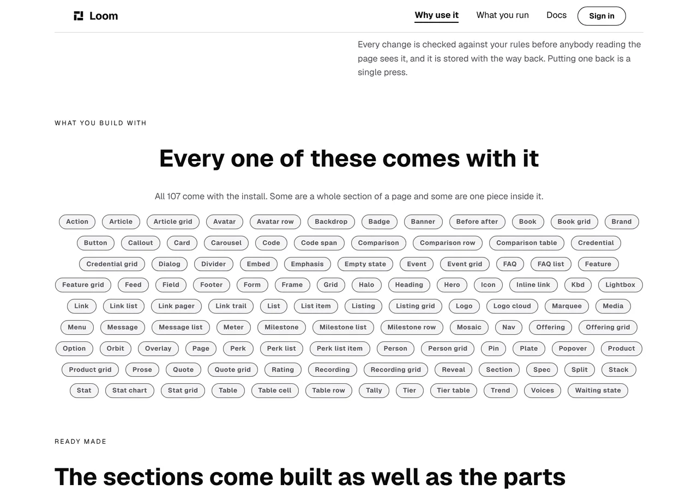
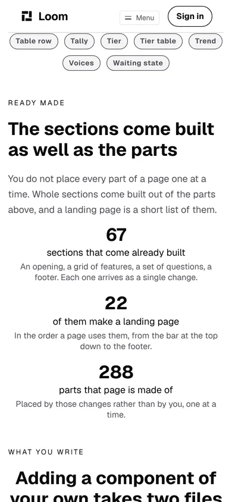

# Marketing — the site says, for the first time, that the sections come built

**Branch** `marketing-32-the-sections-come-ready-made` · **Date** 9 November 2026 ·
**Section** §4d, the marketing site · **Lane** `apps/loom/app/(marketing)/`

---

# What was built

One band, and the press that now lands on the run of bands it belongs to.


**The fact it carries had never appeared anywhere on this surface.** The
starter library ships ready-made sections — whole bands of a page, dropped in
as one change, settled as a shape by
[0120](../decisions/0120-a-starting-composition-is-a-subtree-a-catalogue-hands-to-the-ordinary-seam.md)
on 9 September — and a search of this route group on the morning of this run
found **no page, no band and no sentence that mentioned one**. What the site
said about building a page was the 107 parts and nothing else.

| | before today | now |
| --- | --- | --- |
| what the site says comes with the install | 107 parts | 107 parts, and **67 sections built out of them** |
| what the site says a landing page is | nothing | **22 of those sections**, against **288 parts** |
| where *See what you can build* lands | `/why-use-it`, at the top | `/why-use-it#what-you-build-with` |

---

# 1. Why this is the gap worth closing, and not a nice addition

`docs/positioning.md` is the authority and three of its lines point at the same
hole:

> *"The building part and why this build is better than traditional methods is
> preferred."*

> *"You're writing for a web developer, but assume it is the casual web
> developer. Imagine junior level developer."*

> *"Don't worry about the bad day that drives people to it, worry about how to
> get people interested in it."*

A junior developer shown a field of 107 badges and told nothing else
reasonably concludes that a landing page is 107 decisions. **It is twenty-two**,
and the difference between those two readings is the whole of *how much less
work is this than what you do now* — which is the thing that file says the site
is for.

## The three figures are read off the library, not typed

Every one of them moves when **another lane** publishes a section, and that is
a run with no reason to open a marketing file. So none of them is a digit:

| what the page prints | where it comes from | today |
| --- | --- | --- |
| sections that come already built | `STARTER_COMPOSITIONS.length` | 67 |
| of them make a landing page | `PAGE_SEQUENCE.length` | 22 |
| parts that page is made of | every element the 22 builders mint | 288 |

The third is **counted by building the page** rather than reasoned about: a
ready-made section is a pure function from an id factory to a subtree, so the
only honest way to say how big the thing it assembles is, is to assemble it.
Slots are left out, because a slot is a region of its parent rather than a part
on the page — which is what makes 288 comparable with the 107 badges one band
above it.

`ready.test.ts` holds each of the three **twice**: once against the library,
and once against this file's own source, asserting that the assignment names
the library and contains no digit. The second half is the one that matters over
time, and it is the shape `facts.test.ts` arrived at the hard way —
`FACTS.primitives` stayed a hand-typed literal for two months behind a test
that compared it against the registry and was therefore green the moment
somebody pasted that day's value in.

---

# 2. The band I set out to build, and the two reasons it is not this one

**The plan was a browser frame with a ready-made section composed inside it**,
at the same moment as the rest of the page, in whichever palette the visitor
asked for — the way `example.ts` renders the coffee page. That is the proof;
a table of figures is a claim. It cannot be done today and **both reasons are
in the library rather than here**, so both are findings.

## Every section that carries a control ships a live same-origin path

Measured over all 67 designs: **39 carry at least one link**, naming **43
distinct paths of the host's own** — a sign-up page, a price list, an about
page, a careers page. Three of the 43 happen to be addresses this application
serves; the other forty are not.

`routes.test.ts`' *sends nobody to an address this application does not serve*
goes red on the first one. The library's reasoning for the same-origin path is
recorded and is right for the host it was written for; what it means for a host
that has not edited the band yet is a dead button, and what it means here is
that the band cannot be shown at all. `example.ts` already carries this lane's
version of the argument: *a button pointing anywhere real is a lie about the
fictional product.*

## The placeholder copy is a developer tool's, in this site's own register

The catalogue's fiction is a project-management tool, and on anybody else's
page it is a neutral placeholder. On this one:

| the section | what it says |
| --- | --- |
| the hero | *"Plan the work, review the change, and see what shipped"* |
| the mosaic | *"Every change is a diff you can read"*, *"Undo is one operation"* |
| the steps | *"Describe the change in a sentence"*, *"Approve what you meant"* |

Three of those are claims **this site makes about Loom**, on the page whose job
is making them, and a visitor would have no way to tell whose they were. Two
more sections assert six customers and an uptime figure.

**Both are filed for `Loom primitives`**, with the measurements and with costed
shapes rather than a demand. Neither is broken for a host; both are why this
band is a weaker thing than it should be.

---

# 3. The table that is blocked by one word, which is the maintainer's

The second plan was a table: every section a landing page has, **in the
library's own order**, with the designs that ship for each. The order is
precisely what a junior developer does not have, and the library's own note
says so about its own list — *"the order is the whole of the extra information
this carries."*

It was built, and it went red. **One of the twenty-two is labelled `Pricing`**,
and `voice.test.ts` holds this site to the instruction of 27 September:
*no reference to pricing should remain, we haven't figured that out yet.*

Three ways out, two of them wrong:

- **Exempt the rule.** Rejected. That is this lane deciding a word he took off
  the site is allowed back in a table. A rule is not weakened to let a band
  land.
- **Drop that one row.** Rejected. The table's value is being complete, and a
  column that stops adding up to the figure above it is worse than no table.
- **Ship the figures and name no section.** Taken.

**It is a question in the pull request comment and a filed finding**, because
the answer is one sentence and the table is six lines of helpers this lane
already has.

---

# 4. The press, which claimed one thing and landed on another

*See what you can build* is this lane's own label, written on 1 November when
[0328](../decisions/0328-the-marketing-site-has-no-demonstration-and-no-mechanism-page.md)
removed the demonstration and both of the hero's controls pointed at pages that
had stopped existing. **The destination was not chosen with it.** It was
`/why-use-it`, bare — so a reader pressing *See what you can build* arrived on
a headline reading *You could build all of this yourself*, which is the work
argument, the right first screen for that page, and an answer to a different
question from the one the button asked.

It now lands on `#what-you-build-with`, and the four bands from there read as
one run: every part that comes with the install, the sections already built out
of them, what adding one of your own costs, and a page made of them. The
closing band's copy of the same control moved with it.



Nothing was taken away. What the reader skipped is above them, in the menu, and
on the chain's first rung one band below the hero.

---

# 5. What it looks like, measured

Read off the production build with `pnpm shoot --serve`, `built
2026-11-09T11:41:32.001Z`:

| shot | the band's box | overflow |
| --- | --- | --- |
| `minimal`, 1280×900@2x | 1080×322 at x 100 | `scrollWidth 1280 / innerWidth 1280` |
| `editorial`, 1280×900@2x | 1080×325 | none |
| `bold`, 1280×900@2x | 1076×408 | none |
| `phone`, 390×844@2x touch | 363×560 | `scrollWidth 390 / innerWidth 390` |




**No hard-coded colour**, and `ready.test.ts` holds the band's serialised tree
to naming none. The three figures take the accent on `bold` because
`loom.stat` reads it from the palette.

## One deliberate difference from its neighbours, and it is the right way round

This band is **ranged left** where the two around it are centred. That is not
an oversight: `loom.section` renders its own eyebrow left with no `align` of
its own, so a centred heading under it disagrees with its own label — the
finding the front door's `facts` band records and is filed for
`Loom primitives`. The screenshot above shows both states one under the other:
`READY MADE` agrees with its heading and `WHAT YOU WRITE` does not. The
neighbours are not changed in this branch, because re-aligning two bands this
run did not otherwise touch is a separate argument and a separate diff.

---

# 6. What it cost in words

The site's ceilings did not move and nothing was cut to fit:

| | before | after | ceiling |
| --- | --- | --- | --- |
| the band | — | **108** | 300 |
| `/why-use-it` | 1,201 | **1,309** | 1,500 |
| the site | 3,058 | **3,166** | 3,900 |

The widest cell in the band is 20 words against a ceiling of 110. The site is
at 81% of its total, which leaves **734 words**. The 28 October entry in
`FINDINGS.md` recorded a band landing with eleven words of slack and warned
that *"a ceiling that can only be met by finding something to cut on the same
page is a ceiling that will be met by cutting something that should have
stayed."* [0328](../decisions/0328-the-marketing-site-has-no-demonstration-and-no-mechanism-page.md)
is why that is not this run's problem, and the figure is recorded here so the
next run knows what it is working with.

---

# Decisions

**None taken and none recorded.** Nothing here touches the tree schema, the
delta model or an Accepted record. No primitive was added and none was needed:
the band is `loom.section`, `loom.heading`, `loom.prose`, `loom.stat-grid` and
three `loom.stat`, all registered, which `ready.test.ts` holds against the
registry this site renders with — the question 0067 asks of anything this
surface draws.

All three marketing routes still report `ƒ` in `next build`, so
[0331](../decisions/0331-a-marketing-page-is-served-per-request-because-the-store-governs-it.md)
holds and nothing here froze a governed page.

# Findings

**Two filed, none closed.**

- **For `Loom primitives`:** a ready-made section cannot be shown on any page
  but the one it was dropped into — 39 of 67 carry a live same-origin path, and
  the placeholder copy is a developer tool's. Measurements and three costed
  shapes in the entry.
- **For this lane, as a question for the maintainer:** the table of the 22
  sections in page order is blocked by the word *Pricing*. Either answer
  unblocks something; the recommendation is in the entry and in the pull
  request comment.

# Test numbers

`pnpm install && pnpm verify`, read out of the file the status was written to
rather than off a notification:

```
Test Files  274 passed (274)      Tests  6702 passed (6702)    # framework
1486 findings, 0 malformed
2181 visuals in reports/, 151.7MB, none over 1.1MB, 413 cited by no file
Test Files  467 passed (467)      Tests  7462 passed (7462)    # @loom/app
139 prerendered pages, 2045 text junctions, 0 run together; 3 metadata conventions, 0 unserved
EXIT=0
```

**Nothing failed and nothing was skipped.** `413 cited by no file` is not this
branch's: it is the same 413 the gate printed on `main` before this branch
existed, and the five visuals this run added are all cited by this report —
the visual count went 2,176 → 2,181 and the uncited count did not move.

**Two runs of the gate, and the second is the one quoted.** The first covered
the code and ran before `FINDINGS.md` and this report existed, so its
`findings:check` and `reports:check` read the tree without them. The run above
is the whole tree as it is committed.

This branch's own additions: **15 cases**, all in `ready.test.ts`, which is a
new file. No existing case was changed, deleted or weakened, and no file
outside `app/(marketing)/` was touched apart from `FINDINGS.md` and this
report.

# Open questions

In the pull request comment. One of them is blocking a band rather than this
branch: whether a section of a page called *Pricing* may be named in a table of
the sections a page has.
