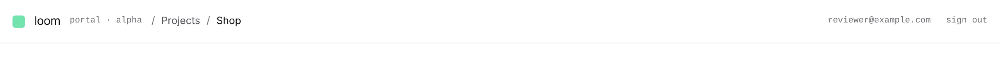
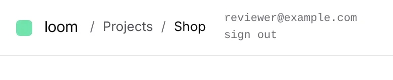
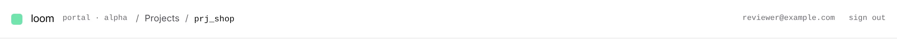

# The top bar says where you are: *Projects / the project*

**Lane:** `Loom portal` · **Date:** 9 November 2026 ·
**Branch:** `claude/project-thread-60mybe` ·
**Records:** none new ·
**Plan:** [`docs/portal.md`](../docs/portal.md) row 8d ·
**Target:** [`docs/portal-wireframes.md`](../docs/portal-wireframes.md) *The
chrome*, "Top bar: `loom / <workspace> / <project>` breadcrumb, search, avatar"

Claimed by a portal run at 2026-11-09 03:20 UTC (#833).

## Why this, and why now

No portal-run pull request or branch had been pushed in the last three hours.
The open pull requests were #829 (framework), #825 (the Signals chart, from its
own thread, waiting on the maintainer) and #778 (docs); this run stayed off
their files. The last run (#832) named the top bar's breadcrumb and search as
the next free piece. The predicted effect on *For review* waits on the
maintainer, and Segments (unit 9) needs a record first.

## What shipped

- **The breadcrumb** after the wordmark, for a signed-in person: *Projects*,
  then, inside a project, the project's name linking to its *Signals*.
  `_components/shell/breadcrumb.tsx`, in the top bar in place of the bare
  *Projects* link.
- **A guarded read of the project's name**, `GET /portal/<project>/name`. The
  top bar is drawn once for the whole portal and never sees a screen's
  project, so it asks, each time the address changes (a rename on *Settings*
  shows on the next screen). Members only, one answer for *not yours* and *no
  such project*, never cached.
- **One guard for both of the chrome's reads**: `_lib/member-answer.ts`
  (`answerMember`). The rail's count (`answerWaitingCount`) now uses it too;
  its eight tests pass unchanged, which is the check the refactor kept its
  behaviour.
- **Never a guessed name.** Nothing is drawn for the project while its name is
  asked; where it could not be read, the id the address already says, in
  mono. A name read for one project is never drawn for another.
- **The way back above the rail went**: the breadcrumb carries it. That link
  read *Your applications* while the screen it opens is headed *Projects*;
  the breadcrumb says *Projects*.
- **Narrow screens**: *portal · alpha* is hidden below `sm` and the project's
  crumb keeps at least 5rem before it truncates, so the name is not squeezed
  to one letter beside the signed-in address.

## Decisions taken

- **The `<workspace>` crumb is the list of projects.** The portal has no
  workspace; *Projects* is what a workspace would hold. Reversible the day
  workspaces exist.
- **Search is not built.** The wireframe draws a box without saying what it
  finds, and *Events* already has its own *Find*. Building a search over
  nothing it names would be a surface without a unit (rule 4). Asked on the PR.

## Tests

- New: `_lib/project-name.test.ts` (11), `_components/shell/breadcrumb.test.tsx` (6).
- `pnpm verify`: exit 0; framework 6,700 passed, 2 skipped; app 7,429 passed.

## Still missing from *The chrome*

- Search (the maintainer's call: what it searches).
- The avatar (the top bar shows the signed-in address and *sign out*).
- *Segments* on the rail, with unit 9.

## Screens

The top bar in the portal's own CSS from the build, with the real
`Breadcrumb` and a stubbed name read (the shell around it is drawn to match
`topbar.tsx`):

- 
- 
- 
