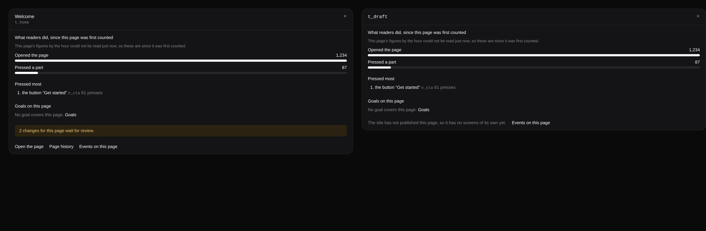

# The *By page* drawer leads to the page's own screens

**Lane:** `Loom portal` · **Date:** 9 November 2026 ·
**Branch:** `claude/project-thread-fnc9dj` · **Unit:** 8a ·
**Records:** none new · **Target:**
[`docs/portal-wireframes.md`](../docs/portal-wireframes.md) *1 · Signals*,
*By page*, the drawer for one page

## Why this piece

Every item left in the plan waits on the maintainer (top-bar search, the
predicted effect on *For review*, *Stays on it* on *Goals*, segments in #834).
Held against the wireframe, the *By page* drawer was short of two things it
draws, both owed only because the drawer (#811) was built before the page's own
tabs (#804, #822):

- *a band linking to its waiting changes*: the band said *N changes for this
  page wait for review* and opened the whole project's *For review*, so the
  sentence named one page and the link showed every page.
- *Page history* beside *Events on this page*: absent.

## What shipped

- The waiting band opens `/portal/<project>/pages/<page>/review`, the page's own
  *For review (N)* tab, which counts the same changes (held proposals mapped to
  the page through its copies).
- *Page history* (`/pages/<page>/history`) sits between *Open the page* and
  *Events on this page*.
- **A fault found on the way and fixed:** readers can be counted on a page
  before its site publishes it, and such a page has no screens under *Pages*:
  `/pages/<page>` answers *not found*. The drawer offered *Open the page* to it
  all the same. `ByPageRow` now says whether the site published the page
  (`published`), and an unpublished page's drawer says *The site has not
  published this page, so it has no screens of its own yet.* in place of both
  links, keeping *Events on this page*. The waiting band needs no such guard: a
  change can only wait on a copy, and a copy starts from a published page.

No table, no column, no environment variable, no `pnpm db:push`.

## Tests

`pnpm verify` exits 0: the package 6,700 passed and 2 skipped (274 files),
the app 7,466 passed (467 files), typecheck, lint and the Next build included.
New or changed:

- `by-page.test.tsx`: the band links to the page's own tab; *Page history*
  links to the page's history; an unpublished page's drawer has neither *Open
  the page* nor *Page history*, says why, and still links its events.
- `by-page.test.ts`: a row is `published` only where the site published its
  page.

## Where this leaves `docs/portal-wireframes.md`

*By page* now draws everything the wireframe gives it. Still owed, all waiting
on the maintainer: top-bar search (what it finds), the predicted effect on
*For review*, *Stays on it* on *Goals*, and *Segments* (unit 9, record 0371 in
#834).

## Picture

The drawer for a published page with changes waiting (left) and for a page the
site has not published (right), rendered from the components with the portal's
built stylesheet:

