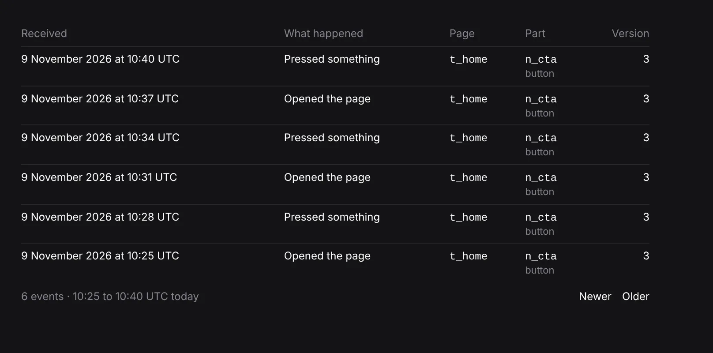

# Unit 8d: *Events* gets *Newer*, a whole page back

**Lane:** `Loom portal` · **Date:** 9 November 2026 ·
**Branch:** `claude/project-thread-lysu30` ·
**Records:** none new ·
**Plan:** [`docs/portal.md`](../docs/portal.md) row 8d ·
**Target:** [`docs/portal-wireframes.md`](../docs/portal-wireframes.md) *Patterns
every screen shares*, *Pagination*

Claimed by a portal run at 2026-11-09 11:21 UTC (#838).

## Why this, and why now

No portal pull request was claimed by a run still going: #834 (record 0371,
Proposed) and #825 (the Signals chart) both wait on the maintainer, with no
comment from him since. Everything left on the plan's order waits on him too:
top-bar search, the predicted effect on *For review*, *Stays on it* on *Goals*,
and unit 9 behind 0371. `FINDINGS.md` has no open entry the portal owns that is
not waiting on another lane.

The one gap left in a pattern the wireframes give every screen was *Events*'
pager. The wireframe asks for *Newer* and *Older*; *Events* had *Older* and
*Newest*, because its read only went one way. A person who paged three pages
back to find something and went one too far had to start again from the top.
The journal already reads either way (`direction: "newer"`), so the backward
read was the portal's own to write.

## What shipped

- **`_lib/events.ts`**: an `EventPlace` (`towards: "older" | "newer"`, `from`)
  replaces the one-way `before` cursor. The address carries it as `before=`
  (unchanged) or `after=`; a mangled address with both reads the older one. Live
  is still the newest page only: either cursor turns it off.
- **`_lib/events-reading.ts`**: one scan for both ways. Reading toward newer
  starts one place below the cursor's delivery, keeps what is strictly newer
  than the event named and matches the filter, takes the fifty nearest, and shows
  them newest first. The same budget (4 reads of 500 deliveries) holds both
  ways, and a page that hit it says so in the way it was reading (*Looked
  through everything received up to …  Newer events continue on the page
  before.*). An `EventPage` now names `older` and `newer` places, and `newer` is
  `undefined` only on the newest page.
- **Reading newer to the top answers `newest`**, and the screen redirects to the
  address without a cursor. A page of the 12 events above the last one seen
  would be a page the list does not otherwise have, and the newest page holds
  them anyway; its address then says what it is, and *Live* can be switched on.
- **`_components/pager.tsx`** lost the `Newer | Newest` label: every list in the
  portal now ends on *Newer* and *Older*, so the pager takes two addresses.
- An empty page that stopped at its budget points both ways at where it
  stopped, so *Newer* from it lands on the events it skipped past and not one
  row off; an empty page that read nothing at all (a page filter with no
  deliveries) starts *Newer* below every event kept (`BEFORE_EVERY_EVENT`,
  place 0; the journal's places count from 1).

No table, no column, no environment variable, no `pnpm db:push`.

## Decisions taken

- **Newer to the top redirects rather than drawing a short page.** The other
  lists step back by whole pages aligned from the top; *Events* cannot (it
  never knows its position), so aligning to the top on arrival is the closest
  equal. Reversible, no record: it is a reading of the wireframe's *Newer*, not
  a choice the maintainer has to make.
- **No record.** No data, no new screen, no new name.

## Tests

`pnpm verify` exits 0 on the branch: the package 6,700 passed and 2 skipped
(274 files), the app 7,452 passed (466 files), typecheck, lint and the Next
build included. New and changed:

- `events-reading.test.ts` 17 (was 10): a page newer is exactly the page
  *Older* came from; stepping up from below everything shows every event once
  and ends at the newest; the filter holds on the way up; the budget stops it
  and says how far up it looked, and *Newer* carries on; an empty older page
  reaches *Newer* from where it stopped, or from below everything when it read
  nothing. Two mutations (the nearest-first sort, the cursor's place) each fail
  two or three of them.
- `events.test.ts`: `after=` is read, both-ways reads the older one, live is
  off under either cursor, `eventsHref` writes `after=`.
- `events.test.tsx`: *Newer* and *Older* addresses keep the filter; an event's
  link keeps `after=`.

## Where this leaves `docs/portal-wireframes.md`

*Pagination* is done on every list. Still owed on the wireframes, all waiting on
the maintainer: top-bar search (what it finds), the predicted effect on *For
review*, *Stays on it* on *Goals*, and *Segments* (unit 9, record 0371 in #834).
