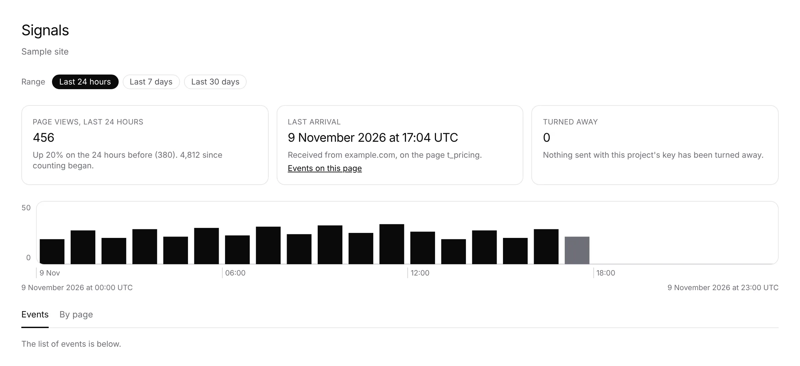

# The last arrival says which site and page it came from

**Lane:** `Loom portal` · **Date:** 9 November 2026 ·
**Branch:** `claude/project-thread-n15u1d` · **Unit:** 8a ·
**Records:** none new · **Target:**
[`docs/portal-wireframes.md`](../docs/portal-wireframes.md) *1 · Signals*,
the four figures

## Why this piece

No portal pull request was claimed by a run still going: #834 (record 0371,
Proposed) waits on the maintainer with no comment from him since. Everything
left in the plan's order waits on him too: top-bar search, the predicted effect
on *For review*, *Stays on it* on *Goals*, and unit 9 behind 0371.

Held against the wireframe, the third figure on *Signals* was short by half.
The wireframe draws *when the last delivery arrived and from which site*. The
figure said when, and then a sentence that was the same on every project:
*When this deployment last received something from one of your pages.* A
person checking that the snippet works on a site they just connected could not
tell from it which site or which page had spoken.

## What shipped

- `arrivalsOf` keeps the page with the newest moment: the newest kept
  delivery's page, or, once nothing arrived is kept, the page whose page-view
  row moved last.
- `_lib/last-arrival.ts`, pure, builds the figure:
  - **The site** is the project's own address when it names one. The door takes
    that project's signals from that origin and nowhere else (0298), so the
    sentence is exact. A project that names no address takes signals from any
    site holding its key, and a delivery keeps no origin, so the figure says
    *a site holding this project's key* rather than guess.
  - **The page** by the name it published, with its id; by its id alone where
    it published none.
  - **A link that lands on something.** A kept delivery is on *Events*, so the
    link is *Events on this page* (`?on=`). A page only counted has no delivery
    left to list, but has its row on *By page*, so the link opens that page's
    drawer (`?page=`). Both keep the range.
- *Last counted* keeps its own wording (it is when the row was counted, not
  when anything arrived) and now names the page too, without a site: a counted
  row does not say where its deliveries came from.

No table, no column, no environment variable, no `pnpm db:push`.

## Decisions taken

- **No origin is recorded on a delivery to answer *which site* for a project
  without an address.** That would be a change to the intake (`Loom signals`'
  lane) and a new fact kept about each delivery; the project's address answers
  it exactly for every project that names one, which is the case the door
  enforces.

## Tests

New: 6 in `_lib/last-arrival.test.ts` (the site named, no site guessed, an
unnamed page by its id, the *Events* link with and without a range, *Last
counted* with its *By page* link, nothing yet), 1 in `signals-frame.test.tsx`
(the sentence and link drawn). Changed: `arrivals.test.ts` now asserts the
page on both kinds, with a third row so the newest is not the last listed.

`pnpm verify` results are in the pull request.

## Toward the wireframe

*1 · Signals* now draws all four figures as the wireframe gives them. Still
missing across the wireframes, all waiting on the maintainer: top-bar search
(what it finds), the predicted effect on *For review*, *Stays on it* on
*Goals*, and *Segments* (unit 9, record 0371 in #834).

