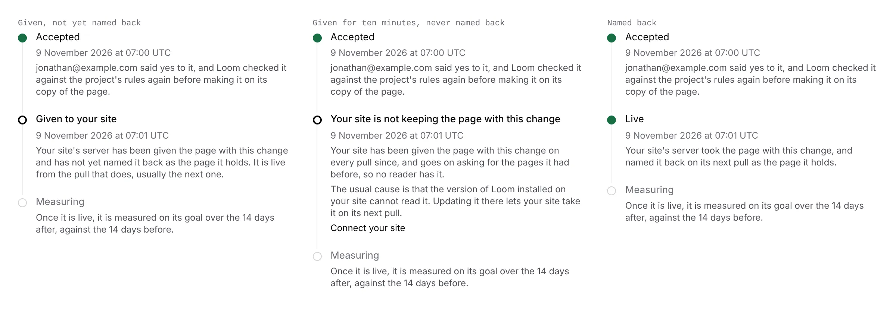

# Unit 8: the *Live* step counts a change live only once the site kept it

**Lane:** `Loom portal` · **Date:** 9 November 2026 ·
**Branch:** `claude/project-thread-h206gq` ·
**Records:** none new ·
**Plan:** [`docs/portal.md`](../docs/portal.md) row 8 ·
**Target:** [`docs/portal-wireframes.md`](../docs/portal-wireframes.md) *4 ·
An accepted change, from Accept to live*

Claimed by a portal run at 2026-11-09 07:25 UTC (#835).

## Why this, and why now

The open portal pull requests were #834 (record 0371, Proposed, pushed under
three hours ago, so a live claim and the maintainer's to decide) and #825 (the
Signals chart, from its own thread and waiting on the maintainer). Everything
left on the plan's order waits on the maintainer: top-bar search, the predicted
effect on *For review*, *Stays on it* on Goals, and unit 9 behind 0371.

`FINDINGS.md` had one entry still open on the portal: the 7 November finding
on sites that pull and refuse their newest pages was closed on *Connect your
site*, with "**Still open on the timeline:** its *Live* step reads an answer
given as an answer taken." Open findings owned by the portal come ahead of the
plan, and its input (the `kept` column, #807) is on `main`.

## What shipped

- **A change is live from the first answer since *Accept* the site named
  back**, for a site that names back the pages it holds, rather than the first
  answer it was given. Since a verdict's 14 days start when the change went
  live, this also moves the measuring window to when readers had it.
- **Two new places on the *Live* step** (and so on *Page history*'s card and
  the *Accepted* list, which read the same step):
  - *Given to your site*: given and not yet named back. Live from the pull
    that does, usually the next one.
  - *Your site is not keeping the page with this change*: given for ten
    minutes (`NOT_KEPT_AFTER_MS`, the rule *Connect your site* already uses)
    and never named back, with the usual cause (the Loom installed on the site
    is too old to read it) and a link to *Connect your site*.
  - A site gone quiet is told that first, as on *Connect your site*.
- **`SitePullStore.takenSince`** replaces `firstTakenSince`: each answer given
  since a moment (first, last, kept), and whether the site has ever named an
  answer back. Contract-tested against memory and Postgres.

No table, no column, no environment variable, no `pnpm db:push`.

## Decisions taken

- **Never early, possibly one pull late.** An answer replaced before the
  site's next pull (two changes accepted inside a minute) is never named back,
  so the door cannot say it was kept. The change is then live from the next
  answer the site named back. Saying a change reached readers before the record
  shows it did would start its measuring early; a minute late costs nothing.
- **A site that has never named an answer back reads as before** (the first
  answer given is taken). The finding records that a site that keeps its pages
  always names them back, so such a site has either just started or pulled
  before the column existed.
- **No `pnpm db:push` gate.** The `kept` column came with #807, still labelled
  `needs-db-push`. Where it is missing, `takenSince` reads the answers without
  it (Postgres `undefined_column`, 42703, and only that) and the timeline
  behaves exactly as it did before this change. Any other failure is still
  *could not be read*.

## Tests

`pnpm verify` on the branch exits 0: 464 test files, 7,437 tests passing; prerender check 139 pages, 0 run together.
Targeted: `going-live.test.ts` 40, `page-history.test.ts` 27,
`pulls-memory.test.ts` 14, `pulls-postgres.test.ts` 18, all passing. New: five
timeline cases for a site that names back (live from the kept answer, given,
not kept with the link, quiet first, never live when undone first), two
contract cases, and the Postgres table-without-`kept` and no-table cases.

## Toward the wireframe

Section 4 is done in the portal. Still missing from it: nothing in this lane;
a site reaching readers still needs the pull client on a customer's site
(`Loom daily build`'s finding; loomjs.org already pulls, 0370).

