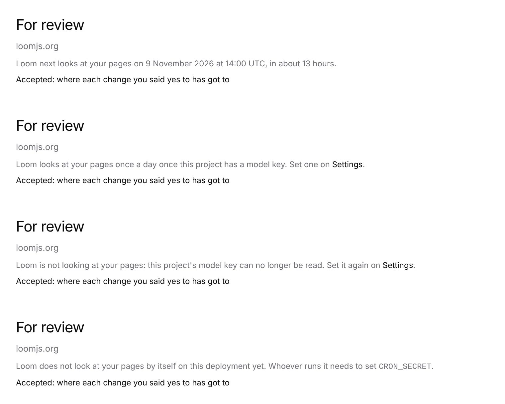

# *For review*: when Loom next looks at the pages

**Lane:** `Loom portal` · **Date:** 9 November 2026 ·
**Branch:** `claude/project-thread-chgz11` ·
**Records:** none new ·
**Plan:** [`docs/portal.md`](../docs/portal.md) row 8b ·
**Target:** [`docs/portal-wireframes.md`](../docs/portal-wireframes.md) *2 ·
For review*, "the next time Loom looks at the pages under the title"

Claimed by a portal run at 2026-11-09 01:20 UTC (#832).

## Why this, and why now

No portal-run pull request or branch had been pushed in the last three hours.
The open pull requests were #829 (framework), #778 (docs) and #825 (the
Signals chart, from its own thread and waiting on the maintainer), so this run
stayed off their files. The last run (#830) named two free pieces: the top
bar's breadcrumb and search, and the next look time on *For review*. The next
look is section 2, ahead of the chrome in the wireframe's order, and its input
(the daily sweep, 0329, and the project's model key, 0332) has been on `main`
since #744. The predicted effect on *For review* waits on the maintainer.

## What shipped

- **The line under *For review*'s title**: *Loom next looks at your pages on
  9 November 2026 at 14:00 UTC, in about 13 hours.* The instant is kept in a
  `<time dateTime>` for a machine. `review/_components/next-look-line.tsx`.
- **Where Loom will not look, it says why instead**, so the screen never
  promises a look that will not happen:
  - the deployment has no scheduler secret, so no sweep starts: *Loom does not
    look at your pages by itself on this deployment yet. Whoever runs it needs
    to set `CRON_SECRET`.*
  - the project has no model key: *Loom looks at your pages once a day once
    this project has a model key. Set one on Settings.*
  - its key can no longer be opened (the deployment's secret changed): *Loom
    is not looking at your pages: this project's model key can no longer be
    read. Set it again on Settings.*
  - where the key could not be read at all, the line is left out and nothing
    else on the screen changes.
- **What the line says, pure**: `_lib/proposing/next-look.ts`:
  `nextDailyAt` (the next start of a daily UTC time after a moment; one
  starting at that very instant has begun, so the next is tomorrow's),
  `nextLookOf` (the schedule first, then the key) and `untilWords` (minutes
  under an hour, then hours, rounded and said as *about*).
- **The schedule and the screen cannot drift apart**: `DAILY_LOOK_UTC` is the
  sweep's start, and its test reads `apps/loom/vercel.json` and requires the
  `/api/proposals` cron to be exactly that time. `vercel.json` is not changed.
- **`scheduleConfigured(secret)`** in `_lib/proposing/schedule.ts`: whether
  the deployment can start a sweep at all. `scheduleCheck` now uses it, so the
  route and the screen judge the secret by one rule.

No table, no column, no environment variable, no `pnpm db:push`.

## Decisions taken

- **The time is said in UTC, by the clock and from now.** The portal renders
  on the server, and `_lib/when.ts` fixes every moment in UTC so the server and
  the browser draw the same thing; *in about 13 hours* gives the reader their
  own clock's answer without a hydration mismatch.
- **The line does not promise every page.** The sweep stops starting pages
  after four minutes, and a page left out is looked at first the next day.
  The line says when Loom looks at the pages, which is true of the sweep;
  saying which page it reaches would need the order and the budget's outcome
  in advance, which nothing knows.
- **No mention of goals or page views.** A page with no goal gets no proposal
  (0352) and the proposer needs enough page views, but Loom still looks; those
  reasons belong on the page and the goal screens, which already say them.

## Tests

`pnpm verify` exited 0 on this branch over `main` at `93b675e`: the
framework suite 273 files, 6,700 tests passed (2 skipped, as on `main`), and
the app suite 462 files, 7,410 tests passed. New here: 17 in
`_lib/proposing/next-look.test.ts` (the `vercel.json` pin, the next start
across a month's end and at the very instant, each reason for no look, the
words), 1 in `schedule.test.ts` (`scheduleConfigured`), 4 in
`review/_components/next-look-line.test.tsx` (each of the four lines).

## Toward the wireframe

*2 · For review* now has the next look under the title. Still missing from
it: a predicted effect in the drawer's *What it expects* (new data, and a
choice of how to predict it, the maintainer's call). Elsewhere: the top bar's
breadcrumb and search (*The chrome*), and Segments (unit 9, a record first).
