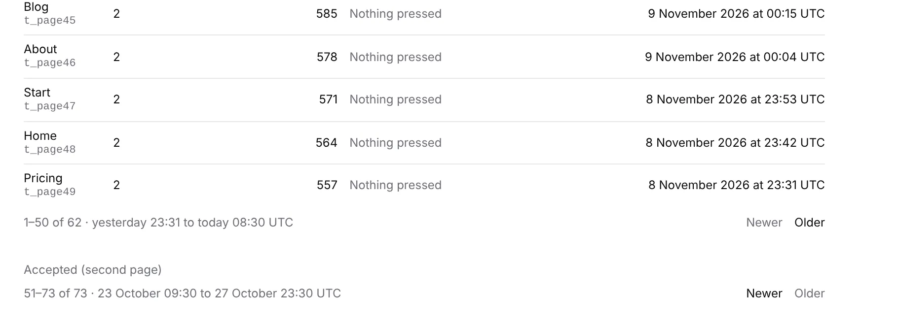

# Unit 8d: one pager under every list, saying which rows and what stretch of time

**Lane:** `Loom portal` · **Date:** 9 November 2026 ·
**Branch:** `claude/project-thread-k3dki0` ·
**Records:** none new ·
**Plan:** [`docs/portal.md`](../docs/portal.md) row 8d ·
**Target:** [`docs/portal-wireframes.md`](../docs/portal-wireframes.md) *Patterns
every screen shares*, *Pagination*

Claimed by a portal run at 2026-11-09 09:19 UTC (#836).

## Why this, and why now

No portal pull request was claimed by a run still going: #834 (record 0371,
Proposed) and #825 (the Signals chart) both wait on the maintainer, and neither
had a comment from him since. Everything left on the plan's order waits on him
too: top-bar search (#833), the predicted effect on *For review*, *Stays on it*
on Goals, and unit 9 behind 0371. `FINDINGS.md` has no open entry owned by the
portal that is not waiting on another lane.

What was left was a pattern the wireframes give every screen and the portal
had built four times, differently. The wireframe asks for *Newer* and *Older*
and *a line saying which rows and which stretch of time the page covers*
(`1–50 of 4,812 · 05:41 to 06:12 today`). Before this run:

| List | Which rows | Stretch of time | Newer |
| --- | --- | --- | --- |
| *Events* | no | no | *Newest* only |
| *By page* | yes | no | yes |
| *Accepted* | no | no | *Newest* only, and nothing when on the newest |
| *Turned down* | no | no | *Newest* only, and nothing when on the newest |

## What shipped

- **`_components/pager.tsx`**: one foot for every list. The line, then the way
  back and *Older*; a way that leads nowhere is drawn greyed
  (`aria-disabled`), so the two links never trade places as a person pages.
- **`_lib/list-span.ts`** (pure): `positionWords` (*1–50 of 4,812*, *51 of 51*,
  *1–50 of 500 or more*) and `stretchWords` (*05:41 to 06:12 UTC today*,
  *at 06:12 UTC today*, *7 November 22:10 to today 06:12 UTC*, the year only
  outside the current one, nothing for an empty page or an unreadable moment).
- **`changesPage`** now says where its page sits (`first`, `last`) and where the
  page before it starts (`newer`), with `newerHref` and `olderHref`. *Accepted*
  and *Turned down* step back a whole page with *Newer*.
- *Events*, *By page*, *Accepted* and *Turned down* all use the one pager; the
  two private `Pager`s in *Events* and *By page* are gone.

No table, no column, no environment variable, no `pnpm db:push`.

## Decisions taken

- **Times are UTC and say so.** The line is drawn on the server, as every other
  time in the portal is (`when.ts`), so the reader's own zone would be a guess
  and a hydration mismatch. *today* and *yesterday* are UTC days.
- **No invented total on *Events*.** *Events* is read by cursor through a
  filter, at most 2,000 deliveries a read, so its place in the whole list is not
  known. It says *50 events* and the stretch, and keeps *Newest* rather than
  *Newer*: stepping back one page would need a read the other way through the
  same filter, which is a piece of its own. The rule *no screen renders
  invented data* outranks matching the wireframe's sample line.
- ***Turned down* says *or more*** where its read stopped at its 500-change
  limit, as its count above the list already does.

## Tests

- `list-span.test.ts` 12, `changes-page.test.ts` 8 (4 new), `pager.test.tsx` 2
  new; *Events* gains one (the line and the greyed ways), *By page*'s line is
  asserted whole.
- `pnpm verify` exit 0: root 6,700 passed and 2 skipped (274 files), app 7,447
  passed (466 files), prerender 139 pages.

## What is still missing from the wireframes

- *Events* has *Newest*, not *Newer*.
- Top-bar search, the avatar menu, *For review*'s predicted effect, *Stays on
  it* on Goals and *Segments* (unit 9, behind 0371) all wait on the maintainer.
