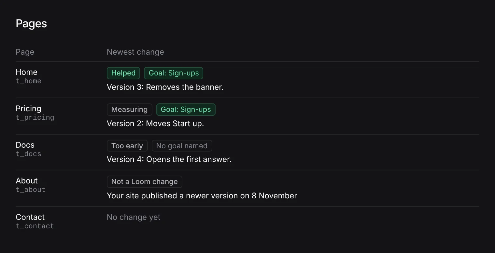

# Unit 5: the list of pages names the goal beside its newest change's verdict

**Lane:** `Loom portal` · **Date:** 9 November 2026 ·
**Branch:** `claude/project-thread-8jsjj8` ·
**Records:** none new ·
**Plan:** [`docs/portal.md`](../docs/portal.md) row 8c ·
**Target:** [`docs/portal-wireframes.md`](../docs/portal-wireframes.md)
*Patterns every screen shares* (*The goal chip*) on *5 · Pages · History*

Claimed by a portal run at 2026-11-09 19:19 UTC (#845).

## Why this, and why now

No portal pull request was claimed by a run still going: the newest portal
work (#844) merged at 17:33 UTC. #834 (record 0371, Proposed) still waits on
the maintainer, with no comment from him since. The rest of the plan's order
waits on him too: what top-bar search finds, the predicted effect on
*For review*, *Stays on it* on *Goals*, and unit 9 behind 0371. The snippet
that makes a customer's site pull (section 4, *the site's connection*) waits on
a release that puts `@jam-overture/loom/live` on npm; until then *Connect your
site* shows the request the site's server makes, which is right.

Going through the wireframe screen by screen against `main`, one shared
pattern was not met: *"Wherever a change or a result appears, the goal it
serves is named beside it in a green tinted chip."* The list of pages, since
#840, shows each page's newest change with its verdict (a result) and no goal.
Every other place a Loom change or result appears already carries the chip
(*For review* cards and drawer, *Accepted* list and timeline, *Page history*
cards, *Events*, *By page*). *Turned down* is the other gap, and is not taken
here: see *Still missing*.

## What shipped

- **The goal chip on *Newest change*.** A Loom change's verdict on *Pages* has
  the goal it served beside it (*Goal: Sign-ups*), read exactly as its card on
  *Page history* reads it (`servedOf`, `goalNameOf`), so the list and the
  history never name different goals. A change raised before proposals named
  their goal says *No goal named*. The site's own version, and a Loom change
  whose goal Loom has no record of (made before 7 November) or could not read,
  carry no chip, as on the history's cards.
- `page.tsx` reads what the change served once and hands it both to the
  measurement and to the chip.

No table, no column, no environment variable, no `pnpm db:push`.

The figures and names in the picture are sample data, drawn from the cell
component alone.

## Decisions taken

- **No chip where the goal is unknown, rather than *No goal named*.** A change
  made before 7 November did name a goal; Loom just did not keep it. Saying
  *No goal named* there would be a wrong statement. This is the rule the
  history's cards already follow (`version-card.tsx`), kept the same.
- **The chip beside the verdict, not under the heading.** The wireframe pairs
  the goal with the change or result; the verdict is the result, and it is
  measured on that goal.

## Tests

- `newest-change.test.tsx`: 6 tests (3 new: the goal named beside the verdict,
  *No goal named* for a change raised before goals, no chip for the site's own
  edit).
- `pnpm verify` on the branch: see the pull request comment for the run's
  numbers.

## Still missing from the wireframe

- **The goal chip on *Turned down*.** A turned-down change's goal is kept by its
  intent id (`loom_proposal_goals`), but `loom_turned_down` keeps only the
  proposal id, so the list cannot reach it. Drawing it needs the intent id
  recorded at turn-down (a column, so `pnpm db:push`) or a read of the refused
  proposal from the governed store. A later run can take it.
- Waiting on the maintainer: top-bar search, the predicted effect on
  *For review*, *Stays on it* on *Goals*, unit 9 (0371, #834).
- Waiting on a release: the pull snippet on *Connect your site*.
