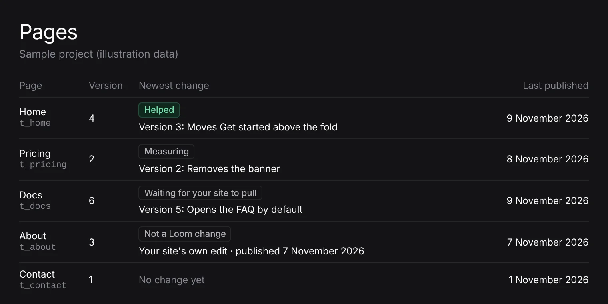

# Unit 5: the list of pages says each page's newest change, and how it did

**Lane:** `Loom portal` · **Date:** 9 November 2026 ·
**Branch:** `claude/project-thread-p5wu8b` ·
**Records:** none new ·
**Plan:** [`docs/portal.md`](../docs/portal.md) row 8c ·
**Target:** [`docs/portal-wireframes.md`](../docs/portal-wireframes.md) *The
chrome* (the rail's *Pages*: what is live, and did each change help?) and
*5 · Pages · History*

Claimed by a portal run at 2026-11-09 13:20 UTC (#840).

## Why this, and why now

No portal pull request was claimed by a run still going. #834 (record 0371,
Proposed) and #825 (the Signals chart) wait on the maintainer, with no comment
from him since. Everything left in the plan's order waits on him too: top-bar
search, the predicted effect on *For review*, *Stays on it* on *Goals*, and
unit 9 behind 0371. `FINDINGS.md` has no open entry the portal owns that is not
waiting on another lane or a release.

The wireframes give each rail item one question. *Pages* answers *what is live,
and did each change help?*, and the list of pages answered neither: it listed
what the site published, with the site's version and when it arrived. A person
had to open every page's *Page history* to see whether anything had changed on
it, and how that went. Everything needed was already read for those histories.

## What shipped

- **A *Newest change* column on *Pages*.** Each page names its newest version as
  its *Page history* does, linking there:
  - a Loom change by its card's heading (*Version 3: Removes the banner*) under
    its verdict chip, worked out exactly as its card works it out (*Helped*,
    *Hurt*, *No clear change*, *Too early*, *Measuring*, *Not measured*,
    *Undone*);
  - one accepted and not yet given to readers under where it has got to
    (*Waiting for your site to pull*), since that is the newest thing on the page;
  - the site's own newer version under *Not a Loom change*, with when it was
    published;
  - *No change yet* for a page nothing has happened to since Loom first saw it.
- **`newestOf`** in `_lib/page-history.ts`: the pending change on top, else the
  newest version readers had. Pure, and the history's own ordering, so the list
  and the history never disagree on which version is newest.
- **`OutcomeChip`** (`_components/outcome-chip.tsx`): the verdict chip, once.
  *Page history*'s cards and the list draw the same chip. `NOT_A_LOOM_CHANGE` is
  exported from `page-history.ts` rather than spelled twice.
- **Degrading.** The list reads the record every screen under *Accepted* reads
  (`readAccepted`) beside what the site published. Where that record cannot be
  read the column is left out and a line under the list says so; the list of
  pages stands. Counters that do not answer cost that page's verdict alone
  (*Figures could not be read*).

No table, no column, no environment variable, no `pnpm db:push`.

## Decisions taken

- **The newest version, not the newest Loom change.** If the site published a
  newer version after a Loom change, the page is on the site's version now, and
  the column says so. The Loom change and its verdict stay on *Page history*,
  one click away. Showing an older Loom change's verdict as the page's state
  would answer *what is live* wrongly.
- **A pending change leads.** One accepted and on its way is the newest thing on
  the page, and the person who just pressed *Accept* is the one most likely to
  look. Its history puts it on top the same way.
- **No record.** No new data, screen or name; a column on a built screen that
  answers its rail item's question.

## Tests

`pnpm verify` exits 0 on the branch: the package 6,700 passed and 2 skipped
(274 files), the app 7,463 passed (467 files), typecheck, lint and the Next
build included. New:

- `page-history.test.ts`: `newestOf` has none for an untouched page, is the
  site's newer version over an older Loom change, and is a pending change ahead
  of what readers have.
- `newest-change.test.tsx`: the cell links to the page's history with the
  verdict over what the version was; *Hurt* draws in the refusing tone; an
  untouched page says *No change yet* and links nowhere.
- `version-card.test.tsx` unchanged and passing on the shared chip.

## Where this leaves `docs/portal-wireframes.md`

The rail's question for *Pages* is answered on the list. Still owed, all waiting
on the maintainer: top-bar search (what it finds), the predicted effect on *For
review*, *Stays on it* on *Goals*, and *Segments* (unit 9, record 0371 in #834).
