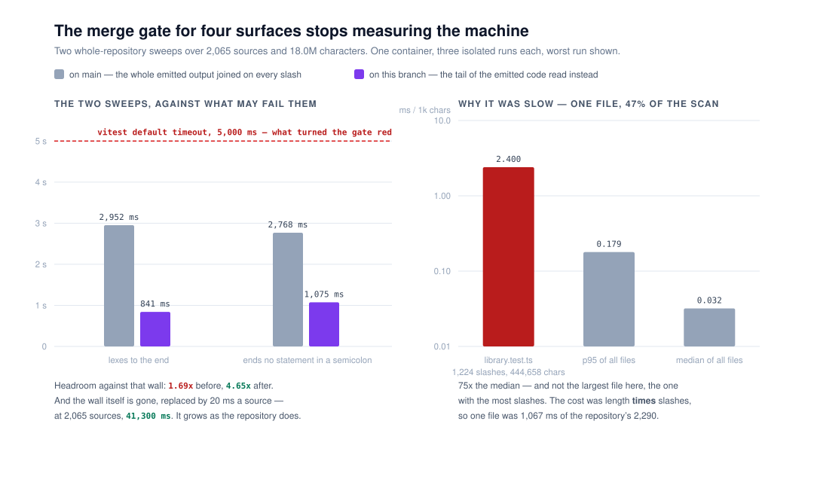

# The gate stops measuring the machine

**Routine:** `Loom daily build` · **Date:** 2026-11-09 (evening) · **Section:**
§1 — Process, the merge gate · **Branch:**
`framework-90-the-whole-repository-gate-stops-measuring-the-machine`

## What was done, in plain language

`pnpm verify` green is the merge gate for four surfaces. On 9 November it went
red on #837's merged head: two whole-repository sweeps in `tools/sources/` timed
out. Re-run, they passed. #843 measured what the diff under test actually cost
that scan and the answer was **nothing measurable** — three runs with its two new
files present against three with them moved out, and the distributions overlap
completely.

So the diff was not the problem and neither was the test. **The instrument was.**
Vitest's default per-test timeout is a fixed 5,000 ms; the scan took about
2,700 ms; the repository grows every day and a fixed budget only moves one way.

This run did two things.

**It found out why the scan was slow, and it was a defect rather than a size.**
`opensRegex` in `tools/sources/code.ts` decides whether a `/` opens a regular
expression or divides. It did that by joining the entire emitted output so far
and reading the end of it — on every such slash. That makes a file's cost its
length *times* its number of slashes. `src/primitives/library.test.ts`, 444,658
characters with 1,224 slashes, was **1,067 ms of the repository's 2,290 ms — 47%
of the whole scan in one file**, at 2.400 ms per thousand characters against a
median of 0.032. It is not the largest file here. `compositions.test.ts` is
133,012 characters and costs 15 ms.

The fix reads the tail of the emitted code instead. The keyword pattern is
anchored at the end and matches a keyword preceded by the start of the code or by
one non-word character, so **the longest keyword plus that one character is the
whole of what can decide it**. That length is derived from the keyword list
rather than typed, because a longer keyword added later would otherwise silently
shorten what the test can see.

**And it changed what may fail a whole-repository check.** `sweepBudget` in
`tools/sources/files.ts` allows 20 ms a source with a 10-second floor — about
forty times what the sweep costs on an idle container. A timeout is a net for a
scan that has stopped, not a measure of how busy the machine is. The budget is a
function of how much there is to read, so it grows with the repository and the
headroom cannot erode.

## The numbers, measured on this container

Three isolated runs of each sweep, this branch against `main`'s `tools/sources/code.ts`
with nothing else changed:

| | on `main` | on this branch |
| --- | --- | --- |
| `lexes to the end` | 2,205 / 2,952 / 2,553 ms | **805 / 841 / 762 ms** |
| `ends no statement in a semicolon` | 2,423 / 2,622 / 2,768 ms | **1,075 / 993 / 990 ms** |
| scan over the whole repository | 2,290 ms | **688 ms** |
| headroom, worst run, against 5,000 ms | **1.69x** | 4.65x |
| headroom against the derived budget | — | **38x**, and it grows |

`everySource()` is 2,065 files and 17,989,501 characters today.

## That the change is equivalent, rather than believed to be

A lexer gating the whole repository is worth proving rather than asserting, so
the old and new `scan` were run side by side:

- **All 2,065 sources in this repository** — identical `code` and identical end
  mode, byte for byte, on every one.
- **300,000 randomly assembled sources** from 63 fragments chosen to land on the
  boundary: every keyword in the list, words that merely end in one, slashes,
  comment openers, template holes, escapes. **0 differ.**
- **Nine adversarial cases** aimed at the tail length and the whitespace walk —
  `instanceof /re/`, `Xinstanceof /re/`, `_instanceof /re/`, `9instanceof /re/`,
  a 5,000-character blanked comment before the slash, 4,000 spaces before a
  keyword, 2,000 spaces before a division, 500 newlines after `return`. All
  identical.

Three mutations, three killed:

| mutation | caught by |
| --- | --- |
| drop the `+ 1` from the derived tail length | *does not read a regex after a word that merely ends in a keyword* |
| remove the trailing-whitespace walk | 5 tests, including the repository sweep |
| make the budget stop growing with the source count | 2 of the 4 budget tests |

## Decisions nobody specified, and why

**A record rather than a comment.** [0375](../decisions/0375-a-whole-repository-check-is-budgeted-by-what-it-reads-rather-than-by-a-wall-clock.md),
`Accepted`. Part 1 is a bug fix and would not need one; part 2 sets how *any*
whole-repository check in this repository is budgeted, and there are four such
sweeps today with more coming. That is a convention other lanes will meet, and
the 4 November entry shows it is the kind of thing that otherwise gets argued
again from scratch.

**20 ms a source, and a 10-second floor.** Forty times the measured cost. It is
deliberately loose: the thing being caught is a scan that has stopped, and a
budget tight enough to catch a slow machine is a budget that fails for whichever
lane happens to be running when the container is busy. The floor is so that a
sweep over a handful of files still has room on a cold container.

**The three other sweeps were left alone.** `mocks.test.ts`,
`deployment.test.ts` and `tools/git/portability.test.ts` do the same kind of
whole-repository work. All three got the lexer speedup for nothing, none is near
its default budget now (the slowest is 481 ms), and changing a test that is not
at risk is refinement inside code that works. 0375 says `sweepBudget` is the
spelling for the next one.

**The 4 November entry is not answered by this.** `src/signals/ledger.test.ts`
asserts a *ratio between two measurements*, not a duration, so a per-source
budget is the wrong instrument for it. It stays `Loom signals`' call and its
recommendations stand.

## Records

- **Added:** [0375](../decisions/0375-a-whole-repository-check-is-budgeted-by-what-it-reads-rather-than-by-a-wall-clock.md)
  — *A whole-repository check is budgeted by what it reads, rather than by a wall
  clock.* `Accepted`, §1 (process). Index regenerated.
- **Superseded:** none.

## Findings

**Closed:** none on `main`, and this needs saying plainly. **The entry this run
answers is on #843, which has not merged**, so there is nothing on `main` to edit
— editing a `FINDINGS.md` that does not yet contain the entry would collide with
that pull request. Whoever lands #843 should mark its entry closed by this
branch; the PR comment says so too.

**Filed, two, both this evening:**

1. *The two whole-repository sweeps each read and lex all 2,065 sources, and one
   pass would answer both* — owned by this lane. About 850 ms of every
   `pnpm verify`, filed rather than taken because the budget no longer needs it
   and the run that found it had just removed the reason it mattered.
2. *`tools/` is in no lane's row, and the second finding to land there picked an
   owner by guessing* — owned by `@jonathanbravecredit`. #843 said it was
   choosing this lane as the closest fit and asked to be corrected; this run
   acted on that guess, which makes two. The recommendation is one cell in the
   lane table.

## Open questions

- **Does `tools/` belong to this lane?** The second finding above. Nothing is
  blocked either way; two findings have now been resolved against a directory
  the table does not cover.
- **Is 850 ms worth moving tests between files for?** The first finding above.
  This lane's answer today is no, and the trigger that would change it is a third
  sweep arriving.

## Verification

`pnpm install && pnpm verify` — **EXIT=0**, read out of the log file rather than
from a harness notice.

| | this branch |
| --- | --- |
| framework | **277 files, 6,748 tests** passed |
| application | **470 files, 7,509 tests** passed |
| in all | **14,257** |
| `pnpm findings:check` | 1,498 findings, 0 malformed |
| `pnpm reports:check` | clean |
| `pnpm prerender:check` | 139 prerendered pages, 2,060 text junctions, 0 run together |

#843 measured `main` at 276 files / 6,740 framework tests. This branch is +1 file
and +8 tests, all of them this lane's: four in `tools/sources/files.test.ts` for
the budget, four in `code.test.ts` for what decides a slash.

**Nothing was skipped, no test was weakened, and no test was given a longer
timeout in place of a fix.** The two sweeps got a budget *and* got three times
faster; the budget alone would have been the remedy #843 recommended against.

## What this run did not do

No self-check-in was armed and this session is not subscribed to any pull
request. Sixth run in a row this lane has said so; the 4 November entry carries
the argument.

The one-application migration named at the top of this lane's brief **is already
done** — `apps/loom/` holds `(marketing)`, `(docs)`, `(lessons)`, `(portal)`,
plus `(demo)` and `(preview)`; `apps/portal` and `apps/docs` are gone;
`pnpm-workspace.yaml` is `apps/*` and the single `apps/loom/vercel.json` is the
one deployment. Nothing in the tree is half-migrated. The three routines that
were waiting on its shape can read that as settled.
