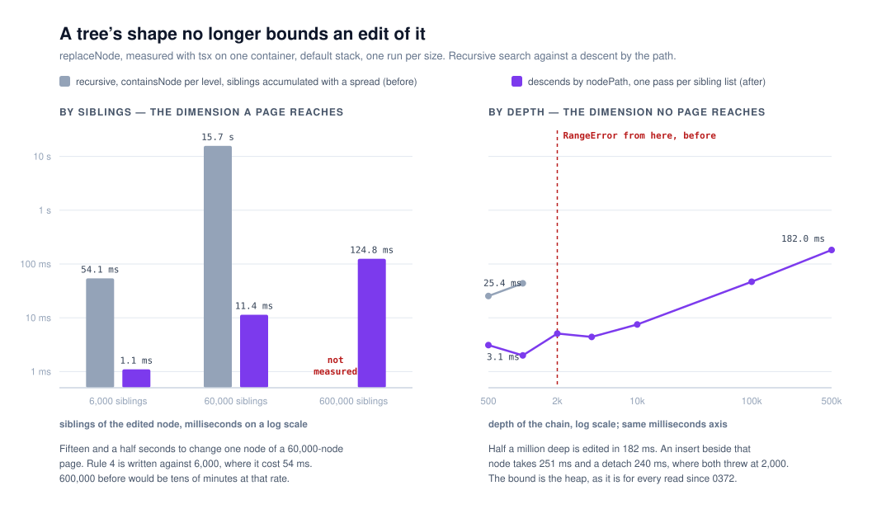

# A tree's shape no longer bounds an edit of it

**`Loom daily build`, 9 November 2026, morning run.**
Branch `framework-tree-walks-iterative`, **pushed onto #829 rather than opened
as a second pull request**. Record
[0373](../decisions/0373-an-edit-to-a-tree-descends-by-the-path-and-rebuilds-a-sibling-list-in-one-pass.md),
`Accepted`. `pnpm verify` **EXIT=0**, read out of the file.

Preview:
https://loom-git-framework-tree-walk-600a93-jpizzolato36-6341s-projects.vercel.app
Nothing on it looks different, and nothing should. Every output of every
function this run touches is unchanged. The chart is the measurement and it is
the only thing here there is anything to look at.

## The migration is done, and this run did not do it

The run's standing instruction puts the one-application migration ahead of
everything but maintainer comments. **`apps/loom` exists with all five route
groups, `apps/portal` and `apps/docs` are gone, and the workspace is
`apps/*`.** It was completed before this run started; `docs/routines.md` has
recorded the four surfaces as one application since 18 August
([0067](../decisions/0067-the-four-surfaces-are-one-application.md)). Nothing in
the tree is half-migrated and no other routine is waiting on this lane for it.
So this run went to the next thing in the order: open findings owned by it.

## What this run completed

### First: #829 was in conflict, and the conflict was this lane's own

**#829 was `mergeable: dirty` when this run opened.** Two pull requests landed
overnight — #826 took 0369, which #829 had been waiting on, and **#831 took
0370, which #829 had claimed.** The only textual conflict was
`decisions/README.md`, which is generated.

Resolved by this lane rather than left for `Loom merge`:
**0370 is renumbered 0372**, which is the next number no open branch claims —
0371 is taken by #834. Nothing the record decides changed. The renumber is noted
in the record's own report and in 0372 itself; every reference to it in
`src/tree/`, `FINDINGS.md` and the 8 November report moved with it. The index
was regenerated with `pnpm decisions:index`, not merged by hand. `pnpm verify`
was run on the merge alone before any new work: **EXIT=0**.

### Then: the rebuild, which this lane filed against itself last night

[0372](../decisions/0372-every-read-of-a-tree-carries-an-explicit-stack-because-a-page-s-depth-is-data.md)
took the depth bound off every **read** of a tree and recorded that
`replaceNode` was now the shallower bound: `O(n·d)`, throwing at 2,000 deep, on
the path every accepted delta takes. It was filed with numbers rather than
fixed, because a rebuild is a different shape of change from a read.

**Measuring it to fix it found a second defect the filing had missed, and it is
the larger one.** `replaceNode` grew each rebuilt sibling list through
`reduceResult` with `[...accumulated, next]` — a copy of the siblings so far,
**once per sibling**. That is `O(w²)` in the width of the node being edited
among, and width is the dimension a real page can actually reach.

| siblings of the edited node | before | after |
| --- | --- | --- |
| 6,000 | 54.1 ms | 1.1 ms |
| 60,000 | **15,731.4 ms** | 11.4 ms |
| 600,000 | not measured | 124.8 ms |

| chain depth | before | after |
| --- | --- | --- |
| 500 | 25.4 ms | 3.1 ms |
| 1,000 | 43.7 ms | 2.0 ms |
| 2,000 | `RangeError` | 5.1 ms |
| 4,000 | `RangeError` | 4.4 ms |
| 100,000 | `RangeError` | 46.8 ms |
| 500,000 | `RangeError` | 182.0 ms |

Fifteen and a half seconds to swap one node among sixty thousand siblings is
what moved this from *filed* to *fixed*. Rule 4 of the runtime is written
against a 6,000-node page, and at 6,000 siblings the old cost was already 54 ms
of copying to change one of them.

**What it does now.** `replaceNode` asks `nodePath` for the chain from the root
to the addressed node — one walk, linear, iterative since 0372 — and folds back
up it. Each ancestor is rebuilt with one pass over its children, matching the
child it replaces **by reference**. There is no `containsNode` per level, no
call frame per level, and nothing accumulated.

`insertChild` and `detachNode` inherit it with no change of their own. An insert
beside a node 500,000 deep takes **250.9 ms** and a detach **240.0 ms**, where
both threw at 2,000.

**Every output is the same.** All fourteen of `mutation.test.ts`'s cases pass,
including the two that pin the published promises: the addressed node is
swapped and only its ancestors rebuilt, and subtrees off the edited path keep
their identity so a renderer can skip them by reference. No existing test was
modified.

## Decisions taken that were not specified

**Pushed onto #829 instead of branching afresh, reversing what last night's
comment said.** That comment said a pull request changing both the reads and the
rebuild is one nobody can review. Three things changed the answer. The procedure
says a lane with an open pull request pushes onto it rather than opening a
second. The rebuild's whole claim — no depth bound — **rests on `nodePath` being
iterative, which exists only on #829**; built off `main` the fix would have
inherited the bound it removes. And the unit turned out to be one story rather
than two: a tree's shape no longer bounds a read *or* an edit of it.

The day's diff in `src/` is **+186 / −27** counting the rename as a rename:
`mutation.ts` +50 / −17, `mutation.test.ts` +24 / −1, and the guard file
+112 / −9 across `depth.test.ts` → `shape.test.ts`. That is reviewable.

**Renumbered 0370 → 0372 rather than leaving it to `Loom merge`.** The merge
routine does renumber a clashing record, but the clash is this lane's and
leaving a dirty branch for it to find is work moved, not work saved.

**Renamed `src/tree/depth.test.ts` → `src/tree/shape.test.ts`.** Width joined
depth as its subject and a file named for half of what it guards is a file a
later run trusts for the wrong reason. The 8 November report and 0372 both note
the rename where they name the file.

**Added a test for a tree that holds one id twice.** Descending by the path
changes what `replaceNode` does on such a tree: it edits the first node in tree
order, where the search it replaces edited every copy. No valid tree has a
duplicate id — `duplicateNodeIds` exists to find one — but this is a change to
what a published function does, so it is stated in 0373 and asserted rather than
left to be discovered.

**Did not fix the three recursive walks outside `src/tree/`.** Filed instead,
with the one measurement that was cheap to take. See below.

## Records

- **[0373](../decisions/0373-an-edit-to-a-tree-descends-by-the-path-and-rebuilds-a-sibling-list-in-one-pass.md)**
  — *An edit to a tree descends by the path and rebuilds a sibling list in one
  pass.* `Accepted`. Nothing superseded.
- **[0372](../decisions/0372-every-read-of-a-tree-carries-an-explicit-stack-because-a-page-s-depth-is-data.md)**
  — renumbered from 0370, and its consequence naming `replaceNode` as the
  remaining bound now says 0373 fixed it. **Its Status is unchanged and nothing
  it decides was edited.**

## Findings

**Closed.** *The rebuild every accepted delta goes through throws at two
thousand deep* (8 November evening, filed by this lane against itself). Closed
by 0373 on #829. The entry's own correction is recorded in it: **it named depth
as the bound and the width defect is the bigger one**, and it did not look at
width at all.

**Filed.** *Three tree walks in this lane still recurse per level.*
`src/runtime/nesting.ts`'s `collect` throws `RangeError` at **10,000** deep —
five times shallower than the delta path now answers — and is linear in time, so
the stack is its only bound. `src/interpretation/materialize.ts` and
`src/render/render.ts` recurse per level and are **unmeasured**, which the entry
says plainly. Owned by this lane, open, nothing blocked. It is filed rather than
fixed because none is on the delta path, the render one sits under React's own
per-level recursion so removing Loom's would not remove the bound, and **0372
and 0373 were each paid for by a published claim or a figure in seconds; none of
these three has either yet.** The entry says not to open it because it is tidy.

## How the guard is known to be a guard

`src/tree/shape.test.ts` gained five cases. Against the implementation this run
replaces, checked by restoring `src/tree/mutation.ts` from `HEAD` and running
the file:

- the three edits to a chain of ten thousand **throw `RangeError`**;
- the swap among sixty thousand siblings takes **14,723 ms**, three times the
  suite's five-second limit, against **34 ms** with the change;
- the fifth, an insert and detach on a wide parent, **passes against the old
  code in 48 ms**. It is not a guard for this defect and is not claimed as one:
  `insertChild` and `detachNode` rebuild their one sibling list with a slice
  rather than an accumulator, so neither was ever quadratic. It guards against
  that being rewritten into one.

The whole file costs **223 ms**.

## Open questions

**Nothing in the schema says how deep or how wide a tree may be.** 0372 declined
to write a cap because it would turn an engine's stack size into a number in
Loom's schema and would be a migration for trees already stored. 0373 declines
it again for the same reason. This is only worth the maintainer's time if a real
page ever gets within two orders of magnitude of either figure, and none is.

**`insertChild` and `detachNode` each walk the tree more than once** — validate,
then edit. Every walk is linear, so this is a constant factor rather than a
bound. Collapsing them onto one descent would mean `replaceNode` publishing the
path it took, and nothing needs that yet. Recorded in 0373's consequences rather
than filed, because it is not a defect.

## Test numbers

`pnpm install && pnpm verify` — **EXIT=0**, read out of a file rather than off
the harness notice.

| | framework | application | total |
| --- | --- | --- | --- |
| the merge of `main`, before today's work | 275 files, 6,706 tests | 464 files, 7,437 tests | 14,143 |
| this branch | 275 files, **6,712** tests | 464 files, 7,437 tests | **14,149** |

**+6 tests, all of them this lane's** — five in `shape.test.ts`, one in
`mutation.test.ts`. Nothing was skipped. No test was weakened, modified or
deleted. The framework file count is unchanged because `depth.test.ts` was
renamed rather than added to.

**One test did fail, once, and it is worth saying what it was.** Giving
`replaceNode` a docblock put a summary on a published export, and
`app/(docs)/_lib/api/extract.test.ts` holds the generated reference to the
committed one. It failed with the instruction to run
`pnpm --filter @loom/app docs:api`, which this run did. The result is **a
one-line diff in `reference.generated.json`** — that summary, and nothing else.
The generator itself reported *"no name is new."* That file is in `(docs)`'
directory and is the one kind of cross-lane edit the gate requires rather than
permits; `Loom merge` regenerates it for the same reason. No prose in `(docs)`
was touched.

## Token discipline

**This session has not subscribed itself to any pull request and has not armed a
check-in, a `send_later`, or any scheduled task.** Seventh run in a row this
lane has said so.
