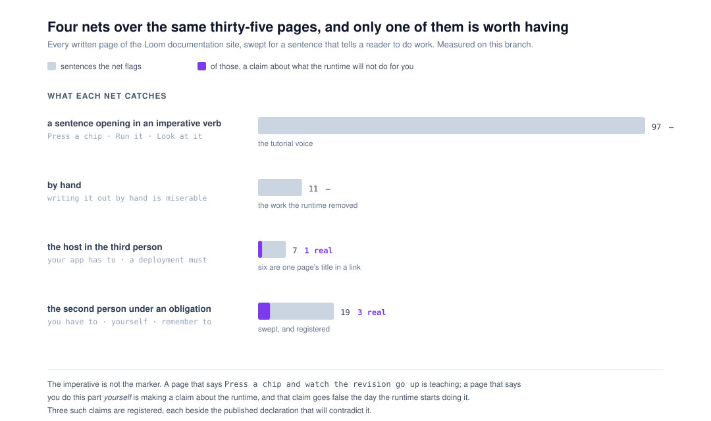
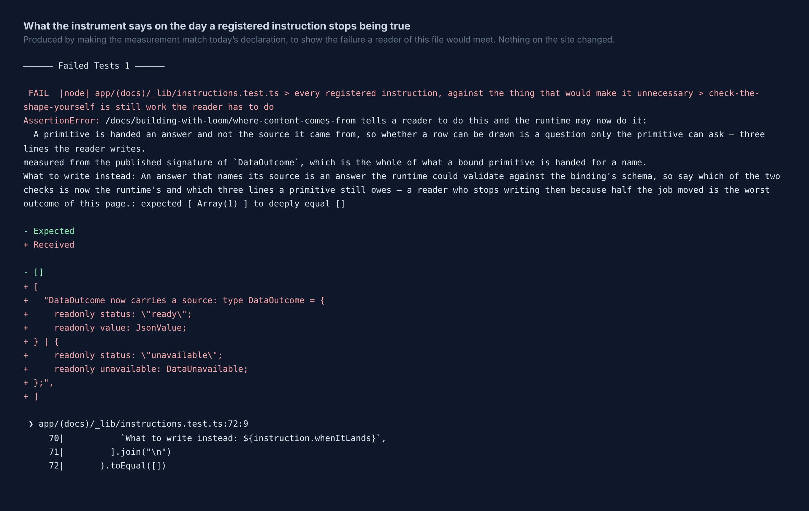

# 10 November 2026 — an instruction a page gives is a claim about what the runtime will not do for you, and the site can now be swept for one

**Routine:** `Loom docs` · **Branch:** `docs-83-an-instruction-is-a-claim-about-the-runtime` ·
**Section:** §4c

> **The gate is green.** `pnpm install && pnpm verify` — **EXIT=0**, read out of
> the file the status was written to. 276 files / **6,740** framework tests and
> 472 files / **7,606** application tests, **14,346** in all, 0 failed, 0
> skipped. The whole-repository sweep that was red on `main` on 9 November
> passed here; it is not fixed, it is the flaky one #847 is open against, and
> this branch does not touch it.

One open pull request from this lane at the start of the run — **#778**, opened
5 November, carrying `0353` as `Proposed`, **unanswered after five days**. Six
others were open: #852 (`Loom marketing`), #851 and #848 (`Loom signals`), #850
and #847 (`Loom framework`), #843 (`Loom signals`), #834 (project thread). None
touches the `(docs)` route group; checked file by file rather than by title.

**No maintainer comment is outstanding for this lane.** Every non-bot comment on
the open set is a routine's own, posted from the maintainer's account; the rest
is `vercel[bot]`.

Branch cut from `origin/main` at `24216f4` after `git fetch origin main`. The
previous run's branch merged as part of that history.

## The plain version

A page on this site can be wrong in three ways, and before today two of them
had an instrument.

A sentence saying something **is** so is held up by the thing itself — an
example that stops rendering is a red test, a count is printed off the registry,
a code fence is compiled. A sentence saying Loom **lacks** a name has
`_lib/absences.ts`, which ships the claim beside the measurement that will
contradict it.

The third is a sentence that tells the reader to do something. *Remember to stop
the broadcaster.* *You still check the shape yourself.* *There is no override,
so change the policy.* **Each of those is a claim about what the runtime will
not do for you**, and each goes false the day the runtime starts doing it —
silently, because while it is false it still reads as ordinary writing, and a
stranger does the work.

Yesterday's run found two such sentences on *What your readers do*, both false
for days, and filed the general case as open with one instruction attached:
**count before building anything.** This run did that, and then built the net
the count justified.

## What the count said, and it changed the design

Four candidate nets over the same thirty-five written pages:

| the net | matches | what they are |
| --- | --- | --- |
| a sentence opening in an imperative verb | **97** | *Press a chip*, *Run it*, *Look at what is not in there* |
| `by hand` | **11** | *writing it out by hand is miserable* |
| the host in the third person — *your app has to* | **7** | six are the title of *What your app has to do* in a link |
| the second person under an obligation | **19** | the one that shipped |

**The imperative is not the marker, and that is the whole finding of the
measurement.** This site is a tutorial and it talks like one; a net built on the
imperative mood flags a hundred sentences to find three, and nobody reads three
sentences at the bottom of a hundred. What distinguishes the dangerous sentence
is not that it tells a reader to act — it is that it tells them the work is
**theirs**, which in English is the second person plus an obligation.

`by hand` is the mirror image and was dropped for it: all eleven matches are
about work the runtime **removed** — *that list is worked out rather than kept
by hand* — which is the opposite claim and cannot go stale in the direction this
guards.

The third-person patterns are kept although they match almost nothing, the way
`absences.ts` keeps `currently` and `at present`. Six of the seven matches were
one page's title inside somebody else's sentence, so the sweep reads past the
text of an internal link; that is one rule with two tests, and without it the
registry would have carried six lines about a hyperlink and taught the next
writer that the list is a formality.

## What shipped

**One module, one test file, nothing else.** No page changed, which means **no
prose was added to a site with 331 words of room** (0353, still unanswered on
#778). This run cost the search index nothing.

### `_lib/instructions.ts`

`ReaderInstruction` is `SiteAbsence` with one word changed, deliberately: *you
check the shape yourself* and *Loom has nothing that checks the shape* are one
fact, and the second is how you measure the first. Three are registered.

| | the page says | measured from | today |
| --- | --- | --- | --- |
| `check-the-shape-yourself` | *You still check the shape yourself… a primitive is never told which source it was bound to* | the published signature of `DataOutcome` | `status`, `value`, `unavailable` — **no source** |
| `call-the-library-yourself` | *everything after this point is library code you call yourself* | the published `CliCommand` | `init`, `add-primitive`, `help` |
| `change-the-policy-not-the-verdict` | *no reviewer who can wave it through… rather than look for an override* | every published name, swept for one that overrides, bypasses, exempts or waives | **nought** |

Sixteen more sentences carry a written reason instead, in six groups. The
largest is the second person used rhetorically — *the part you cannot
reconstruct later* — which is the price of keeping `you cannot` in the net and
is worth paying, because of the sentences on this site that say Loom will not do
something, that is the phrase most of them would be written in.

### What the instrument found on the day it was written

**An unregistered absence**, which is the thing it was least expected to be
useful for. *What AI may change* says, of a refusal:

> There is no button that turns it into a yes, and no reviewer who can wave it
> through.

That is a claim about what **Loom lacks**. It belongs in `SITE_ABSENCES` and was
never in it, and `datedSentencesIn` had never flagged it, because it carries no
dated word — no *yet*, no *so far*, no *today*. `absences.ts` names that blind
spot in its own notes; this is the first measured instance of it. What caught it
was the sentence immediately after, which carries `yourself`.

It is registered as an instruction rather than moved, because the sentence a
reader acts on is the instruction, and that is the sentence that should be
beside the measurement.

## The failure a reader would meet

Produced by making one measurement match today's declaration. **Nothing on the
site changed**, so there is no before-and-after screenshot to take: the artefact
this branch produces is the failure above, and it is here rather than described.

## Mutations

**Seventeen planted, seventeen killed.** Two survived the first pass and each
one changed the code rather than the test.

**The first is the one worth reading.** Every measurement reads a published
declaration by name and reports nothing when it finds the name. Making the
*missing-declaration* branch return `[]` instead of saying so **passed every
test**, because with the declaration present nothing could reach that branch —
so a guard whose name stopped being published would have gone green forever, in
exactly the case where the page is most likely to have changed underneath it.
The branch is now a value a test can hand in (`sourceNamedOnAnAnswer(undefined)`),
which is the same move `absences.ts` makes by exporting `datedSentencesIn`.

**The second was two patterns where one would do.** Dropping `it is up to you`
from the net killed nothing, because `up to you to` caught the test sentence
anyway. Both collapsed to `up to you`, and the mutation now dies. A redundant
pattern is not harmless: it is a line a reader believes is load-bearing.

A third thing came out of mutating rather than from writing: `remember to`,
`do not expect` and `up to you` match **nothing on this site today**, so any of
them could be deleted without a test noticing. They are held by a case of their
own now, listing the voices the finding named — because the sentence that
started all this, *stop() the broadcaster and start another*, was written in one
of them.

## Decisions taken that were not specified

- **No page changed, and that was a decision rather than a consequence.** The
  three registered instructions were each read against the runtime and all three
  are true today. A run that went looking for an instrument and came back having
  also rewritten three paragraphs would be a run whose instrument nobody could
  check.
- **A link's text is not swept.** An obligation written *inside* a link's text
  is missed, and the answer is that an obligation belongs in the prose around a
  link rather than in its title. Two tests hold the rule, one of which asserts
  the sentence either side stays readable.
- **`you should` is in the net and `should` is not.** *The two lists you should
  not write by hand* is a claim of **no** obligation, which cannot go stale in
  the direction this guards — but it is registered with that reason rather than
  excluded by the pattern, because the reason is what a writer needs and a
  silent exclusion teaches nobody.
- **The `(docs)` route group grew no component and no primitive.** This is
  module-and-test only; nothing here wanted a primitive the library does not
  have.

## Records

**None added, none superseded.** Nothing here touches the tree schema, the delta
model or an `Accepted` record. `0353` is untouched and still `Proposed` on #778.
Nothing is escalated as `ARCHITECTURAL`.

## Cross-lane diff

**None.** Every file changed is inside `apps/loom/app/(docs)/_lib/`, plus
`FINDINGS.md`, this report and its two visuals. Nothing in `src/`, nothing in
another surface's route group.

`_lib/instructions.ts` was mutated seventeen times in the working tree and
restored with `git restore --source=HEAD` after each; two page files were
mutated to check the registry is held against the pages in both directions and
restored the same way. `git diff origin/main --stat` shows nothing under `src/`
and nothing under `docs/`.

**No file on #778 was touched.** #778 changes `_lib/search/`; this branch
changes `_lib/instructions.ts` and adds `_lib/instructions.test.ts`, neither of
which exists on that branch.

## Findings

**One closed in part, two filed.**

- The 9 November shape — *an instruction a page gives is a claim about what the
  runtime will not do for you* — is **closed for the second person** and its
  status updated in place.
- **Open, and named rather than acted on:** the instruction written with no
  marker in it. Of the two sentences that started this, the instrument would
  have caught one. *A broadcaster watches the nodes that were there when it
  started* has no second person, no modal, no imperative and no dated word; its
  only purpose on the page was to make a reader write a workaround. No pattern
  reaches that. What reaches it is a page-level behavioural test, and there are
  two of those against thirty-five pages. The entry says explicitly not to open
  it as a sweep.
- **Open:** an absence claim reached a page with no dated word in it, and the
  sweep that exists for that claim had never seen it. The sentence is true and
  is now guarded; what is open is the blind spot, and there is no count of how
  many others are like it, because finding them is reading rather than running.

## Token discipline

**This session is not subscribed to its pull request and no check-in is armed.**
Sixth time this lane has said so. Run, report, exit.
