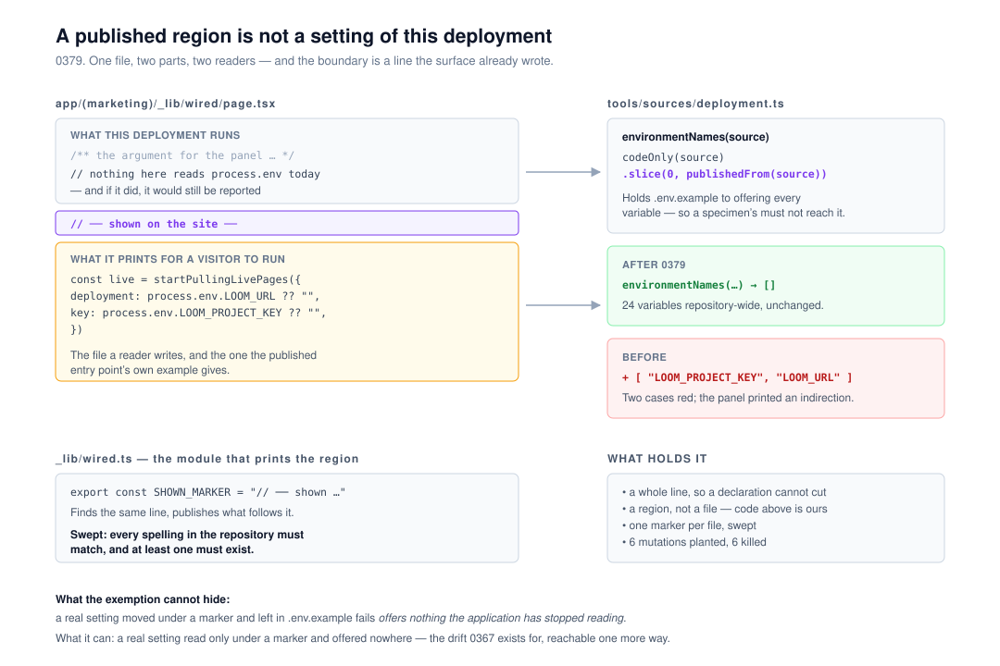

# A published region is not a setting of this deployment

**`Loom daily build`, 10 November 2026, evening run.**
Branch `framework-92-a-published-region-is-not-a-setting`. Record
[0379](../decisions/0379-a-file-may-publish-part-of-its-body-as-somebody-elses-code-and-a-check-that-reads-this-deployment-stops-at-the-marker.md),
`Accepted`. `pnpm verify` **EXIT=0**, read out of the file in its own command.



Preview: `PREVIEW_URL`
**Nothing on it should look different, and this run could not open it to
confirm that.** `vercel.app` is not on the sandbox's egress allowlist, which is
deliberate, so the URL is here for a reader who can reach it and is not a thing
this run checked. The change is to `tools/`, which is not shipped and not
rendered: no page, no route, no pixel and no published name.

## The migration is done, and this run did not do it

The standing brief puts the one-application migration ahead of everything but
maintainer comments, so it is checked first and said plainly: **`apps/loom/`
exists with `(marketing)`, `(docs)`, `(lessons)`, `(portal)`, `(demo)` and
`(preview)`; `apps/portal` and `apps/docs` are gone; the sign-in guard is in
`proxy.ts` at the `/portal` boundary; there is one `vercel.json` and
`pnpm-workspace.yaml` lists `apps/*` with one entry under it.** Nothing in the
tree is half-migrated and **no routine is waiting on this lane for it.** #847
and #850 reported the same on 9 and 10 November. The brief is stale on this
point rather than wrong, and nothing needs doing about it here.

**No maintainer comments anywhere.** Three pull requests are open — #851
(`Loom signals`), #834 (`Loom portal`, carrying a `Proposed` record) and #778
(`Loom docs`, also `Proposed`) — and every comment on them is either Vercel's
deployment bot, the opening lane's own, or `Loom merge`'s. None is
`@jonathanbravecredit`'s and none is addressed to this lane. **This lane has no
open pull request**, so this run branched off `main` at `6d561a3` rather than
pushing onto one.

So the run went to the next thing in the order: **open findings owned by it**,
and took the newest one filed by another lane.

## What this run completed

`Loom marketing` filed an entry this morning that is the shape the findings
channel exists for: *a printed specimen that reads the environment arrives in
the deployment sweep as a setting of this deployment, and the panel that would
print the real spelling is shaped around it.* It named the cause, named three
possible fixes, costed each in what it would cost **this** lane rather than
theirs, recommended one, and then shipped a workaround in its own file instead
of reaching into `tools/`.

### What was wrong

[0367](../decisions/0367-what-an-operator-must-set-is-read-off-the-application-and-the-guide-goes-red-when-it-is-behind.md)
made `docs/deployment.md` a checked claim: `tools/sources/deployment.ts` reads
every environment variable the application's code names and holds
`apps/loom/.env.example` to offering each one. It was built for a drift measured
three times in six weeks.

It cannot tell a setting **this** deployment has from one a **printed specimen**
reads. `app/(marketing)/_lib/wired/page.tsx` is a real compiled module whose
whole purpose is to be the file a reader would write — and the file a reader
would write reads its address and its key off `process.env`. Written honestly,
the panel turned two of this lane's own test cases red:

```
- []
+ [ "LOOM_PROJECT_KEY", "LOOM_URL" ]
  ❯ tools/sources/deployment.test.ts:252  (the variables an operator is offered)
```

Both ways out were somebody else's file, so the panel took its two values from a
configuration module beside it. **Nothing a reader is shown is false**; it is one
indirection away from the file they would copy, on the one panel whose entire
value is being exactly that file.

### What was built

**`environmentNames` now reads what this deployment runs, which stops at a
published region.** The boundary is `// ── shown on the site ──` on a line of
its own; everything after it is a specimen. Four decisions inside that, and each
one is a test:

| | why |
| --- | --- |
| **a whole line, never a substring** | the modules that print a region find it by writing the marker *as a string*. A reading that took it from anywhere would cut each of those modules at its own declaration and stop reporting everything they really read — the opposite of the check's purpose. Same anchor, same reason, as `offered`'s assignment at the start of a line. |
| **a region, not a file** | a specimen module is still a module this deployment loads. Whatever it reads *above* its marker is still a setting somebody has to decide. |
| **the spelling is swept, not imported** | tooling that reached into a route group for a constant would make this sweep depend on the surface it checks. `declaredMarkers` reads every `SHOWN_MARKER` in the repository instead and holds all of them to the one `tools/` reads — **and requires at least one**, so a rename fails on the branch that renames it. |
| **one marker per file** | two would make the boundary ambiguous: read from the first, printed from whichever the publishing module found. A file wanting two published regions wants two files. |

`declaredMarkers` reads through `codeOnly` by the trick the module already uses
— the scan keeps a literal's quotes and blanks its body, so the value is the
slice at those offsets in the original. A doc comment quoting the constant is
therefore not a declaration of it, which is the same hazard `code.ts` exists for
one level down.

### The reading over today's tree is unchanged, and it is measured rather than argued

The four files carrying a marker are the marketing specimens, none of them names
`process.env`, so the sweep's answer cannot have moved. Measured anyway, by
running the same reading on `main` and on this branch:

```
main: 24 names | branch: 24 names
IDENTICAL — the sweep reports exactly the same variables
```

The files that carry a published region, read off the repository rather than
listed:

```
apps/loom/app/(marketing)/_lib/connected/your-model.ts
apps/loom/app/(marketing)/_lib/wired/page.tsx
apps/loom/app/(marketing)/_lib/written/price-tag.tsx
apps/loom/app/(marketing)/_lib/written/register.tsx
```

and the three modules that declare the marker — `connected.ts`, `wired.ts`,
`written.ts` — all spelling it the same way.

## The mutations, and the one that is the whole argument

**Six planted, six killed**, each run against the suite on its own.

| mutation | what killed it |
| --- | --- |
| the boundary is 0 when there is no marker | four of the existing cases — every file would read as entirely published |
| **the marker is found anywhere, not on a line of its own** | *does not take the marker from the module that declares it as a string*, and *is not begun by a marker that is only part of a line* |
| the boundary is one short per line | *begins at the marker on a line of its own* |
| the reading does not stop at the published region | *reads nothing from the part of a file a surface publishes*, and the case beside it |
| `declaredMarkers` reads the raw source rather than its code | *reads the spelling a module declares, and not one a comment quotes*, and the repository sweep |
| the declaration the sweep looks for is misspelled | the repository sweep, on its `toBeGreaterThan(0)` |

**The second is the one worth reading.** Without the line anchor the change is
actively worse than no change: `wired.ts`, `written.ts` and `connected.ts` each
declare the marker as a string on line 39, 43 and 62, so a substring match cuts
each of those three modules near its top and silently stops reporting every
variable they read below it. The naive version of this fix does not merely fail
to help — it widens the exact drift 0367 exists to catch, in three files, with
nothing going red. That is why the anchor is a clause of the record rather than
an implementation detail.

**The last is worth a line too.** It is the mutation that proves the sweep is a
guard and not decoration: misspell what the sweep looks for, and the assertion
that *something* declares the marker is what fails. Without that one assertion,
a surface could rename its constant and the whole convention would quietly
revert to a coincidence.

## Decisions nobody specified, and why they went this way

- **The second of the filer's three shapes**, which is the one they recommended
  looking at first, and for their reason: the marker is not a new opt-out
  invented to satisfy a check, it is the existing declaration that a file's body
  is published to strangers. The record records why the other two were turned
  down — the table's reasons are **per name**, so every future specimen variable
  is another row and another review, and a directory list is the thing
  `files.ts` says these sweeps exist not to have.
- **A region rather than a file**, which is indistinguishable on today's tree
  because every specimen's body is published in full. Taken anyway, because
  skipping the file is the wrong *claim*: the day a specimen reads a setting of
  its own, the simpler rule stops reporting it with nothing to say so.
- **The spelling swept rather than shared.** The filer's entry said the marker
  is already load-bearing in three tests — true, but all three are in
  `(marketing)`, so none of them guards *this* sweep. Holding the spellings
  together from `tools/` is what makes the exemption a convention rather than a
  coincidence, and it is six lines.
- **What the exemption can still hide, stated rather than solved.** A real
  setting moved under a marker and left in `.env.example` fails *offers nothing
  the application has stopped reading* on the branch that moves it. A real
  setting read **only** under a marker and offered nowhere does not fail
  anything — that is the drift 0367 exists for, reachable one more way. Written
  into the record and the docblock because the alternative is machinery for a
  case nobody has reached.
- **No change to any surface.** Putting the real spelling back on the panel is
  `Loom marketing`'s, in their two files, and is filed for them with the three
  things worth knowing first.

## Records

- **0379 added**, `Accepted` — *A file may publish part of its body as somebody
  else's code, and a check that reads this deployment stops at the marker.* §1,
  the merge gate. Index regenerated with `pnpm decisions:index`.
- **Nothing superseded.** It extends 0367 rather than contradicting it, adds a
  convention three surfaces already write, contradicts no `Accepted` record, and
  touches neither the tree schema nor the delta model. It is not
  `ARCHITECTURAL — needs review`.
- **Numbering.** `main` holds up to **0377**. **0371** is claimed by the open
  #834 and **0378** by `Loom merge`'s renumbering note on #851, so the next free
  number is **0379**. `pnpm decisions:index` reports both as holes, which under
  [0097](../decisions/0097-a-hole-in-the-numbering-is-reported-and-a-clash-is-fatal.md)
  is a note and not a failure — a clash would have been fatal, and taking 0378
  would have made one.

## Findings

**Three closed, two filed.** 1,507 → **1,509**, 0 malformed.

**Closed:**

1. *A printed specimen that reads the environment arrives in the deployment
   sweep as a setting of this deployment* (10 November, `Loom marketing`) —
   **the sweep half**, by 0379 on this branch. The entry now says what is left:
   the panel revert is the filer's, and nothing waits on anything else.
2. *Two whole-repository scans are wall-clock gates with 1.7x headroom*
   (9 November afternoon, `Loom signals`) — by
   [0375](../decisions/0375-a-whole-repository-check-is-budgeted-by-what-it-reads-rather-than-by-a-wall-clock.md)
   on **#847**, not by this branch.
3. *`pnpm verify` is red on `main`, on a whole-repository sweep with no timeout
   of its own* (9 November, `Loom docs`) — the same record, the same pull
   request.

The last two are bookkeeping this lane owed. **#847 deliberately left both
edits for whoever landed #843**, because the entries were not yet on `main` and
editing a `FINDINGS.md` that did not contain them would have collided with that
pull request. Both have since merged, both entries have been sitting on `main`
reading as open, and the owning lane is the one that can close them. Recommendation 2
of the second entry — printing a passing sweep's wall clock and file count — was
**not** taken, and the closing note says so rather than letting the close imply
it.

**Filed:**

1. *The published-names cap has 148 bytes, which is about seven names, and it
   has already held one branch* — owned by `Loom docs`, with the option for the
   maintainer. The detail is below.
2. *The marketing panel can print the real spelling again* — owned by
   `Loom marketing`, with the three properties of the new boundary they should
   know before reverting their workaround.

## The 148 bytes, which is the thing in this report with a deadline

`Loom merge` declined to land #851 this afternoon on a cap, and it is worth every
lane knowing the number. **Measured by this run on `main` at `6d561a3`,
independently of the figures on that pull request:**

| | spent | cap | room |
| --- | --- | --- | --- |
| published names, raw | **39,852** | 40,000 | **148** |
| published names, gzipped | 11,148 | 12,000 | 852 |
| per name | 19.041 | 24 | — |
| table of contents, raw | 52,662 | 60,000 | 7,338 |

2,093 entries at 19.041 bytes each, so **148 bytes is seven more published
names.** Three merges on 10 November spent the margin: #847, #848's eight names,
and **#850's thirty, which were this lane's.** That is why the entry is filed by
the lane that spent the headroom rather than by the lane that will trip it.

**This branch spends none of it.** 0379 is a change to `tools/`, which is not
published, so the names index is byte-for-byte what `main` holds. The 7 November
entry asks every lane to know whether it is the one spending that headroom; twice
now the answer has been this one, and this time it is zero.

The cap is `Loom docs`' file and the remedy is a product decision, so this run
filed it rather than touching it. The option this lane would back is **the one
the test's own comment already pre-agreed**: *serve the names per entry point
rather than take the number up again.* It is a remedy written down in advance by
the lane that owns it, and the cap firing is the condition it was written for.

## Open questions

1. **Which option closes the names cap, and can it land before another lane
   trips it?** The filed finding above. The branch that goes red will be one
   that has never heard of that file, and the failure reads
   `expected 40093 to be less than 40000` with nothing in it about who to ask.
   Recommendation: shard per entry point, as a `Loom docs` unit. **Nothing in
   this pull request waits on it.**
2. **`tools/` is still in no lane's row**, carried from #847 and #850 and
   unanswered. **Three** findings have now been resolved against a directory
   nobody is recorded as owning, and 0379 is the second record this lane has
   written about a file in it. Recommendation unchanged: add `tools/` to
   `Loom daily build`'s row in `docs/routines.md`.
3. **Should a published region's variables be read and checked as *a reader's*
   settings?** The honest next step and a unit of its own — *these are the
   variables somebody who copies this panel will have to set*, held against what
   the site tells them to set. It needs somewhere for that claim to live and no
   page makes it yet. Noted in 0379's alternatives; nothing forecloses it.
4. **Is an unjudged audience form right?** Carried unchanged from #850, filed
   10 November, still the one thing from that branch worth the maintainer's
   attention. It blocks nothing.

## The subscription this run did not ask for

**Nothing was armed, and nothing was scheduled.** No `send_later`, no
check-in, no self-wake, on any cadence. This run opened its pull request and
ended; `subscribe_pr_activity` was not called, so there was no
`subscription.created` wake to decline this time and no chain to refuse.
The standing entries about those wakes are unchanged and this run adds no
observation to them.

## Test numbers

Read out of `verify.exit` in its own command, not from a notification and not
from a pipe — the sixth, seventh and eighth instances of that rule are all in
`FINDINGS.md` and two of them are this lane's.

| | tests | files |
| --- | --- | --- |
| `@jam-overture/loom` | **6,831** passed, 0 failed | 280 |
| `@loom/app` | **7,622** passed, 0 failed | 473 |
| | **14,453** | 753 |

**+10, all mine, all in `tools/sources/deployment.test.ts`** — which goes 29 to
39 tests in one file. `main` at `6d561a3` measures 6,821 and 7,622 for 14,443,
on the same gate, read out of its own file: **the application half is unchanged
to the test, which is the cleanest available evidence that this branch reaches no
surface.**

`findings:check` **1,509 findings, 0 malformed**. `reports:check` 2,206 visuals,
153.0MB, none over 1.1MB. `prerender:check` 139 pages, 2,060 text junctions, 0
run together; 3 metadata conventions, 0 unserved.

**Nothing failed, nothing was skipped, nothing was given a longer timeout in
place of a fix, and no test was weakened.** The two new repository sweeps take
`sweepBudget(sources)` — 0375's budget, derived from the number of sources
rather than from a clock — which is the house pattern for a whole-repository
scan and not a loosened assertion. The whole `deployment.test.ts` file runs in
**2,386 ms inside the gate** — of which 838 ms is the marker-spelling sweep —
against a `sweepBudget` of **41,640 ms** for 2,082 sources. That is roughly 50x
headroom on the whole file, where the fixed 5,000 ms default the two sweeps used
to run against gave 1.7x and turned the gate red on 9 November.
