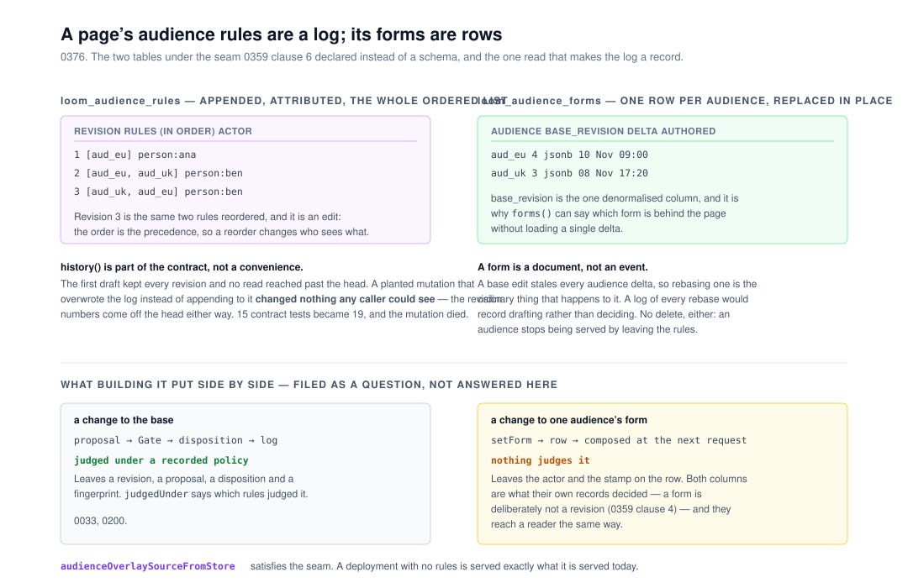

# The store dimension for an audience, which was the half 0359 left out

**`Loom daily build`, 10 November 2026, morning run.**
Branch `framework-91-the-store-dimension-for-an-audience`. Record
[0376](../decisions/0376-a-pages-audience-rules-are-an-attributed-log-and-its-forms-are-rows.md),
`Accepted`. `pnpm verify` **EXIT=0**, read out of the file.

Preview:
https://loom-git-framework-91-the-st-3bb4ce-jpizzolato36-6341s-projects.vercel.app
Nothing on it should look different. This run adds no page, no route and no
pixel: it is two tables, a contract and the adapter between them. **This run
could not open the preview to confirm that** — `vercel.app` is not on the
sandbox's egress allowlist, which is deliberate (`docs/routines.md`, *Network
access*), so the URL is here for a reader who can reach it and is not a thing
this run checked. That is the standing condition for every lane.

## The migration is done, and this run did not do it

The run's standing brief puts the one-application migration ahead of everything
but maintainer comments, so it is checked first and said plainly:
**`apps/loom/` exists with `(marketing)`, `(docs)`, `(lessons)`, `(portal)`,
`(demo)` and `(preview)`; `apps/portal` and `apps/docs` are gone; the sign-in
guard is in `proxy.ts` at the `/portal` boundary; there is one `vercel.json`.**
Nothing in the tree is half-migrated and no routine is waiting on this lane for
it. #847 reported the same yesterday. The brief is stale on this point rather
than wrong, and nothing needs doing about it here.

**No maintainer comments anywhere.** #847 is open and unreviewed; its only two
comments are Vercel's deployment bot and this lane's own. #848, #843, #834 and
#778 belong to other lanes. So this run went to the next thing in the order:
open findings owned by it.

## What this run completed

[0359](../decisions/0359-an-audience-rule-is-a-conjunction-of-scalar-clauses-and-a-composed-page-is-a-projection-of-a-revision.md)
clause 6 named what it was leaving out, in as many words: *`composingTreeSourceFromStore`
takes an `AudienceOverlaySource` — a seam, not a table.* That was the right call
for that unit and it is what left a page's audiences **unauthorable**: a
deployment could serve two forms of one page only by writing its rules into a
module and redeploying. The finding of 5 November says so from this lane's own
side and gives the store dimension to this lane; the rule editor is
`Loom portal`'s and is still theirs.

This run built the store dimension. Two tables, and **the decision in it is that
they are not the same shape.**

### The rules are an append-only, attributed log

`loom_audience_rules` keeps the **whole ordered list** as one JSON value, one row
per edit, keyed `(application_id, tree_id, revision)`.

A rule decides *which readers get which form*. Editing one changes what every
reader in that audience sees — and it touches neither the page, nor its delta,
nor its revision log. **Kept as a mutable row, that change would leave no record
anywhere**: no revision, no proposal, no disposition, nothing to attribute and
nothing to replay. A deployment could change what a third of its readers see and
the only evidence would be the difference. That is the hole this whole system
exists to close, so a rule list is stored the way the policy log is (0200) and
the composite key makes the **database** enforce the sequence — two editors
racing at one head, and the second is refused, with no transaction and nothing
to lock on the first revision.

**The order is one value and never a `position` column**, which is the other half
of the same point. 0359 clause 3 makes the rule order the precedence; an order
expressed as a column is an order a reorder *half-applies*, and a reader arriving
between two of those row updates is served a precedence nobody authored.

### The forms are rows, replaced in place

`loom_audience_forms` keeps one row per audience per page, upserted in one
statement. A delta in the revision log is an event — it happened, it advanced a
revision, it is never edited. An audience form is the opposite: a document being
**rebased onto a base that has moved**, which is 0359's own consequence
(*a base edit stales every audience delta*). A log of every rebase would record
drafting rather than deciding.

`base_revision` is the one denormalised column here, for the query it exists for:
`forms(treeId)` lists each audience's base revision **without its delta**, so the
screen whose job is to say which forms are behind the page does not load every
delta to read one integer off each. It says `baseRevision` and not *stale*,
because staleness is a comparison against the page's head and this store holds no
pages.

### The seam now has an implementation

`audienceOverlaySourceFromStore` turns the store into the `AudienceOverlaySource`
the composition takes — the audience dimension's `treeSourceFromStore`. Three
tests drive the whole path with the overlay read out of a store somebody wrote
to, rather than out of a module, which is what every existing test did.

**One of those three is the property that makes this safe to adopt:** a
deployment that has written no rules at all is served its base tree, unchanged.
Wiring the composing source into a deployment that has never heard of an audience
changes nothing about what it serves.

### What `Loom portal` can build the editor against

All of it is on `@jam-overture/loom/store`, with the Postgres half on
`@jam-overture/loom/postgres`. Nothing reaches into `src/`.

| call | what it answers |
| --- | --- |
| `rules(treeId)` | the current ordered list, with its revision and who recorded it |
| `recordRules(treeId, { rules, actor, recordedAt, expectedRevision? })` | `recorded` or `unchanged`; `out-of-date` when `expectedRevision` lost the race |
| `history(treeId, { limit? })` | every edit, newest first — who changed who sees what |
| `forms(treeId)` | each audience's `baseRevision`, actor and stamp, **without its delta** |
| `setForm(treeId, { audienceId, delta, actor, authoredAt })` | the form that audience earns, replacing whatever it had |
| `overlay(treeId)` | both halves whole, for the render path |
| `memoryAudienceOverlayStore()` / `postgresAudienceOverlayStore(db, scope)` | the two implementations, one contract |
| `describeAudienceOverlayStoreContract` | on `@jam-overture/loom/testing/contracts`, for a host writing a third |

**`expectedRevision` is the one the screen should pass.** Omitted, a concurrent
editor wins and this edit appends after it; named, the person who was reordering
a list somebody else has since changed is told rather than silently overwriting
them. The one thing that screen still has to teach is unchanged from 0359: rules
are an ordered list, general to specific, and **the last matching rule wins a
contested node.**

## The mutation that mattered, and what it changed about the design

Three mutations planted, three killed — but **the second one survived first, and
it was right to.**

The log was written and no read reached past its head. A mutation that made the
in-memory store **overwrite the log instead of appending to it** passed all
fifteen contract tests, because the revision numbers come off the head either
way. *It is a log* was not an observable claim. That is the same emptiness 0359
found in its own removed invariant check, one file across, and the honest answer
was not a cleverer test: the contract was missing a read.

`history` is therefore part of the interface — bounded, newest first, unpaged on
`ProjectStore.list`'s terms. **A record of who changed who sees what that nobody
can read is not a record.** Four tests came with it, the mutation died, and the
portal gets the reading it will want for the same screen.

| mutation | what it killed it |
| --- | --- |
| `sameRules` sorts both lists by audience before comparing | *treats the same rules in another order as an edit* |
| the memory store overwrites the rule log rather than appending | *keeps every edit, newest first* and *bounds the history it hands back* — **neither existed until this mutation survived** |
| the Postgres `setForm` drops its tree-mismatch guard | *refuses a form carrying a delta for another page* |

The first mutation is also worth a line, because the first attempt at it was a
no-op: `[...rules].sort()` on an array of objects compares them as
`"[object Object]"` and reorders nothing. A mutation that proves nothing looks
exactly like a mutation that was killed.

## Decisions nobody specified, and why they went this way

- **A log for rules and rows for forms**, rather than one shape for both. Both
  arguments are in 0376 clauses 1 and 3. The symmetric alternatives — two logs,
  or two mutable rows — each get one of the two wrong.
- **No delete.** An audience stops being served by leaving the rules; its form
  then matches nobody and costs a row, and the day the rule comes back the work
  is still there. A delete would make *we stopped serving this* and *we threw the
  work away* one button. An **empty rule list is a recorded state**, which is the
  attributable spelling of *this page is served to everybody the same way*.
- **A form for another page is refused at the write.** `composeTreeForContext`
  refuses it at every render, so storing one trades a fault a person sees now for
  a page that is quietly unavailable later. A *stale* `baseRevision` is **not**
  refused, and the asymmetry is deliberate: a form whose base has moved is
  exactly the work somebody is about to rebase.
- **`history` cannot be walked past its limit.** A deployment with more than a
  hundred recorded rule edits on one page has a reading it cannot complete.
  Stated in the record rather than solved, because the paging vocabulary exists
  and adding it now would be machinery written for nobody.
- **`db:push` creates both tables**, rather than waiting for the editor that
  will write to them. They are empty on every deployment that has not defined an
  audience, and a page with no rules is served exactly as it is today — so there
  is nothing to weigh against having them ready. `docs/deployment.md` says what
  they are and that missing them changes nothing for a deployment serving one
  form of every page.

## What the gate caught, which is three things worth naming

The first `pnpm verify` of this branch was **EXIT=1**, and so were the next two.
None of the three was a weak test and none was fixed by weakening one.

1. **`documentation.test.ts` — a decision-record number in a published
   sentence.** Five doc comments on this branch named `0359` or `0263` in running
   prose, and the rule is the maintainer's: *"I don't think docs should reference
   internal decisions. The casual reader would not know what those are."* A
   number is allowed only inside a bare parenthetical citation — `(0359)`,
   `(0263, 0359)` — and `(0359 clause 6)` is not one of them. All five rewritten
   so the sentence survives without the number.
2. **The generated API reference had to be regenerated.** `extract.test.ts` and
   `offered.test.ts` both go red when the package publishes a name the
   reference does not list, and both name the remedy in the failure:
   `pnpm --filter @loom/app docs:api`. Done and committed. The fault's own
   sentence is unusually good — it says which written pages name something from
   each door and that **nothing here asks for prose**, so a sentence for any of
   these names is `Loom docs`' to place if they want one.
3. **A published contract suite has to say which seam it holds.**
   `app/(docs)/_lib/proving/contracts.ts` lifts the seam out of the module's own
   opening sentence — *"One suite, run against every `TreeStore`."* — and
   **refuses a module whose sentence does not name one**, deliberately, so a
   renamed seam is a failing build rather than a blank cell on *Testing what you
   built*. This suite opened *"One suite, two implementations."* and took the
   `next build` down on prerender. Renamed to the convention; the page now lists
   six suites.

**On the cap that is about to break the gate** (the 7 November finding, six days
of headroom, measured): this branch publishes 30 new names across `./store`,
`./postgres` and `./testing/contracts`. **It adds nothing to `./signals`**,
which is the door whose page is at 500,755 of 540,000. The store door's entry in
the generated reference goes 42,416 → 49,883 bytes and is nowhere near a cap.
Stated because the finding asks every lane to know whether it is the one
spending that headroom, and this one is not.

**One export removed before the gate ran a fourth time.**
`AudienceOverlayErrorCode` was published to mirror `StoreErrorCode` and
`projectStoreErrorCodes` — except both of those exist to be *walked* by
something that keeps a list, and nothing walks this one. A derived type with no
consumer is a published name to maintain for nothing, so it went.

## Records

- **0376 added**, `Accepted` — *A page's audience rules are an attributed log and
  its forms are rows.* §5, and §1's audience dimension. Index regenerated with
  `pnpm decisions:index`.
- **Nothing superseded.** 0376 builds the clause 6 that 0359 deliberately left
  open; it contradicts no Accepted record, and the schema change is additive with
  nothing to migrate, so it is not `ARCHITECTURAL — needs review`.
- **Numbering.** `main` holds up to 0374. `0371` is claimed by the open #834, and
  **0375 is claimed twice** — #847 and #848, opened twelve minutes apart on
  9 November. 0376 is the next free number; whoever merges those two has one to
  move.

## Findings

**Two closed, one filed.**

- **Closed (the store half):** *a page can be served per audience now, and the
  two halves that would let the portal offer it are a schema change and a
  screen* (5 November, evening). The store dimension is built; the entry now
  says what the editor has to work with, and **the rule editor stays open and is
  `Loom portal`'s.**
- **Closed:** *a defensive invariant check in new code was unreachable, and the
  thing that makes it unreachable is one line in `insert`* (5 November, evening).
  The sentence is now on `rejectIdCollisions` in `src/tree/apply.ts`, where the
  invariant is actually enforced and therefore where a run reaching for a
  defensive check will meet it. **This branch was the next composer that entry
  predicted**, which is why it was the branch that paid the one-diff cost the
  entry asked for.
- **Filed:** *a form an audience is served is a change a reader sees that no
  policy judged.* A change to the base goes proposal → Gate → disposition → log;
  a change to one audience's form is a row. Both are what their own records
  decided and they reach a reader the same way. Three shapes, a recommendation
  (*leave it, and write it down*), and **nothing waits on the answer.**

## The subscription this run did not ask for, again

#850 produced **five wakes in 67 seconds** — `subscription.created` for a
subscription this session never called for, `vercel[bot]`'s deployment comment,
two edits of that same comment as the build went Building → Ready, and
`check_suite.completed` saying nothing failed. The 7 November entry this lane
owns predicted exactly that and counted six on #801.

**It cost one session rather than six**, because all five were queued and handed
over in a single read. That is the one number in that entry worth updating, and
it is appended there with the caveat that one observation cannot say whether the
batching is a harness change or the luck of five events landing inside one turn.

The `subscription.created` body still asks for a check-in chain — *the first
about 50 minutes after the last activity, later ones about 4 hours apart* —
which is the shape `docs/routines.md` records as having cost a week's allowance
on 9 August and which this lane's brief forbids in two sentences. **Nothing was
armed.** The pull request was verified once against primary sources — Vercel
`Ready` on `d68ecdea`, check suite completed with nothing failed, no review
threads — and then `unsubscribe_pr_activity` was called. No comment was posted
about any of the five.

## Open questions

1. **Is an unjudged form right?** The filed finding above, and the one thing on
   this branch worth the maintainer's attention. It blocks nothing.
2. **`tools/` is still in no lane's row**, carried from #847 and unanswered. Two
   findings have now been resolved against a directory nobody is recorded as
   owning. Recommendation unchanged: add `tools/` to `Loom daily build`'s row in
   `docs/routines.md`.
3. **The audience dimension has no `/portal` surface and no documentation page.**
   Both are other lanes'. `./store` publishes everything the editor needs and
   nothing on the documentation site mentions audiences at all — filed by nobody
   yet, because it is not a defect until somebody wants to read about it.

## Test numbers

Read out of `verify.exit`, not from a notification or a pipe.

| | tests | files |
| --- | --- | --- |
| `@jam-overture/loom` | **6,788** passed, 0 failed | 278 |
| `@loom/app` | **7,526** passed, 0 failed | 471 |
| | **14,314** | 749 |

**+48, all mine**: 19 in the shared contract suite run against the in-memory
store, the same 19 plus 7 Postgres specifics run against PGlite, and 3 driving
the adapter end to end from `source.test.ts`. `findings:check` 1,497 findings, 0
malformed. `reports:check` 2,197 visuals, 152.6MB, none over 1.1MB.
`prerender:check` 139 pages, 2,060 text junctions, 0 run together.

Nothing skipped, nothing given a longer timeout in place of a fix, and no test
weakened. The two `vi.setConfig({ testTimeout: 30_000 })` lines in the new
Postgres suite match every other PGlite suite in the repository and are the
cost of building a WASM Postgres per test, not a loosened assertion.
