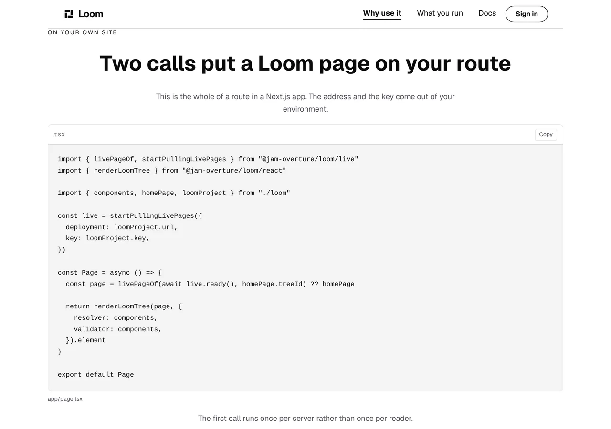

# Marketing — the site shows, for the first time, what a reader puts in their own app

**Branch** `marketing-33-what-you-wire-into-your-app` · **Date** 10 November 2026 ·
**Section** §4d, the marketing site · **Lane** `apps/loom/app/(marketing)/`

---

# What was built

One band, at the foot of `/why-use-it`, printing one file.


**The site had three code panels and none of them was a page.** It showed a
reader how to write a component, how to register it, and how to connect a model.
It never showed how a Loom page gets onto a route, and `renderLoomTree` — the
published seam every claim on this surface rests on — was printed nowhere a
visitor could read it.

| | before today | now |
| --- | --- | --- |
| what the site shows you writing | a component, its registration, a model client | those three, and **the route that serves the page** |
| what it says about a change reaching your site | one clause on one band: *"changing it is a write rather than a deploy"* | the two calls that make it true, and **no pull request, no merge and no deploy** |
| source panels on the site | 3 | 4 |

---

# 1. Why this is the gap worth closing

`docs/positioning.md` is the authority and the line that points at this hole is
the one about what the front door leads with:

> *"Don't worry about the controls. That is the stuff under the hood. The
> building part and why this build is better than traditional methods is
> preferred."*

**The building part had a missing step, and it was the last one.** By the band
above this one a reader of `/why-use-it` has been shown every part of the claim:
the components that come with the install, the two files that add one of their
own, a page made out of them, what that page reports, the function that brings
their model, that page arranged for somebody else, and the record of what let
the change through.

Not one of those said **where any of it runs.** A reader who believed all of it
still did not know what goes in `app/page.tsx`.

## The band before it is what fixes the position

This band was drafted directly under *What you write*, where the other source
panels are, and it reads worse there: three panels in a row is a tutorial, and
the question this one answers is not one a reader has yet.

*What allowed it* ends on a rule stopping a change and asking a person: *"Taking
all three away at once is more than your rules let a page do unasked, so Loom
stops and asks you."* A reader arriving from that sentence has exactly one
question left, and it is **how does either of those reach my site.** The band's
last sentence is the answer and it only lands in this position.

---

# 2. What the panel may claim, and where the permission comes from

Neither claim is this lane's to make or to soften.

**Two calls** is [0361](../decisions/0361-the-site-pulls-into-its-own-process-and-a-host-wires-the-live-page-in-two-calls.md)
clause 2, in its own words:

> *"The whole of a host's integration is two calls. One at startup —
> `startPullingLivePages({ deployment, key })` … — and one where a page is
> rendered: `livePageOf(…) ?? builtTree`. The `??` is the fallback, entire."*

**No pull request, no merge and no deploy** is
[0358](../decisions/0358-an-accepted-change-goes-live-from-the-portal-and-the-site-pulls-it-with-no-pull-request.md),
and the published entry point repeats it in its first paragraph. *Within a
minute* is `DEFAULT_PULL_INTERVAL_MS`, whose own comment reads *"A minute, which
is a change live within a minute of somebody accepting it."*

**It is the pitch half of `positioning.md` and not the under-the-hood half.**
That file puts the rules, the record, the undo and the refusals under the hood,
and *what you can build, and why building it this way beats how you do it now*
in front. A copy change that is live without shipping anything is a fact about a
developer's working day. This band says nothing about a rule, a record or a
refusal that the band above it had not already said.

---

# 3. The panel is run rather than transcribed

`written.test.ts` proves its two panels compile. `connected.test.ts` went
further on 7 November — it starts a server, points the specimen at it and hands
the answer to the interpreter — and its sentence for why is the right one:
*that is the difference between a panel that compiles and a panel that works.*

**This panel is held to that standard.** `wired.test.ts` starts a server that
answers the live-pages door, points the specimen at it, calls the page
component, and reads the heading out of the rendered markup:

| the door answers | what the page serves |
| --- | --- |
| the same page under the same id, carrying a different sentence | **the sentence Loom answered with** |
| `{ "pages": [] }` | the sentence the code built |
| nothing, because there is no deployment configured | the sentence the code built |

Those three rows are the three cases the copy names, each driven end to end.
The live tree is made by rewriting the **serialised** built page rather than by
building a second one, because what has to hold is that the ids match —
`livePageOf` finds a page by id, and two trees built in a test would have two
ids and the first row would pass on the fallback while claiming the opposite.

**Nothing is mocked.** This suite's node pool runs with `isolate: false`, so a
module an earlier file loaded is not re-evaluated — the hazard this lane filed
on 6 November. `vi.resetModules()` is the remedy `apps/loom/vitest.config.ts`
names, and the second assertion is the brace on that belt: a stale module would
have been built with no deployment, no request would reach the server, and
*asked the door with the key it was configured with* goes red. A stale module
here fails loudly rather than passing quietly, which is the property that entry
asks for.

---

# 4. The one thing in the panel that is not what a reader writes

The spelling a reader writes, and the one the published entry point's own
example gives, reads the environment:

```ts
deployment: process.env.LOOM_URL ?? "",
key: process.env.LOOM_PROJECT_KEY ?? "",
```

**Written that way the panel turns two of `tools/sources/deployment.test.ts`'
cases red**, and it is a real check doing its job: it reads every environment
variable the application's code names and holds `apps/loom/.env.example` to
offering each one. It cannot tell a setting **this** deployment reads from one a
**printed specimen** reads — and a specimen here is real compiled code on
purpose, because a snippet nothing typechecks is the thing these panels exist
not to be.

Both ways out are another lane's file: offering two settings this deployment
does not have in the operator's guide, or editing that sweep's own table in
`tools/`. **So it is filed, with three costed shapes, and the panel is shaped
around it.** The two values come from the configuration module the file already
imports from, the copy beside the panel says *the address and the key come out
of your environment*, and `wired.test.ts` holds the panel to reading no
environment variable so a later run cannot put the real spelling back and go red
on `main`.

Nothing a reader is shown is false. It is one indirection away from the file they
would write, on the one panel whose value is being exactly that file.

## And the registry is called `components`, which is the rule working

`voice.test.ts` sweeps every source panel for the words this site may not say to
a stranger, and `registry` is one of them. So the binding is named for what it
holds — and that is the word the copy three bands above already uses: *"Loom
keeps a list of the components an AI model is allowed to use."* A reader now
meets the same word in the prose and in the code. `wired.test.ts` holds it from
the other side.

---

# 5. What it looks like, measured

Read off the production build with `pnpm shoot --serve`, `built
2026-11-10T11:35:06.204Z`, clipped to the band by its own anchor.

| shot | overflow |
| --- | --- |
| `minimal`, 1280×900@2x | `scrollWidth 1280 / innerWidth 1280` |
| `editorial`, 1280×900@2x | none |
| `bold`, 1280×900@2x | none |
| `phone`, 390×844@2x touch | `scrollWidth 390 / innerWidth 390` |


**The bar across the top of the three clipped shots is the sticky header**
floating over the band's own box, not something the band draws. The in-context
shot below is the same band with the page under it.

**On a phone the panel scrolls sideways and nothing on the screen says so.**
That is `loom.code` doing what it does for all four of this site's panels, and
it is the 18 October entry in `FINDINGS.md`, still open and owned by
`Loom primitives` — *"a line too wide for a phone ends mid-word with nothing on
the screen saying there is more."* Another instance rather than another finding.
The phone shows roughly the first forty-two characters of a line, which is the
measurement the 80-character bound above was set against.

**No hard-coded colour.** The band is `loom.section`, `loom.heading`,
`loom.prose`, `loom.code` and one `loom.code-span`, all registered, which
`wired.test.ts` and the pinned panel list in `pages.test.ts` hold against the
registry this site renders with — the question 0067 asks of anything this
surface draws.

`wrap: false`, like the three panels before it, because this is source and a
wrapped line of TypeScript reads as two statements. The budget that makes saying
`false` honest is in lines rather than words:

| | the panel | ceiling |
| --- | --- | --- |
| lines | 20 | 28 |
| characters | 514 | 800 |
| the longest line | 75 | 80 |

The longest line is what took the render call's two options onto lines of their
own, and a phone shows roughly the first forty characters of a line, so the
bound is on how far it runs rather than a promise that nothing scrolls.



**The eyebrow is ranged left under a centred heading**, which is the finding the
front door's `facts` band records and `Loom primitives` owns: `loom.section`
renders its own eyebrow left with no `align` of its own. The band is centred
because its three neighbours are — `What you write`, `Hook up your model` and
`Who is reading it` all are — and re-aligning four bands this run did not
otherwise touch is a separate argument and a separate diff. The 9 November run
made the same call the other way round for a band whose neighbours were not
centred, and said so.

---

# 6. What it cost in words

The site's ceilings did not move and nothing was cut to fit:

| | before | after | ceiling |
| --- | --- | --- | --- |
| the band | — | **102** | 120 |
| `/why-use-it` | 1,309 | **1,411** | 1,500 |
| the site | 3,166 | **3,268** | 3,900 |

The panel's own 514 characters are not in those figures: `measure.ts` does not
count what is inside a source panel, which is why the panel has a budget of its
own in §5.

**This band is one of the widest plain bands on the site**, at 102 against a
ceiling of 120 — `budget.test.ts` recorded the widest at 99 on the day that
ceiling was set, and this is above it. It carries four facts and each is a
sentence. The site is at 84% of its total, which leaves **632 words**.

---

# Decisions

**None taken and none recorded.** Nothing here touches the tree schema, the
delta model or an Accepted record. No primitive was added and none was needed.
All three marketing routes still report `ƒ` in `next build`, so
[0331](../decisions/0331-a-marketing-page-is-served-per-request-because-the-store-governs-it.md)
holds and nothing here froze a governed page.

Two things in the brief this run was given are **superseded by maintainer
instructions already recorded**, and are named here so a later run does not go
looking for them:

- The brief's *strongest version* — the site rewriting itself in front of a
  visitor with the telemetry beside it — was removed by his instruction of
  31 October,
  [0328](../decisions/0328-the-marketing-site-has-no-demonstration-and-no-mechanism-page.md).
- The brief's *the differentiator is not adaptation, it is the record* is the
  `docs/rollout.md` bullet his answers of 24 October reversed; `docs/positioning.md`
  is the authority and a dated note in `rollout.md` points there.

# Findings

**One filed, none closed.**

- **For `Loom daily build`** (`tools/sources/deployment.ts`): a printed specimen
  that reads the environment arrives in the deployment sweep as a setting of
  this deployment. Measured on this branch, with the two cases it reddens, three
  costed shapes, and a recommendation.

The question carried from 9 November is **still open and still unanswered**:
whether a table of the twenty-two sections a landing page has may name the one
labelled *Pricing*. Nothing was added to it and nothing was asked a second time;
it is in the pull request comment once, as the entry at
`FINDINGS.md`'s 9 November heading records.

# Test numbers

`pnpm install && pnpm verify`, read out of the file the status was written to
rather than off a notification:

```
PLACEHOLDER
```

**Nothing failed and nothing was skipped.**

This branch's own additions: **16 cases**, all in `wired.test.ts`, which is a
new file. One existing case was changed and it is the pinned panel list in
`pages/pages.test.ts` — the pin went red naming this panel on the run that grew
it, for the fourth time out of four, and the change is one line adding it plus
its count in the title. No case was deleted or weakened, and no file outside
`app/(marketing)/` was touched apart from `FINDINGS.md` and this report.

# Open questions

In the pull request comment. None of them blocks this branch.
