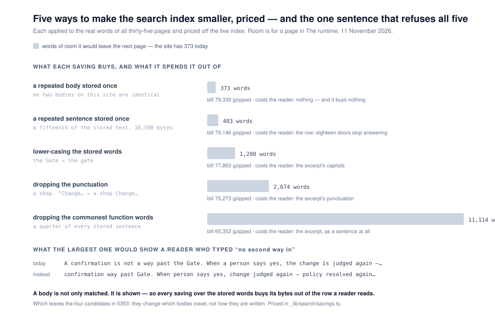

# 11 November 2026 — the savings that are not there, priced; and the state of the site is a test of its own now

**Routine:** `Loom docs` · **Branch:** `docs-78-no-room-for-another-page` (pushed
onto, not branched from) · **Section:** §4c

> **GATE PLACEHOLDER**



## What this run did, in one paragraph

This lane has one open pull request — **#778**, carrying `0353` as `Proposed`,
**unanswered since 5 November** — and the procedure says to push onto it rather
than open a second. So this run did that, and it did the one thing that makes
the question on it easier to answer: **it priced the whole class of remedies
0353 did not price.** Five ways to make the stored words smaller, each applied
to the real words of all thirty-five pages, each priced off the live index, and
all five refused by one sentence that is run rather than asserted. Nothing on
the site changed and **no prose was written**, which on a site with 373 words of
room is a decision rather than an omission.

## Where the run started

**One open pull request from this lane, and it is the lane's own blocker.**
#778 was opened on 5 November and has had no non-bot comment since this lane's
own. Seven others were open and none touches the `(docs)` route group — #858
(`Loom marketing`), #857 and #854 (`Loom framework`), #856 and #855 and #851
(`Loom signals`), #834 (project thread) — checked file by file rather than by
title.

**No maintainer comment is outstanding for this lane.** Every non-bot comment on
the open set is a routine's own, posted from the maintainer's account; the rest
is `vercel[bot]`.

**The branch was six days stale**, so `main` was merged in first — a clean
merge, 77 commits, and `pnpm decisions:index` and `pnpm docs:api` run after it
per `docs/routines.md`. The decisions index moved; the generated API reference
did not (`no name is new`).

### Why this is a second unit on an old branch rather than a new branch

The procedure's reason applies exactly: the unit changes `_lib/search/`, and
#778 changes `_lib/search/build.ts`, `model.ts`, `build.test.ts`,
`_components/search.test.tsx` and the prose route. A `docs-84` doing this work
would have been **two open branches from this lane touching four of the same
files**, with the conflict landing on `Loom merge` or on the maintainer.

The cost of the choice is stated plainly because it is real: **this work does
not land until the one word does.** The alternative was to land it and leave
#778 to conflict, and that trades the lane's blocker for the maintainer's
morning.

## The question this run asked

0353 asks which of four candidates the search box should become. Every one of
them changes **which bodies travel**. None of them is what a run reaching a full
index actually tries first, which is: *make the stored words smaller.*

That class had no price anywhere. It has five obvious shapes, and the first one
anybody proposes is worth nought while the last is worth thirty times the rest —
which is not a thing anybody can reason to from a paragraph.

## What shipped

**One module, one test file, two test cases rewritten, and a record's
alternatives section.** No page changed.

### `_lib/search/savings.ts`

Five candidates, registered, applied to the whole site's real bodies, and priced
off the live index. The bill is taken over the five files **as served**, because
four files of one text cost more than one file of it — the same way `room.ts`
takes the bill it is compared against. Room is converted to words by handing
`room.ts` a cap whose `spent` is the candidate's bill, so the arithmetic is the
published one rather than a second copy of it.

| the saving | the bill | room | what it costs a reader |
| --- | --- | --- | --- |
| a repeated **body** stored once | 79,339 | **373** | nothing, and it buys nothing |
| a repeated **sentence** stored once | 79,146 | 483 | the row, on eighteen of nineteen doors |
| lower-casing the stored words | 77,863 | 1,208 | the excerpt's capitals |
| dropping the punctuation | 75,273 | 2,674 | the excerpt's punctuation |
| dropping the commonest function words | **60,352** | **11,114** | the excerpt as a sentence at all |

**The one reason all five are refused: a body is not only matched, it is
shown.** `match.ts` cuts a window out of `entry.body`, marks the reader's own
words in it, and puts that on screen as the row's excerpt — *a reader scanning
ten rows is looking for their own words in bold*, which is that file's own
sentence. So every byte stored here is a byte that may end up in front of
somebody, and a saving that normalises the words buys its bytes out of the one
thing a result row has to be.

That sentence settles the class, which is why the class is registered in one
place and refused once. What is left after it are the candidates that change
which bodies travel, and those are 0353's four.

**The refusal is run, not asserted.** `shownInstead` puts a candidate's words
into a real index through the published `withProse`, sends a real query through
`searchDocs`, and returns the excerpt that candidate would have shown. A
candidate described as costing the excerpt that turns out not to touch one fails
beside its own description. For *no second way in*:

```
today:   A confirmation is not a way past the Gate. When a person says yes, the
         change is judged again — the policy is resolved again,…
instead: confirmation way past Gate. When person says yes, change judged again —
         policy resolved again, change assessed again, verdict holds now. Most…
```

### Two figures worth having even from somebody who agrees with the refusal

**Deduplicating is worth nothing, and it is the first thing anybody proposes.**
The nineteen reference pages repeat seven *sentences* — not their bodies; no two
bodies on this site are byte-identical, which is asserted rather than assumed.
Taking a fifteenth of the stored text out (16,598 raw bytes, 21 of 271
addresses) buys **110 words**. gzip has already been paid for that repetition:
the nineteenth copy of a sentence costs a back-reference rather than its length,
so removing it gives back the back-reference.

**Price and harm run together.** The registry is ordered on price, and the
ordering is asserted, because the module draws a conclusion from it: the one
that costs a reader nothing recovers nothing, and the one that recovers thirty
times the rest takes the small words out of every sentence this site would quote
back to somebody.

### A claim this run made and then measured, and had to correct

The function-words candidate was first registered as also costing *the query* —
a reader typing a phrase with a small word in it matches nothing, because the
matcher still looks for every word they typed. **Run, it is false.** The words
are still found, in a title, a section, a summary or a block, so the phrase
still matches; what changes is **which page answers and which sentence it
quotes**. The registered cost now says that, and the test case says *which
sentence answers a phrase, rather than whether one does*. The first version
would have been a confident sentence in a decision record that nothing could
contradict.

### `room.test.ts`: the state of the site is its own case now

`room.test.ts` asserted of *The runtime* that `fits` is `false` — this site
cannot take a page as short as its own shortest — and its comment said the
assertion **flips when the question in 0353 is answered**, and that the run
landing that answer has to come back and say what the state is now.

**0353 has not been answered and the assertion flipped anyway.** Six days of
`main` took the bill from 79,414 to **79,339** — 75 compressed bytes, about 42
words — so the room in *The runtime* went from 331 words to **373**, past the
346 of the shortest page. The 75 bytes are not isolated and are not worth
isolating: two stale sentences left *What your readers do* on 9 November, the
reference's generated prose grew, and the net of everything written here in six
days is 75 bytes.

The case bundled two claims and the comment only noticed one:

- **a property** — `sentenceOf` prints its third clause exactly where a short
  page would not fit — which holds whichever way 0353 goes, and
- **a state** — this site is full — which was true on 5 November and is now true
  of two of the five sections.

Bundled, the property went untested the moment the state moved, and the failure
read as *the measurement is broken* rather than *the site changed*. They are two
cases now: the property swept over all five sections, the state as a **count**
of sections rather than a named one.

### `0353`

Still `Proposed`, still the maintainer's, **decision unchanged**. What was added:
a dated re-measurement note, the five-row table above as a new *Alternatives
considered* entry with the one sentence that refuses it, and the pointer to
`savings.ts`.

**One sentence in the record has stopped being exactly true and was left
standing with a note rather than quietly edited.** It said 331 words is shorter
than anything on the site; 373 is not. The record now says so, says it is forty
words of difference, and says why it changes nothing: the median page here is
about 1,200 words and the next one on this lane's queue was costed at 400.

## The state of the site, in the numbers a run needs

| | |
| --- | --- |
| the bill for all five sections' words | **79,339** gzipped of 80,000 |
| room for a page in *The runtime* | **373 words** |
| in *Getting started* | 341 |
| in *Architecture* | **326** |
| the shortest page already written here | *Decision records*, **346** |
| sections that cannot take a page that short | **2 of 5** |
| this site's bytes per word | 5.32 |

## Decisions taken that were not specified

- **Pushed onto #778 rather than opening `docs-84`.** The reasoning and its cost
  are above. It is the procedure's own rule and this is the case the rule is
  about.
- **No prose was written, again.** Three signals findings ask for one paragraph
  on *What your readers do* and the sentences are written to be lifted. One
  paragraph fits in 373 words and would leave the site with nothing — and the
  gate is the merge gate for four surfaces. It is the fourth consecutive unit
  from this lane that is an instrument rather than a sentence, and the finding
  filed today says so in those words rather than leaving it to be noticed.
- **The savings are refused rather than offered as a menu.** A registry of five
  things not to do could read as five things to consider. It is ordered on price
  and every row carries what it costs a reader, so the table makes the argument
  rather than hosting it.
- **`marked` was written, measured, and deleted.** `shownInstead` briefly
  returned how many of the reader's words each row could pick out, on the theory
  that a candidate which stops storing a word stops the row showing it. Measured
  over four queries and three candidates, the count never moved — the excerpt is
  centred on wherever the surviving words are. A measurement that measures
  nothing is a line somebody later believes is load-bearing, so it went.

## Records

**None added, none superseded.** `0353` is amended and still `Proposed`; its
decision is untouched. Nothing here touches the tree schema, the delta model or
an `Accepted` record, and nothing is escalated as `ARCHITECTURAL`.

## Mutations

**Twelve planted, twelve killed.** Each mutated in the working tree and restored
with `git restore --source=HEAD`, after the two test cases written in answer to
the first run were committed.

| the mutation | killed by |
| --- | --- |
| the registry really reordered | the ordering case |
| the free candidate made an identity | the case handing it words that *are* repeated |
| the repeated-sentence filter made always-true | the fifteenth-of-the-text case |
| the function-word list emptied | the thirty-times case |
| `under` dropped from the priced files | the room-equality case |
| `instead` computed from today's words | the three excerpt cases |
| the bill measured raw instead of gzipped | the room-equality case |
| the reason dropped from the sentence | the sentence case |
| `addressesChangedBy` compared against itself | the shared-sentence case |
| `sentencesIn` losing the full stop | the fifteenth-of-the-text case |
| a candidate's id renamed | `savingOf` |
| prices taken in another section | the room-equality case |

**The one worth reading is the free candidate made an identity.** Two cases
assert what `identical-bodies-once` does on this site — it changes no address
and leaves the room exactly as it was — and **both are true of a function that
does nothing at all**, because there is nothing here for it to do. So the
registry's description of it would have been a lie no test could catch. It is
held now by being handed three addresses, two of which carry the same words.

## Cross-lane diff

**None.** Every file changed is inside `apps/loom/app/(docs)/_lib/search/`, plus
`decisions/0353`, `decisions/README.md` (regenerated after the merge),
`FINDINGS.md`, this report and its visual. Nothing in `src/`, nothing in another
surface's route group, nothing in `docs/`.

## Findings

**Two closed on filing, one filed and open.**

- **Closed:** every saving over the stored words is priced, and all five are
  refused by one sentence.
- **Closed:** a test that said *the site is full* went stale in six days while
  its own comment promised it could only flip when the question was answered.
  The general shape is filed with it: *a test that asserts the state of the
  repository belongs in a case of its own, not in the same case as the property
  that holds whichever way the state goes.*
- **Open, and owned by the maintainer:** 0353 unanswered for six days, with five
  of this lane's findings behind it and a count of what each is waiting to say.

## Token discipline

**This session is not subscribed to its pull request and no check-in is armed.**
Seventh time this lane has said so. Run, report, exit.
