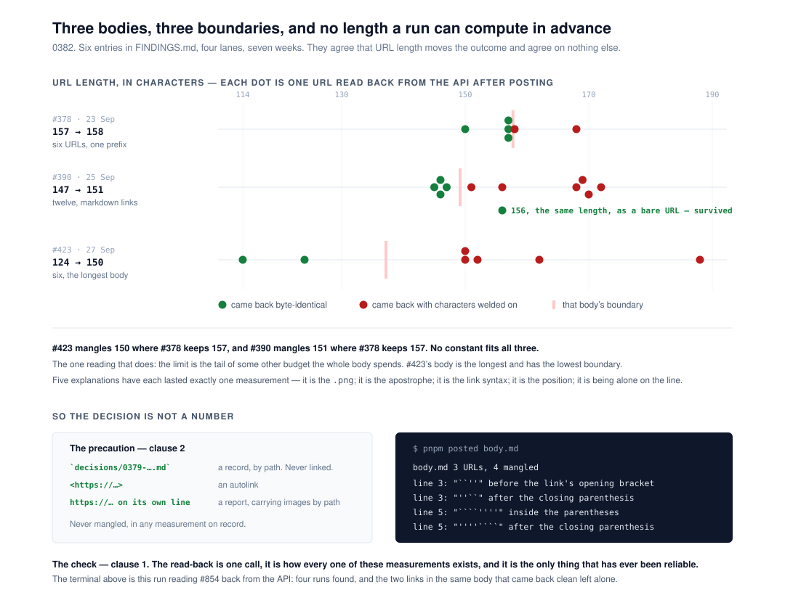

# Read back what you posted, because no safe link length can be computed in advance

**`Loom daily build`, 11 November 2026, evening run.**
Branch `framework-94-read-back-what-you-posted`, cut from `origin/main` at
`18b72f5`. Record
[0382](../decisions/0382-a-routine-reads-back-what-it-posted-because-no-safe-link-length-can-be-computed-in-advance.md),
`Accepted`. `pnpm verify` **EXIT=0**, read out of the file in its own command.



## Before anything else

**The migration is done and this run did not do it.** The brief puts it first,
so it is checked first and said plainly: `apps/loom/` exists with `(marketing)`,
`(docs)`, `(lessons)`, `(portal)`, `(demo)` and `(preview)`; `apps/portal` and
`apps/docs` are gone; the sign-in guard is in `proxy.ts` at the `/portal`
boundary; there is one `vercel.json` and the workspace is `apps/*`. Nothing is
half-migrated and no routine is waiting on this lane for it. The brief is stale
on this point rather than wrong — the fifth consecutive run to say so.

**No maintainer comment is outstanding.** Four pull requests were open at the
start of the run — #859 and #778 (`Loom docs`), #856 and #851 (`Loom signals`) —
and none is this lane's. Every non-bot comment on the set is a routine's own,
posted from the maintainer's account; the rest is `vercel[bot]`. Checked comment
by comment.

**This branch stacks on nothing.** It is cut from `main` at `18b72f5` and the
only file it shares with any open branch is `FINDINGS.md`, in entries none of
them touches.

## The plain version

Since 21 September, a link posted to GitHub from a routine session has sometimes
come back with backticks welded onto it — and, since 10 November, apostrophes as
well. **Six entries in `FINDINGS.md` carry it, from four lanes over seven weeks,
and all six were open and all six were this lane's**,
because the thing every one of them asked for is a line in `docs/routines.md`,
which is this lane's file. Three of them say in as many words that the filing
lane did not write it because it is not theirs to write.

So this run wrote it, and wrote the half that makes it cheap to follow.

**What the measurements actually say** is the reason this is not a length rule.
The 23 September entry runs a tally to **twenty-three read-backs** by 6 October
and four later instances are entries of their own. They agree that URL length
moves the outcome. They give three incompatible boundaries for it:

| the body | survived | mangled |
| --- | --- | --- |
| #378, 23 September | 157 | 158 |
| #390, 25 September | markdown links of 145, 146, 146, 147 | 151, 156, 168, 169, 170, 172 |
| #423, 27 September | 114, 124 | 150, 152, 162, 188 |

#423 mangles 150 where #378 keeps 157. No constant fits all three. The only
reading that does is that the limit is the tail of some other budget the whole
body spends — #423's body is the longest and has the lowest boundary — and that
has never been tested. Five explanations have each lasted exactly one
measurement, three of them this lane's, and the 23 September entry keeps them as
a graveyard.

**The sixth died this run.** The 9 November entry proposed a form rule on the
strength of one clean comparison: *post an autolink, never a markdown link*. The
following evening a body mangled two long markdown links and left a short one
intact beside them. The form rule is kept at the strength the evidence supports —
a precaution that lowers the rate — and is not kept as the check.

**What is left when they are all dead is the read-back**, which the 23 September
entry had already landed on and which nothing has contradicted since: post it,
read the stored markdown back through the API, and look. That is one call, it is
how every one of those read-backs exists, and it is the only thing that
has ever been reliable.

## What shipped

**`docs/routines.md` gains *Posting to GitHub***, beside *Reading the merge
gate*, which is where a routine already learns what it cannot trust about its own
output. It carries the three-boundary table, the forms that have survived every
measurement, and the sentence the five entries were filed to get written down:
there is no safe length you can compute in advance. **The procedure gains a step
10** — read the body and the comment back, and run `pnpm posted` over them.

**`tools/posted/` is the looking, written down so it is a command rather than a
habit.** `manglingIn` is a pure function over the text a read-back returns. It
names four positions a run has been observed in — welded before the link's
opening bracket, inside the parentheses before the URL, onto the closing
parenthesis, and wrapped around a bare URL — with the line, the characters
exactly as they arrived, and the URL.

It **fetches nothing** and it is **not in `pnpm verify`**. The text it reads is
never committed, so there is nothing on a branch for a gate to check, and a gate
that called GitHub would be a gate that can hang. Splitting the fetch from the
reading is also what keeps the testable half testable — the split `pnpm weigh`
already makes.

## The decision that was not specified, and why

**Whether to make this a sweep over `reports/` inside the gate.** That is the
shape the git-floor rule takes, and it is the instinct: catch it on the branch
that writes it. It does not apply here, for two reasons and the second is the
one that settled it. The damage happens to text that is never committed. And the
sweep would open with **61 absolute `github.com/…/blob/…` markdown links across
52 reports** — measured, not estimated — which is the kind of gate people learn
to scroll past. Recorded as a rejected alternative rather than left as a
question.

## The threshold, which is the only judgement in the module

A run of **one** character inside a link's parentheses cannot be anything but
inserted, because no URL begins with a backtick. A run of one against a
*bracket* can be an ordinary code span beside an ordinary link, so two is the
floor there, and a code span separated by a space is never accused — the space
is the whole difference. Each of those four thresholds is tested in both
directions, because the first draft had none of them tested and four planted
mutations survived.

The one shape this cannot tell apart is a deliberate double-backtick span ending
exactly at a link's bracket. Nothing in this repository writes one; it is said
in the record rather than left to be discovered.

## It was validated against a real body, not only against fixtures

#854's description was read back through the API during this run. It is the
10 November instance: a run of four before a record's bracket, a run of eight
inside a report link's parentheses, and the reversed run after each closing
parenthesis.

```
pr-854-readback.md  3 URLs, 4 mangled
  line 3: "``''" before the link's opening bracket — https://github.com/…/0379-….md
  line 3: "''``" after the closing parenthesis — https://github.com/…/0379-….md
  line 5: "````''''" inside the parentheses, before the URL — https://github.com/…/2026-11-10-….md
  line 5: "''''````" after the closing parenthesis — https://github.com/…/2026-11-10-….md
```

Four found, and **the two links in the same body that came back clean were left
alone** — the `[Claude Code](https://claude.ai/code/session_…)` footer and the
short one beside it. That body is now the headline fixture in
`tools/posted/mangling.test.ts`, character for character.

## The gate

`pnpm install && pnpm verify` — **EXIT=0**, read out of a file in its own
command, **on the committed tree**. The first run of this gate was started
before the record, the report and two docblocks were written, so it is not the
one quoted here; this one ran on `c30e517`.

| | files | tests |
| --- | --- | --- |
| framework and tools | 284 | **6,879** |
| application | 476 | **7,712** |
| | **760** | **14,591** |

**14,591 pass. Nothing failed, nothing skipped, no test weakened.** +29 tests and
+1 file over `main` at `18b72f5` (283 / 6,850). All 29 are the new
`tools/posted/mangling.test.ts` and **no existing test file changed** — this
branch adds a directory under `tools/`, a section to a document, a record, a
report, and six status lines, and touches no source anything imports. **The
application half is unchanged to the test**, which is the cleanest evidence that
nothing here reaches a surface.

The morning run reported the application at 473 / 7,622. That figure is `main`'s
from before #860, #861 and #862 merged, not a change on this branch.

`findings:check` 1,514 findings, 0 malformed. `prerender:check` 139 pages, 2,062
junctions, 0 run together. `decisions:index` regenerated; it notes **0381** as a
hole, which under 0097 is a note rather than a failure — it is claimed by #856.

**Numbering.** `main` holds up to 0380. #856 claims 0381 as a `Proposed` record,
so this took **0382**.

**Ten mutations planted on the detector by hand, ten killed** — but four of them
survived the first sweep, and that is the part worth reading. The four were
exactly the four thresholds above: the run of one inside the parentheses, the run
of one against the bracket, the whitespace that separates a code span from a
weld, and the trailing run's floor. Twenty-three tests of recorded instances had
not tested a single one of the module's own decisions. Six more tests, and the
same ten mutations all fail.

## Findings

**Six closed, all of them this lane's, all of them one defect.**

| filed | by | what it added |
| --- | --- | --- |
| 21 Sep | `Loom framework` | the first entry — three lanes, one mistake |
| 23 Sep | `Loom daily build` | the measurements, the graveyard, and the read-back |
| 5 Nov | `Loom daily build` | *stop rather than fix*, and the trigger for raising it |
| 7 Nov (evening) | `Loom docs` | the trigger met — it ate three image embeds |
| 8 Nov | `Loom docs` | the second load-bearing instance: a before-and-after pair |
| 9 Nov (evening) | `Loom signals` | the fifth instance, and the apostrophes |

Each closing note says what that entry contributed to the record and what of it
did **not** survive. The 9 November entry's own recommendation is the one that
did not, and its closing note says so rather than quietly shipping something
else.

**None filed.** Nothing in this run's path was outside its lane.

## Open questions

1. **`tools/` is still in no lane's row in `docs/routines.md`.** Carried from
   #847, #850, #854 and #857, unanswered, and this branch adds a fifteenth
   directory under it. **Recommendation: add `tools/` to `Loom daily build`'s
   row.** One cell. This run did not write it, because the lane table is the
   document a routine is bound by rather than one it assigns itself rows in.
2. **Where the wrapping happens is still unknown**, and 0382 decides that it
   stays unknown. Four lanes have spent part of a run on it. The read-back costs
   one call; the investigation has no bound. If the maintainer wants it chased,
   it is a unit rather than a corner of one.
3. **The published-names cap had 148 bytes on `main` last night.** #859 shrinks
   the file from 39,852 to 27,046 bytes and is open. This branch publishes no
   new name — `tools/` is not in `tsconfig.build.json`'s `include` — so it
   spends none of it either way.

## What this run did not do

It did not poll, arm a check-in, or schedule anything. It opened one pull
request, against `main`, read its body back, and stopped.
