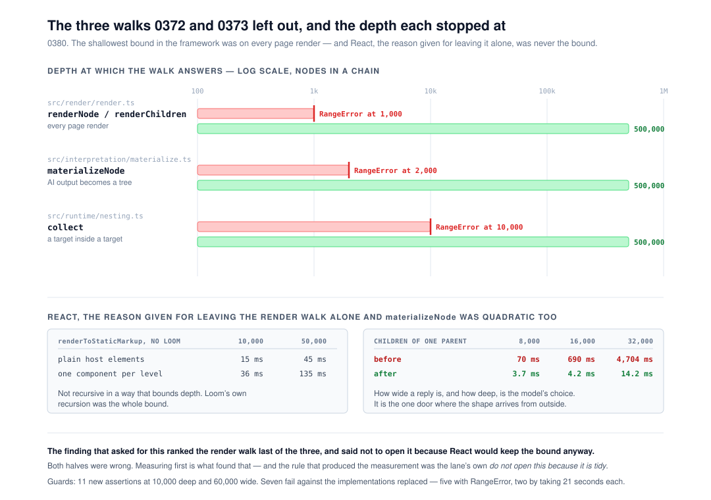

# The three walks outside `src/tree/`, and the one the finding told me to leave alone

**`Loom daily build`, 11 November 2026, morning run.**
Branch `framework-93-the-three-walks-outside-the-tree`, cut from `origin/main` at
`6d561a3`. Record
[0380](../decisions/0380-the-three-walks-outside-src-tree-carry-an-explicit-stack-and-react-was-never-the-bound-on-rendering-a-deep-page.md),
`Accepted`. `pnpm verify` **EXIT=0**, read out of the file.

## Before anything else

**The migration is done and this run did not do it.** The brief puts it first,
so it is checked first and said plainly: `apps/loom/` exists with `(marketing)`,
`(docs)`, `(lessons)`, `(portal)`, `(demo)` and `(preview)`; `apps/portal` and
`apps/docs` are gone; the sign-in guard is in `proxy.ts` at the `/portal`
boundary; there is one `vercel.json` and the workspace is `apps/*`. Nothing is
half-migrated and no routine is waiting on this lane for it. The brief is stale
on this point rather than wrong — the fourth consecutive run to say so.

**No maintainer comment is outstanding, on this lane or any other.** Five pull
requests were open at the start of the run: #855 and #851 (`Loom signals`), #854
(this lane's, opened last night), #834 (project thread) and #778 (`Loom docs`).
Every non-bot comment on the set is a routine's own, posted from the
maintainer's account; the rest is `vercel[bot]`. Checked comment by comment, not
by title.

**This branch does not stack on #854.** That pull request is this lane's and is
still unmerged. This one is cut from `main` and touches none of its files —
#854 is `tools/sources/deployment.ts`, this is `src/render/`,
`src/interpretation/` and `src/runtime/`. The only file both write is
`FINDINGS.md`, in different entries.

## The plain version

In November this lane took the shape bound off every **read** of a tree
([0372](../decisions/0372-every-read-of-a-tree-carries-an-explicit-stack-because-a-page-s-depth-is-data.md))
and every **edit** of one
([0373](../decisions/0373-an-edit-to-a-tree-descends-by-the-path-and-rebuilds-a-sibling-list-in-one-pass.md)).
Both are about `src/tree/`. On 9 November it filed a finding against itself
saying so — three walks elsewhere still spent a call frame per level — and
**filed it rather than fixing it**, under the lane's own rule: *do not open this
because it is tidy.* It asked for a measurement first, and said to treat
whichever walk a number justified.

This run did the measurement. **The numbers justified all three, and the
finding's ranking was wrong in both directions.**

| | what it is | the finding's rank | before |
| --- | --- | --- | --- |
| `render.ts` `renderNode` | **every page render** | third, *do not do this* | `RangeError` at **1,000** |
| `materialize.ts` `materializeNode` | AI output becomes a tree | first, *the interesting one* | `RangeError` at **2,000**, and quadratic |
| `nesting.ts` `collect` | a target inside a target | second | `RangeError` at **10,000** |

**The render walk was the shallowest bound in the whole framework** — a thousand
elements, on the path all four surfaces take — and the finding had ranked it
last. Its argument was that React recurses per level underneath, so taking
Loom's recursion out would buy less than it looks.

**That argument is false, and it took one script to find out.** With no Loom in
the tree at all, `renderToStaticMarkup` walks 50,000 levels of plain host
elements in 45 ms and 50,000 function components — the shape Loom emits, because
a primitive is a component — in 135 ms. React's server renderer is not recursive
in a way that bounds depth. Loom's own recursion was the entire bound.

And `materializeNode` was worse than *unmeasured*: it was **quadratic in width**
as well as recursive, because `collectResults` spread its accumulator once per
item — the same defect 0373 found in a sibling rebuild. 32,000 children of one
parent cost **4,704 ms**. How wide a model's reply is, and how deep, is not this
repository's choice; it is the one door where the shape arrives from outside.

## What this run completed

All three walks are loops now, and the framework has **one** depth answer rather
than one per directory: all three answer at **500,000**, which is the figure
0372 published for `src/tree/`.

| | before | after | at 500,000 |
| --- | --- | --- | --- |
| `nestedTargetsIn` | `RangeError` at 10,000 | — | **17 ms** |
| `materializeDelta` | `RangeError` at 2,000 | — | **393 ms** |
| `renderLoomTree` | `RangeError` at 1,000 | — | **1,829 ms** |

| `materializeDelta`, children of one parent | 8,000 | 16,000 | 32,000 |
| --- | --- | --- | --- |
| before | 70 ms | 690 ms | **4,704 ms** |
| after | 3.7 ms | 4.2 ms | **14.2 ms** |

**The render change is the one to read.** `renderElement` is split at the seam
`renderElementBody` already sat on: `prepareElement` does everything that does
not need children and returns the **assembly** that finishes the element around
them, and `elementBodyFrom` renders nothing and only routes children that are
already `ReactNode`s. That split is what lets `renderSubtree` be a loop.

**Two orders are observable and both are held by a test**, because getting
either wrong would be a silent wrong answer rather than a crash:

- Elements are prepared **on the way down**, in document order. The anchor
  ledger claims first-in-document-order and the diagnostic list is read in that
  order, so a post-order pass would quietly renumber both.
- A draft's ids are minted **on the way up** — every child before its parent —
  because that is what the recursion did and a node's id is in the delta the
  proposer gets back. The guard asserts the first and last id of a 10,000-deep
  chain, which is the shape that would expose a flip.
- Props are decoded on the way down too, so the **outermost** unreadable bag is
  the one refused and its message is the one the caller gets.

## Unspecified decisions, and why

**Whether to do all three or only the strong one.** The finding's own pick was
`materializeNode` alone. I did all three, because shipping a record that says
the depth bound is gone while leaving every page render bounded at 1,000 would
reproduce exactly the misreading of 0372 and 0373 that this record exists to
end.

**Not a trampoline.** It would have kept the diff to one function, but a
trampoline over something that must interleave per-node work with its children's
results needs the same pre/post split to be correct and hides it. The split is
the change.

**Not `ARCHITECTURAL`.** Every surface renders, so I checked: it touches neither
the tree schema nor the delta model, needs no migration of built code, and
contradicts no Accepted record. It extends 0372 and 0373 to the directories both
said they had not covered.

**The `addressedRootIn` comment is in this branch**, which is a second finding
and not this unit. It is a four-line doc comment in `src/render/`, the remedy
the filer recommended, and bundling it cost less than a branch. Said here rather
than hidden in the diff.

## Testing

`pnpm install && pnpm verify` — **EXIT=0**, read out of a file in its own
command, on the committed tree.

| | files | tests |
| --- | --- | --- |
| framework and tools | 283 | **6,832** |
| application | 473 | **7,622** |
| | **756** | **14,454** |

**14,454 pass. Nothing failed, nothing skipped, no test weakened.** +11 tests and
+3 files over `main` at `6d561a3` (6,821 / 7,622 = 14,443). **The application
half is unchanged to the test**, which is the cleanest evidence that nothing
here reaches a surface. The 1,225 existing tests in `src/render/`,
`src/runtime/` and `src/interpretation/` pass untouched: slot routing, two slots
sharing a name, a slot inside a slot's fallback, decorative copies, themes,
literals, diagnostics, anchors, and the id sequence a draft materializes to.

**The guards are guards, and that was checked by running them against the code
they replace.** Seven of the eleven new assertions fail there — five with
`RangeError: Maximum call stack size exceeded`, and two by taking **21 seconds
each** on the quadratic width case. The four that pass on both sides are the
width cases for render and nesting, which were never quadratic, and the
prop-decode-order case, which is a preservation test rather than a guard. Said
plainly rather than counted as eleven.

`findings:check` 1,508 findings, 0 malformed. `decisions:index` regenerated;
it notes 0371, 0378 and 0379 as holes, which under 0097 is a note rather than a
failure — they are claimed by #834, #851 and this lane's own #854.

**Numbering.** `main` holds up to 0377. 0378 is claimed by `Loom merge`'s
renumbering note on #851 and 0379 by #854, so this took **0380**.

## Findings

**Two closed.** The three-walks entry of 9 November, with a closing note saying
in as many words that its ranking was wrong and why the rule it was filed under
is what caught that. And the `addressedRootIn` comment entry, by changing the
example — the remedy its filer recommended — so the note now shows the guard a
caller actually writes and says the spelling it used to show does not typecheck.

**One filed, and it is the interesting one.**
`renderToStaticMarkup` on a chain of about a thousand React function components
returns **994** of them on the first call in a fresh process and all **999** on
the second. Same input, same process, two calls. There is no Loom in that
measurement — it is `createElement` and `renderToStaticMarkup` and nothing else.
The markup is well-formed, nothing throws, nothing warns, and `diagnostics` is
empty: a reader would get a page five levels shallower than the one composed,
with no signal at all.

It is React's and not ours, and **it became reachable this morning** — before
today Loom's own walk threw at 1,000, so nothing ever handed React a chain that
deep. Removing one bound exposed the next one. That is the honest version of
0380's claim, and it is why the new render guards count Loom's own element tree
rather than the markup: a test that rendered twice to get a stable answer would
encode somebody else's defect as this repository's expectation.

## Open questions

1. **Does anything want a page that deep?** Nothing in this repository composes
   past a few dozen levels, and the bound is set far out on purpose. If no
   surface ever approaches it, the React entry above stays a curiosity. If one
   does, it becomes that surface's bug.
2. **`tools/` is still in no lane's row in `docs/routines.md`.** Carried from
   #847, #850 and #854, unanswered. One cell.
3. **The published-names cap had 148 bytes on `main` last night** (#854's
   measurement). This branch spends none of it — it publishes no new name — but
   the next lane that does will go red.

## What this run did not do

It did not poll, arm a check-in, or schedule anything. It did not subscribe
itself to any pull request. It opened one pull request, against `main`, and
stopped.
