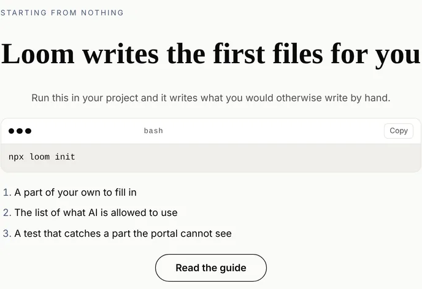
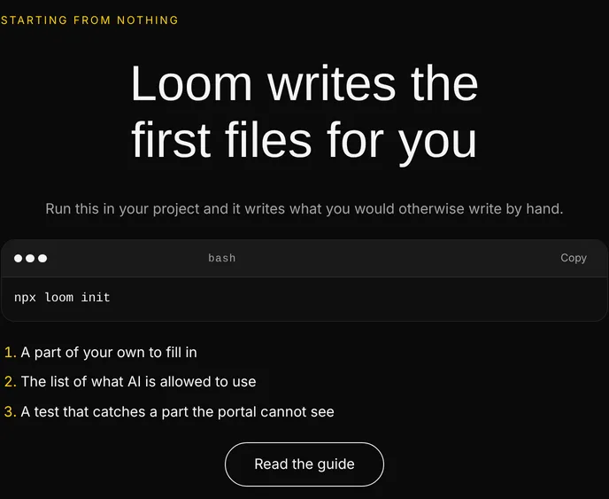
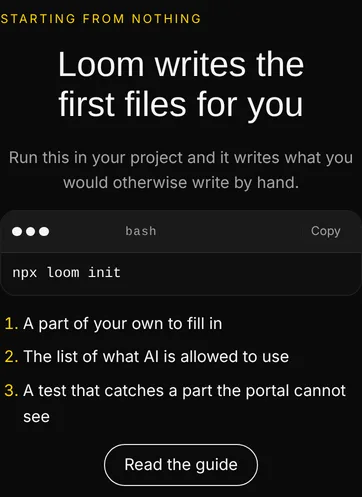
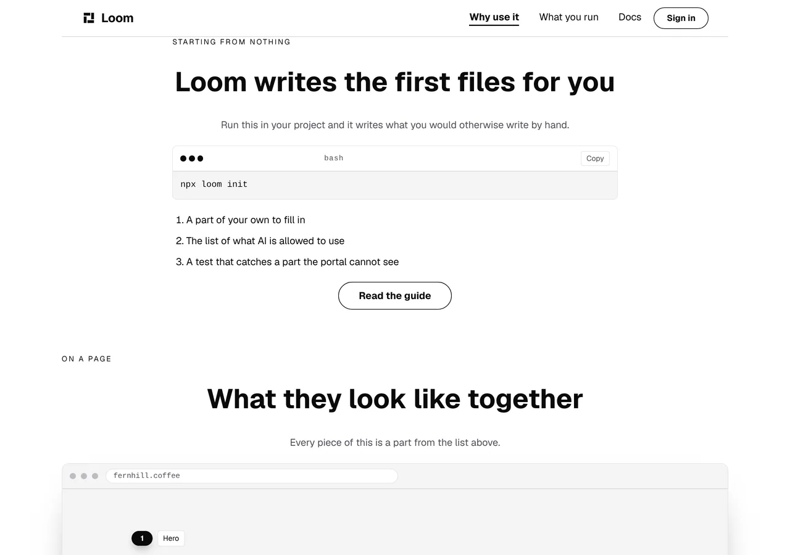

# Marketing — the site says, for the first time, that Loom writes your first files

**Branch** `marketing-34-your-first-files` · **Date** 11 November 2026 ·
**Section** §4d, the marketing site · **Lane** `apps/loom/app/(marketing)/`

---

# What was built

One band on `/why-use-it`, directly under the two panels it is the alternative
to.


**The site shows a reader two files and tells them to write both.** The package
ships a command that writes one of them, and no page of this surface had ever
mentioned that the command exists.

| | before today | now |
| --- | --- | --- |
| what the site asks a reader to do first | install two packages, then write four files by hand | install two packages, then **run one command** |
| commands this site prints | 1 (`npm install …`) | 2 |
| links from this site into `/docs/getting-started/scaffolding-a-project` | **none** | one, from the band |
| source panels on the site | 4 modules | 4 modules and a command |

---

# 1. Why this is the gap worth closing

`docs/positioning.md` is the authority and two of its lines point straight at
it. On what the front door leads with:

> *"Don't worry about the controls. That is the stuff under the hood. The
> building part and why this build is better than traditional methods is
> preferred."*

and on who is reading:

> *"You're writing for a web developer, but assume it is the casual web
> developer. Imagine junior level developer."*

**The thing that turns a curious junior developer into somebody who has
actually run this is a first command that leaves something working behind it.**
By the band above this one a reader of `/why-use-it` has been shown the
components that come with the install, the two files that add one of their own,
a page made out of them, what that page reports, the function that brings their
model, the same page arranged for somebody else, what let that change through,
and the route that serves it.

Every one of those is something they write. The site had never said that any of
it is written for them.

## It was reachable and unreachable at the same time

`/docs/getting-started/scaffolding-a-project` has taught `loom init` for weeks,
and it is a good page: it runs the command as it builds and prints the real
transcript, so nothing on it can quietly stop being true.

**Nothing on this surface linked to it.** `docs-pages.ts` holds every
documentation page this site names and `docs-pages.test.ts` holds both
directions of that list — each one is served and says what we send people there
for, and no band links into the documentation at an address that is not on it.
The scaffolding guide was not on it. A reader who had just been shown two files
to write by hand could reach that page only by going to the front of the
documentation and finding it themselves.

So the band is two things at once: the claim, and the first link to the page
that teaches it.

---

# 2. The panel is run rather than transcribed

`written.test.ts` set this lane's standard — a panel is a real compiled module.
`connected.test.ts` raised it on 7 November by starting a server and handing the
answer to the interpreter, and `wired.test.ts` raised it again on 10 November by
driving the route end to end.

**A command is not a module, so the equivalent is to run it through the thing it
is a command of.** `scaffold.test.ts` takes everything the site prints after
`npx loom`, hands it to the framework's own `parseArguments`, hands what comes
back to `planCommand`, and holds the three lines a reader reads against the
three files that plan writes:

| if | then |
| --- | --- |
| the command is edited into something the CLI does not take | the parse fails |
| the scaffold grows or loses a file | the row count fails |
| a file is renamed in `src/cli/templates.ts` | the row naming it fails |
| a later run prints the command that adds a part of your own | the register guard fails |

Nothing is mocked and nothing is stubbed. `@jam-overture/loom/cli` is a
published entry point and the test imports it the way `facts.test.ts` imports
`@jam-overture/loom/sdk`.

## The three lines carry a filename they never print

`SCAFFOLDED` is one row per file and each row has two fields: the `module` the
plan writes, and the `says` a reader reads. **The `module` is never rendered**,
and that is not tidiness — two of the three files are named after words this
site is not allowed to print. A row that rendered its filename would be a
register failure on the surface whose whole job is not using them, so there is a
case holding every row's `module` off the page and a case holding every row's
`says` on it.

What it buys is the thing a printed count cannot: the band says *three files*
by having three lines, and the three lines are pinned to the plan rather than to
a number somebody typed.

## Eight mutations, eight killed

Run by hand against the committed tree, each one restored afterwards:

| the mutation | what died |
| --- | --- |
| `npx loom init` → `npx loom start` | 5 cases |
| a row dropped from `SCAFFOLDED` | 2 |
| `registry.ts` → `registry.tsx` | 1 |
| the rows reordered | 1 |
| the row renders its `module` beside its `says` | 2 |
| *Read the guide* points at `/docs` | 1 |
| the second command added to the panel | 6 |
| the anchor dropped | 1 |

---

# 3. The command this band does not print, which is filed

The obvious second line of that panel is the command that adds a component of
your own, and it is the one a reader needs the moment the first has run:

```bash
npx loom add primitive shop.price-tag
```

**It is unprintable on this site.** `primitive` is in `copy.ts`'
`RESERVED_VOCABULARY` under the maintainer's instruction of 26 September, and
the rule is not about prose — `voice.test.ts` says in as many words that it
reads source panels. Measured on this branch by writing the line and running the
file:

```
× every page of this site > /why-use-it never says primitive
× the panels that print source > say no word to a stranger that the rest of
  the site may not say
```

The word is the command's **grammar**, not a name inside an identifier:
`parseArguments` refuses anything but `add primitive <type>`. So there is no
spelling of it that satisfies the rule.

**The rule was not widened.** The precedent exists and it is this lane's own —
`withoutPackageNames` exempts `@jam-overture/loom-primitives` from the sweep so
the front door can print an install command — and extending it to a command's
own grammar is this lane deciding a word the maintainer took off the site is
allowed back. A rule is not widened to let a band land. It is filed with three
costed shapes, and `scaffold.test.ts` holds the panel to naming no reserved
word, so the next run that reaches for the second command finds out in the file
it is editing rather than from a reviewer three files away.

**It is the second instance of one shape in three days.** The 9 November entry
is the same thing one layer out: the table of the 22 sections a landing page has
cannot be printed because one of them is called *Pricing*. Both are one sentence
from the maintainer; neither blocks anything.

---

# 4. What it looks like, measured

Under all three palettes, and the band wears whichever one the visitor asked
for — the markers take the accent and nothing here names a color.

| | |
| --- | --- |
|  |  |

**On a phone it is the best-behaved panel on the site**, and that is a property
of the content rather than of this run: `loom.code` scrolls sideways with
nothing on screen saying so, which is an open finding of this lane's from
18 October, and `npx loom init` is short enough that it never comes up.
`scrollWidth 390 / innerWidth 390` at 390, measured by the harness.



In place, between *What you write* and *On a page*:



## One thing on the picture that is not this band's

The eyebrow ranges left under a centred heading, which is an open finding
against `loom.section` for `Loom primitives` and is visible on *On a page*
directly below in the same photograph. Nothing was done about it here.

---

# 5. What it cost in words, and the number that matters

| | before | after | ceiling |
| --- | --- | --- | --- |
| the band | — | **55** | 300 |
| `/why-use-it` | 1,411 | **1,466** | 1,500 |
| the site | 3,268 | **3,323** | 3,900 |

**No ceiling moved and nothing was cut to fit.**

**`/why-use-it` has 34 words left**, and that is the number to read. It is the
page five of the chain's six rungs land on, it is the only page of this site
this lane has been adding to, and the next band on it does not fit. The site has
577 words of room and no fourth page to spend them on, because the shape
question — *is the total number of words on this site a thing he wants capped at
all, now that a total with no term for how many pages it is a total of
re-decides the size of the site every time somebody adds or removes one* — has
been open since 26 October and is the maintainer's.

Said here rather than filed again, because the finding of 7 November already
says it and a second copy is not a second measurement.

---

# Decisions

**None, and that was checked rather than assumed.** This adds a band to a page
and a row to a list of documentation pages. It touches no tree schema, no delta
model and no Accepted record, publishes no name, and changes nothing outside
`app/(marketing)/`. Nothing here is `ARCHITECTURAL`.

# Findings

**One filed**, for the maintainer and, if the answer goes the expensive way,
for `src/cli/`: *the command that adds a component of your own cannot be
printed on this site, because its own grammar is a word the site keeps off
every page.* Three costed shapes, the measured failure, and the recommendation
to look at the second one first.

**Two open ones this band is another instance of**, neither re-filed:
`loom.code` scrolling sideways on a phone with nothing saying so (18 October),
and `loom.section` ranging its eyebrow left under a centred heading. Both are
`Loom primitives`'.

# Test numbers

`pnpm install && pnpm verify` — **EXIT=0**, read out of a file in its own
command, on the committed tree.

| | files | tests |
| --- | --- | --- |
| framework and tools | 280 | 6,821 |
| application | 474 | 7,634 |
| | **754** | **14,455** |

**+12 tests and +1 file over `main` at `6d561a3`.** All twelve are the new
`scaffold.test.ts`. Two existing files changed and neither was weakened: both
are lists a new thing has to be declared on, and both went red on the run that
added one, which is what they are for.

- `balance.test.ts` — `loom.list` classified as read-down rather than a row of
  cells, with its reason, beside `loom.milestone-list`.
- `pages/pages.test.ts` — the panel census, which has now caught every panel
  this site has grown on the run that grew it, five times out of five.

`findings:check` 1,509 findings, 0 malformed. `reports:check` inside budget.
`prerender:check` 139 pages, 0 run together.

# Open questions

In the pull request comment. None of them blocks this branch.
