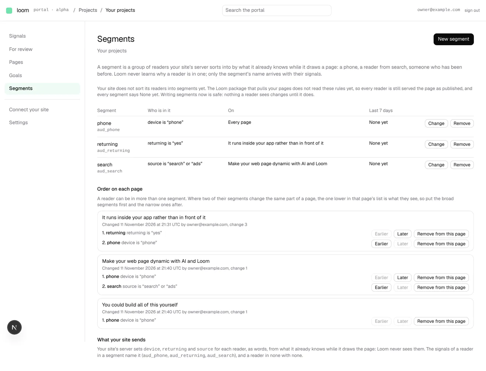
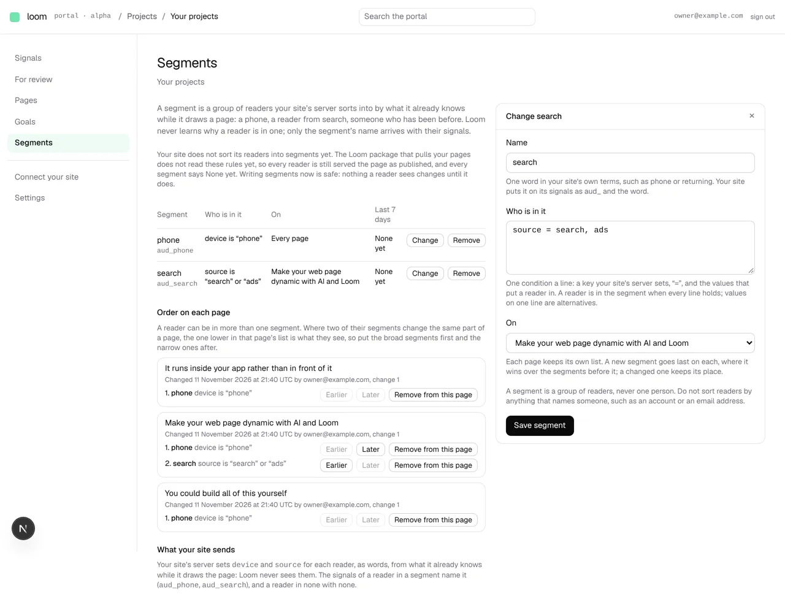
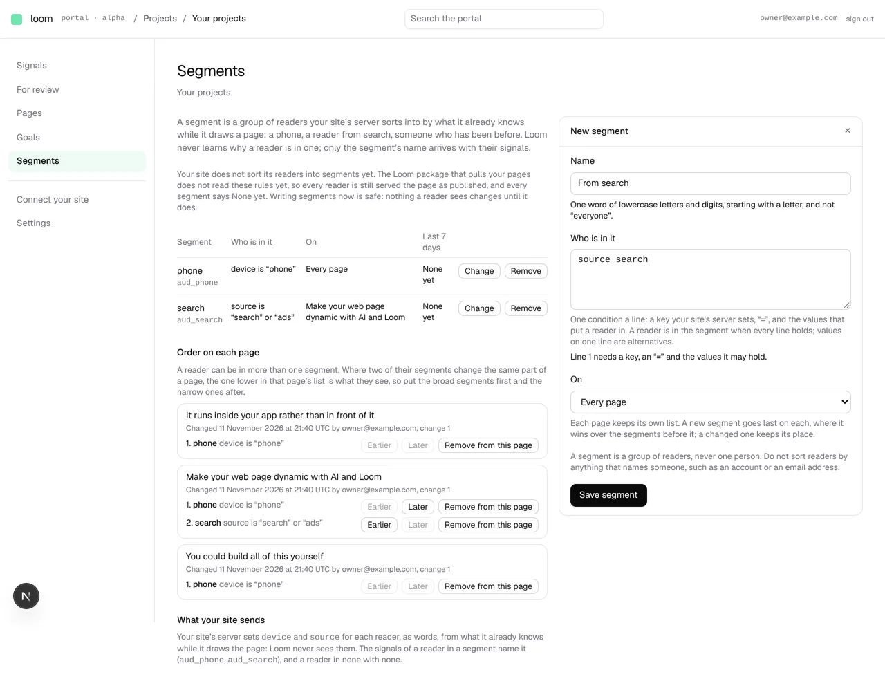

# Portal 9, piece 1: the Segments screen (11 November 2026)

## What shipped

*Segments* on every project's rail, after *Goals*: piece 1 of
[0371](../decisions/0371-a-segment-is-an-audience-the-site-sorts-its-readers-into-and-loom-keeps-only-its-rules-and-its-name.md),
written through 0376's audience store as the acceptance asked (no portal table).

- **The list.** Each segment by its word with its `aud_` id beneath, who is in
  it as a sentence (*source is “search” or “ads”*; per page where pages
  differ), the pages it is on (*Every page*, a page's name, or *2 of 3 pages*),
  and its page views over the last 7 days from the hourly counters by audience
  (0284, 0356): *None yet* while nothing was ever counted under it, never a
  nought.
- **Order on each page.** Each page's own list, with who changed it last and
  when, *Earlier* / *Later* / *Remove from this page*, and the rule the order
  carries said in words: the later of two segments wins a part both change
  (0359 clause 3).
- **What your site sends.** The keys its server must set and the ids its
  signals carry.
- **The drawer** (`?segment=new`, `?segment=<word>`): name, conditions one a
  line (`device = phone`), every page or one. A changed segment keeps its
  place in each page's order; a new one goes last. The form says a segment is
  a group, never one person.
- **A plain sentence that no site sorts readers yet**, because the door does
  not answer the rules and the pull client does not read them. Filed for
  `Loom daily build` in `FINDINGS.md` (11 November, evening), as 0371's
  consequences asked.
- The top bar's search finds *Segments* and *New segment*.

## Decisions taken, and why

- **A segment's name is its id's word** (`phone` → `aud_phone`), like
  `aud_everyone`. 0376's store keeps a rule's audience and conditions only;
  a separate display name needs a table, which the acceptance of 0371 ruled
  out for piece 1. It also means the screen and a batch can never disagree.
  Reversible: a name table can be added later without changing any id.
- **Writes are per page, against the revision read** (`expectedRevision`), and
  a reorder against the revision on the screen. 0376 has no write across
  pages, so a partial edit is said page by page rather than hidden.
- **Values are words.** The site's server sets each key to text; `true` is the
  word "true". Said on the screen.
- **Owner only**, as goals are: segments decide which form a reader is served.
- **At most ten segments** (0371's default).

No decision record added: these sit inside 0371 clauses 1, 3 and 7.1.

## Tests

- New: `segment.test.ts` (16), `editing.test.ts` (10), `rules.test.ts` (5,
  against 0376's memory store), `segment-views.test.ts` (3),
  `segment-form.test.tsx` (3). Changed: the rail and tab tests now include
  *Segments*.
- `pnpm verify` exits 0: the app suite is 481 files, 7,796 tests, all passing,
  and the prerender check finds 139 pages with nothing run together.
- Checked in a browser against a local Postgres with `db:push` run: saving
  wrote revision 2 on one page, *Earlier* wrote revision 3 with the order
  swapped, a refused form kept what was typed and said which line was wrong,
  and a phone-width page does not scroll sideways (the table scrolls inside).

## Against the wireframes

`docs/portal-wireframes.md` *6 · Segments* left the screen undesigned; 0371
designed it. Still missing from unit 9: piece 2 (the read door answers each
page's rules), piece 3 (a segment picker on *Signals*, *By page* and *Goals*),
and piece 4 (*only for: <segment>*), which waits on its own record and the
maintainer's answer on whether a segment's form goes through the Gate.

`pnpm db:push`: nothing new. 0376's two tables have been in
`scripts/db-push.ts` since #850 (10 November). A production database not
pushed since then shows *Segments cannot be read here* until it is.
