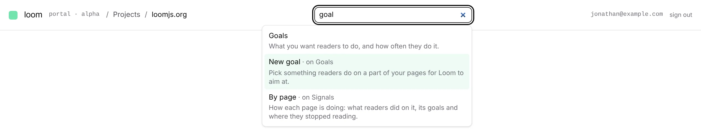
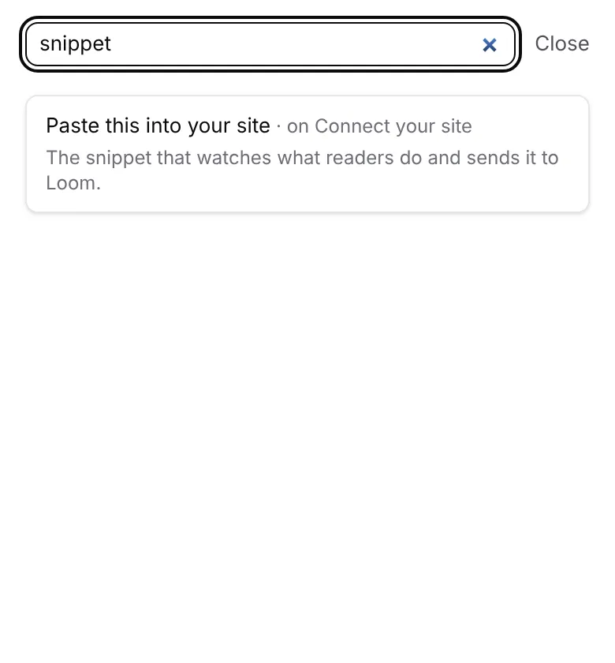

# Unit 8d: the top bar's search finds the portal's screens and features

**Lane:** `Loom portal` · **Date:** 11 November 2026 ·
**Branch:** `claude/project-thread-cvbsqt` ·
**Records:** none new ·
**Plan:** [`docs/portal.md`](../docs/portal.md) row 8d, *Blocked on the
maintainer* item 8 ·
**Target:** [`docs/portal-wireframes.md`](../docs/portal-wireframes.md)
*The chrome* (top bar: breadcrumb, search, avatar)

Claimed by a portal run at 2026-11-11 19:22 UTC (#862).

## Why this, and why now

No portal pull request or branch was claimed by a run still going, and no
maintainer comment was new since #861 merged at 17:31 UTC. The maintainer
answered what the search finds on 11 November (*"I would like it to be
intuitive. I think largely it should be for searching for portal features. Not
necessarily data."*), which left it free; it is the last unbuilt piece of 8d
bar the avatar (deliberately not built: the address is shown on every page,
0027), and it comes ahead of unit 9 in the agreed order.

## What shipped

- **`_lib/feature-search.ts`.** A hand-written index of nineteen places: every
  screen of a project in the rail's order (*Signals*, *For review*, *Pages*,
  *Goals*, *Connect your site*, *Settings*), the features inside them a person
  looks for by name (*Events*, *By page*, *Accepted*, *Turned down*, *New goal*,
  *Paste this into your site*, *The key*, *Publish your pages*, *Model key*,
  *Close this project*), and the portal's own (*Projects*, *New project*, *Is
  anybody trying to get in?*). Each has its name as its heading says it, the
  screen it is on, one sentence on what a person does there, and the other words
  a person might type (*anthropic*, *api key*, *install*, *rejected*,
  *delete*). `findFeatures` is pure: every word typed must be found (begun is
  enough), case, accents and a plural *s* do not count, the words that only make
  it a question (*where do I*) are dropped, a word in the name outranks one in
  the other words, which outrank the screen and the sentence, and a name typed
  out whole comes first. `searchAnswer` turns that into links for the project in
  the address, or, outside a project, counts a project's answers instead of
  drawing links with nowhere to go.
- **`_components/shell/feature-search.tsx`.** The box in the top bar, a
  combobox with a listbox under it: up to six answers, each its name, the
  screen it is on and its sentence; the arrow keys move, Enter opens the one
  marked (or the first), Escape empties the box, `/` reaches it from anywhere a
  person is not typing, and moving to another screen empties it. A query that
  names nothing says that data is each screen's own *Find*. On a phone the box
  is the word *Search* until pressed, then lies over the top bar with *Close*.
- **Anchors** on the sections the search leads to: `#snippet`, `#key`,
  `#publish` on *Connect your site*, `#model-key` and `#closing` on *Settings*,
  each with room for the fixed top bar above it.
- **The top bar on a phone.** It already overlapped at 390px before this
  change (the address ran over the project's name). The address is now cut
  short there, whole on a long press, and the breadcrumb clips rather than runs
  under it; on a wider screen nothing moves.

## Decisions taken, and why

- **An index, not a read.** The maintainer's word was features, not data, so
  the search asks nothing of the store and costs nothing on a request.
- **A project's features are counted outside a project.** Guessing which
  project a person meant would open a screen they did not ask for.
- **Every word narrows**, as *Events*' own *Find* does, so the two searches in
  the portal behave alike.

## Tests

- `_lib/feature-search.test.ts`: 35 tests (words compared, asking words
  dropped, names and other words found, narrowing, whole names first, nothing
  for nothing, no data, hrefs in and out of a project, the six-answer cap,
  every feature held against a screen the portal serves and an anchor that
  exists, each anchored feature named as its heading reads, the arrow keys).
- `_components/shell/feature-search.test.tsx`: 10 tests (closed until typed,
  links into the project, arrow keys and Enter, Enter with none marked, only
  the current answers where two share a screen, Escape, the no-answer
  sentence, outside a project, `/`, the phone's *Search* and *Close*).
- `topbar.test.tsx`: one new test (the search only once signed in).
- `pnpm verify`: exit 0; the app 477 files, 7,728 tests passed; the framework 6,848 passed (2 skipped); findings, reports and prerender checks clean.

## Toward the wireframe

*The chrome* now has the breadcrumb, the search and the labelled rail. The
avatar is left out on purpose (the address it would hide is shown by design,
0027). Still owed in the plan: unit 9's pieces 1 to 3 (the *Segments* screen
through 0376's store, the door answering the rules, a segment picker).
