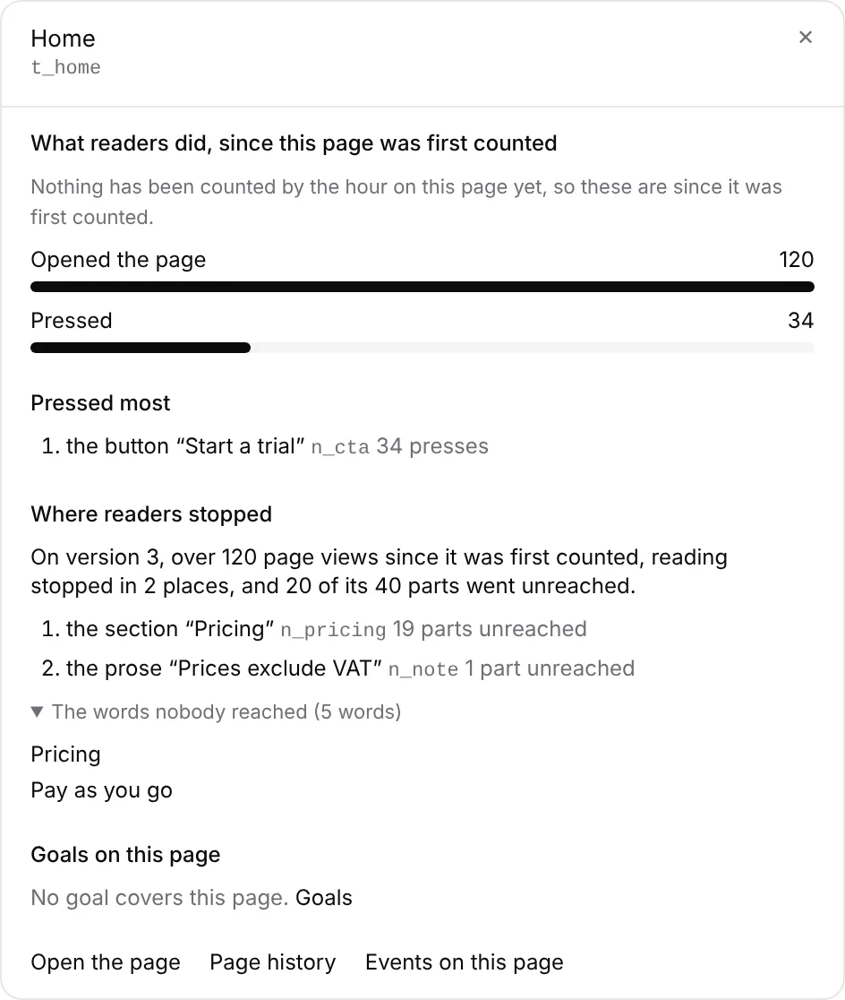

# Unit 8a: the *By page* drawer says where readers stopped

**Lane:** `Loom portal` · **Date:** 11 November 2026 ·
**Branch:** `claude/project-thread-k5ghw9` ·
**Records:** none new ·
**Plan:** [`docs/portal.md`](../docs/portal.md) row 8a, *Blocked on the
maintainer* item 9 ·
**Target:** [`docs/portal-wireframes.md`](../docs/portal-wireframes.md)
*By page*, the drawer for one page (*where readers stopped*)

Claimed by a portal run at 2026-11-11 17:19 UTC (#861).

## Why this, and why now

The maintainer merged #834 at 16:34 UTC today, which answered three items the
plan had parked on him: 0371 is Accepted (segments, pieces 1 to 3 free), the
top bar's search finds portal features, and the *By page* drawer gains *where
readers stopped* (his *"Sounds good."* on #849). No portal pull request or
branch was claimed by a run still going. Of the three, this is the one in the
earliest unit of the agreed order (8a, ahead of the chrome's search and unit
9), its input (`pageFrontierOf`, 0374) is on `main`, and it touches no table.

## What shipped

- **`_lib/page-stops.ts`.** `pageStopsOf` (pure) reads one version's
  `PageReading` through `pageFrontierOf`, `largestUnreachedIn` and
  `unreachedWordsIn` (0374) into what the drawer says: the version, page views,
  parts, parts unreached, how many places reading stopped, the three places
  that cost the most (named from the published tree, id beside), the words
  nobody reached, and the parts that were on a reader's screen without saying
  so. `readPageStops` asks the window for the published tree at its revision
  alone, as the proposer's evidence does, so every part named is a part of the
  page the site serves.
- **Refusals before readings.** Orphaned rows are checked first and draw
  nothing (a tree and a window that do not belong together read as a page
  everyone stopped at the top of). A page in more than one form (0263), one the
  site has not published, one no page view of this version has reached, and
  counters that do not answer each get a sentence rather than a nought.
- **The drawer.** *Where readers stopped* sits under *Pressed most*, as the
  wireframe orders it: one sentence (*On version 3, over 120 page views since
  it was first counted, reading stopped in 2 places, and 20 of its 40 parts went
  unreached.*), the costliest places in order, and *The words nobody reached
  (N words)* one click away. Parts not reporting are named apart, under it.
- **The read** runs beside the hourly read once a drawer is open, through the
  bounded tally store, so it is on the portal's budget and costs that part of
  the drawer alone when it does not answer.

## Decisions taken, and why

- **Since the version was first counted, not over the range.** The frontier
  needs the per-part counters, which keep no time; the hourly counters do not
  hold reach. The sentence says *since it was first counted* so it is not read
  as a figure for the range above it.
- **The published version only.** Adding versions together would mix two
  trees' parts; the version the site serves is the one a fix applies to.

## Tests

- `page-stops.test.ts`: 10 tests (a stop named with its cost and words, none
  unreached, not-reporting kept apart, unopened, two forms, orphaned refused
  first, unpublished, the window read for the published revision, counters
  that fail, word count).
- `by-page.test.tsx`: 23 tests, 9 new (the sentence and costliest order, the
  words one click away, not-reporting named apart, nothing unreached, and each
  of the five refusals).
- `pnpm verify`: 475 files, 7,673 tests passed; findings, reports and
  prerender checks clean.

## Toward the wireframe

The *By page* drawer now has every part the wireframe lists. Still owed
elsewhere in the plan: the top bar's search (portal features, item 8), and
unit 9's pieces 1 to 3 (Segments screen through 0376's store, the door
answering rules, a segment picker).
