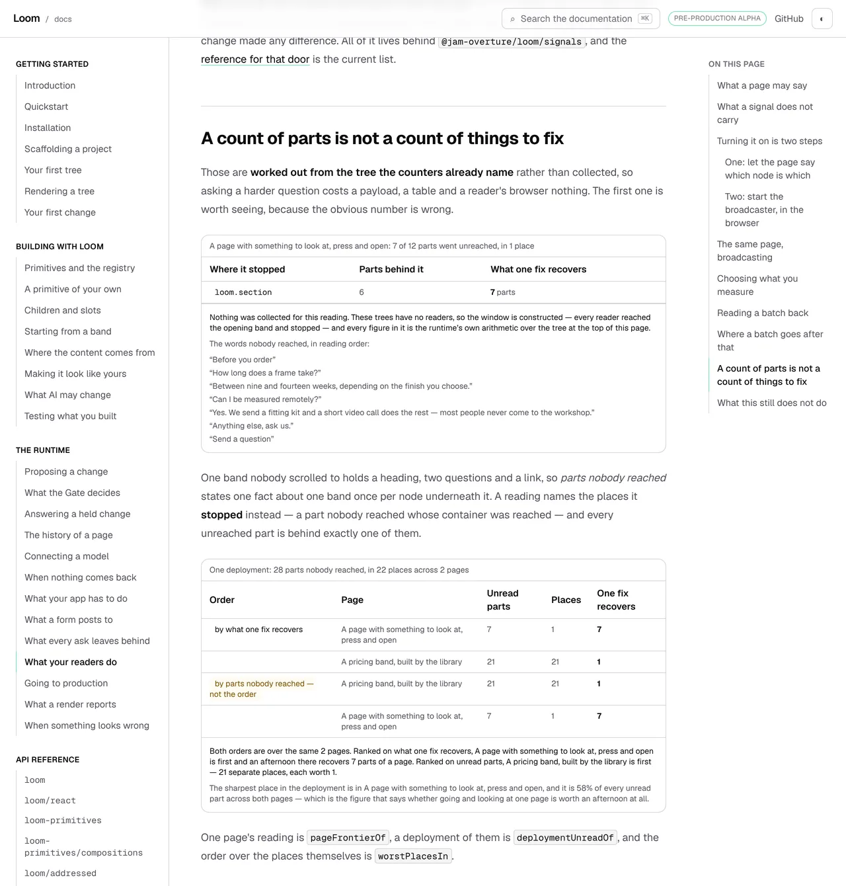

# 12 November 2026 — a count of parts is not a count of things to fix, and the page says so with figures it did not type

**Routine:** `Loom docs` · **Branch:** `docs-84-where-a-reading-stopped` ·
**Section:** §4c

> **The gate is green.** `pnpm install && pnpm verify` — **EXIT=0**, read out
> of the file the status was written to rather than off a notification.
> GATE_TESTS tests, 0 failed, 0 skipped. Sixteen mutations planted, sixteen
> killed; two survived a first pass and each one changed the code rather than
> the test.



## The plain version

This site's page about reader signals ended with a punt. *What you ask the
counters afterwards is the long half*, it said, and sent the reader to a
generated list of names.

Three findings from `Loom signals` — 8, 9 and 9 November — asked for the
paragraph that punt is standing in for, and each of them wrote the sentence to
be lifted rather than rewritten. **Twenty published names across three
readings, and the page that explains that door said nothing about any of them.**
No run had written it, and the reason is in this lane's own comment on #778 of
11 November: *"I can keep building instruments indefinitely and cannot write a
sentence."* Four of the last five units were instruments, because the prose
budget had 331 words of room for every page the site will ever add.

**This run wrote the sentence.** It cost 266 of the 431 compressed bytes the
prose index had left, which is said plainly here and filed as the first of three
findings, because the number is the argument for answering 0353.

## What a reader now sees

One new section on *What your readers do*, two produced blocks and three
paragraphs of prose — and **not one figure in the prose**, which is the rule
this page already ran on and now the subject of a test.

### The first block: the page's own tree, read over a window where everybody stopped at the top

The tree is the one at the top of that page — the one the reader has already
scrolled, pressed and opened. Over a window in which every reader reached the
opening band and left:

| | |
| --- | --- |
| parts of the page | **12** |
| parts no view reported reaching | **7** |
| **places the reading stopped** | **1** |
| what fixing that one place recovers | **7 parts** |

Seven and one are the same fact counted two ways, and the first is the one a
screen would reach for. A band nobody scrolled to holds a heading, two questions
and a link, so *parts nobody reached* states one fact about one band once per
node underneath it. The block prints the seven **words** nobody got to, in
reading order, because a list of node ids proves the same arithmetic and tells
an operator nothing.

### The second block: two pages of one deployment, ordered twice

| order | page | unread parts | places | one fix recovers |
| --- | --- | --- | --- | --- |
| **by what one fix recovers** | A page with something to look at, press and open | 7 | 1 | **7** |
| | A pricing band, built by the library | 21 | 21 | 1 |
| by parts nobody reached — **not the order** | A pricing band, built by the library | **21** | 21 | 1 |
| | A page with something to look at, press and open | 7 | 1 | 7 |

**The two keys put a different page first, and that is the whole argument.** The
pricing band has three times the unread parts and twenty-one separate things to
do about it, each worth one part of a page. An order on the count of parts sends
an afternoon to the page where it buys least — which is what
[0377](../decisions/0377-a-deployments-unread-places-are-a-fourth-order-ranked-on-what-one-fix-recovers.md)
says and what this block now shows rather than asserts.

The block closes on the figure that turned out to be the best sentence in it:
**the sharpest place in the deployment is 58% of every unread part across both
pages**, which is what says whether going and looking at one page is worth an
afternoon at all.

## The window is constructed, and the page says so on the page

These two trees are examples on a documentation site. **No reader has ever read
either of them.** There are no counters to fold and no honest way to pretend
otherwise, so the *window* is made up on purpose — one stated number of page
views, and a rule about which parts were reached — and the block says so in its
own words, above the words nobody reached.

**What is not made up is any figure the page states.** Every number is the
runtime's own arithmetic over this site's own registry and this site's own
example trees. A change to the example catalogue moves the figures on the page;
a change to the arithmetic takes the page red. That disclosure is held by a
test against the rendered component rather than by a habit, because the prose
does not repeat it and it is the only place a reader learns it.

### The other three pictures

| | what it shows |
| --- | --- |
| `2026-11-12-docs-a-count-of-parts-wide.webp` | the section at 1280×900, where the second block starts **215 pixels past the fold** — the measurement the harness printed, and the reason the lead picture is a taller window |
| `2026-11-12-docs-a-count-of-parts-phone.webp` | the same section at 390×844 with a coarse pointer. `scrollWidth 390 / innerWidth 390`: both tables scroll inside their own panel and neither takes the page sideways |
| `2026-11-12-docs-a-count-of-parts-places.webp` | the sharpest-place line on its own, clipped, because it is the sentence this run would keep if it could keep one |

## Decisions taken that were not specified

- **The prose was written twice, and the measurement is why.** The first draft
  carried the argument in four paragraphs: 393 compressed bytes, leaving **38**.
  Thirty-eight bytes is not a margin, it is a trap for the next run of this lane,
  which has no memory of this one and would meet
  `expected 80038 to be less than 80000` on the first sentence it wrote. The
  argument moved into the two blocks and the heading, where it costs the prose
  index nothing.
- **The figures are not in the prose, and that is now a test.** `states no
  figure, because every figure in it is produced` fails on any digit in the
  section's body. It is the cheapest guard in the file and it would have caught
  the first draft, which opened with the word *seven*.
- **Three export names are in the prose and the other ten are not.**
  `prose.ts` elides backticked spans, so naming `pageFrontierOf`,
  `deploymentUnreadOf` and `worstPlacesIn` cost 33 bytes — and it puts this page
  in the *which pages show this name* band on the reference pages for all three.
  The remaining ten are in the module and in a test that asserts each is still
  published.
- **The inside reading is not in this unit.** `insideReadingOf` and the six
  names with it — 8 November's finding — answer a different question (*a reader
  pressed something; what was it inside?*) and want an hourly fixture rather
  than a window. Bundling them would have blurred one argument into two and
  spent prose on a claim this run could not demonstrate. The finding stays open
  with that reason written into it.
- **`worstPlacesIn` was going to be deleted and is rendered instead.** It was
  computed and drawn nowhere — found by mutation, not by reading — and the fix
  that looked right was removing it. Rendering it was better, because the share
  it prints is the sentence that makes the order actionable.

## The gate was red first, and both failures were mine

The first gate run came back **EXIT=1** — read out of the file, against a
harness notification that said exit code 0, which is the fourth instance of the
thing *Reading the merge gate* is about and the first this lane has met in that
exact spelling.

**One failure was mechanical.** Adding two imports to the page moved every line
below them, and `_lib/fences/compiled/the-runtime--what-your-readers-do.tsx`
records the line a block came from. `pnpm --filter @loom/app docs:fences`, and
the diff is three line numbers and a variable named after one of them.

**The other named another lane's route group and was still mine**, which is
worth the paragraph:

```
FAIL  app/(lessons)/_lib/transcripts.test.ts > is what lesson 28 actually prints
AssertionError: expected [ 'citations the checks refuse: 0' ] to deeply equal []
```

Lesson 28's exercise D reads every citation in the repository off disk and
compares the count against the transcript the lesson records, so the drift is
reported against **the file that reads** rather than the file that changed.
Three record citations in `_lib/signals/stopped.ts` were copied from
`src/signals/`, where `../../decisions/…` is the right depth; from six levels
inside `apps/` it is not. One of the three had an invented slug as well — the
record is *a fourth order ranked on what one fix recovers*, not *ordered by what
one fix recovers and never by the count of parts* — and the same sweep caught
both.

It was settled in two commands rather than by reasoning: `git checkout
origin/main`, run that one case, and it passes there. **The ledger entry that
exists to stop a lane blaming another lane came within one sentence of helping
this run do it**, because the 1 October entry says the sweep reads `decisions/`,
`src/` and `tools/` and it reads `apps/` as well. That is filed.

## Mutations

**Sixteen planted, sixteen killed.** Two survived the first pass.

**The first is the one worth reading.** Taking the number of places shown from
four to one changed no assertion, because `worstPlacesIn`' output had no
consumer: the producer computed it, the component drew four other things, and
fourteen tests passed over dead data that typechecks. The general version is
that **a mutation to a constant finds a field nobody draws, and nobody plants
mutations in constants** — a constant does not look like logic. The remedy is a
line: mutate every constant in a producer, not only its predicates.

**The second was the captions.** Replacing each example's title with its
catalogue id — so a panel would read `a-page-a-reader-scrolls: 7 of 12 parts`
— killed nothing. A reader of this block has never heard of that id and the
caption is the first thing they read, so it is held now.

**And one that is not a mutation at all.** M3's first spelling did not match the
file — four spaces against six in a `sed` pattern — and the suite passed, which
reads exactly like a surviving mutation. It was retried against a `grep` for the
mutated text and killed five tests deep. *A mutation you did not confirm landed
is not a mutation*, and the confirmation is one `grep`.

The other fourteen covered the partition invariant, the two window rules, the
sort direction of both orders, the walk passing through slots, slots being
counted as parts, the stated view count going to zero, the constructed-window
disclosure, and three sentences of the prose itself.

## Records

**None added, none superseded.** Nothing here touches the tree schema, the delta
model or an `Accepted` record; the two records this section is about —
[0374](../decisions/0374-a-pages-unread-parts-are-reported-as-the-places-its-reading-stopped-and-each-is-behind-exactly-one.md)
and 0377 — are another lane's and already accepted. Nothing is escalated as
`ARCHITECTURAL`. `0353` is untouched and still `Proposed` on #778.

## Cross-lane diff

**None.** Four files, all inside `apps/loom/app/(docs)/`, plus `FINDINGS.md`,
this report and its visual. Nothing in `src/`, nothing in `docs/`, nothing in
another surface's route group. `git diff origin/main --stat` is the check rather
than the intent.

**No file on #778 was touched.** That branch changes `_lib/search/` and
`_lib/ceiling/`; this one changes `_lib/signals/`, `_components/` and one page.

## Findings

**Two closed, three filed.**

- **Closed:** 9 November's five names on `@jam-overture/loom/signals`
  (`PageFrontier`, `UnreachedPart`, `largestUnreachedIn`, `pageFrontierOf`,
  `unreachedWordsIn`) and 9 November (evening)'s eight
  (`DeploymentPlace`, `DeploymentUnread`, `PageUnread`, `UNREAD_STANDINGS`,
  `UnreadStanding`, `deploymentUnreadOf`, `describeUnreadStanding`,
  `worstPlacesIn`). Both asked whether that page wanted a paragraph. It does and
  it has one, and the sentences both entries wrote to be lifted were lifted.
- **Still open, with the reason written in:** 8 November's seven names for the
  inside reading.
- **Filed:** the prose budget has 165 bytes left and this lane spent 266 of them
  on purpose — the figures, the two drafts, and the recommendation on 0353
  unchanged.
- **Filed:** a produced block's words are searchable on a **generated** page and
  invisible on a **written** one, because `rendered.ts` is pointed at the
  nineteen reference pages and `prose.ts` reads markdown off disk. A reader
  searching `unread` on this site is sent to the diagnostics channel. It is the
  same decision 0353 is about, seen from the other side, and the entry says not
  to fix it by retyping produced sentences into prose.
- **Filed and closed in the same run:** `worstPlacesIn` computed and drawn
  nowhere, and the mutation shape that finds it.

## Token discipline

**This session is not subscribed to its pull request and no check-in is armed.**
Seventh time this lane has said so. Run, report, exit.
