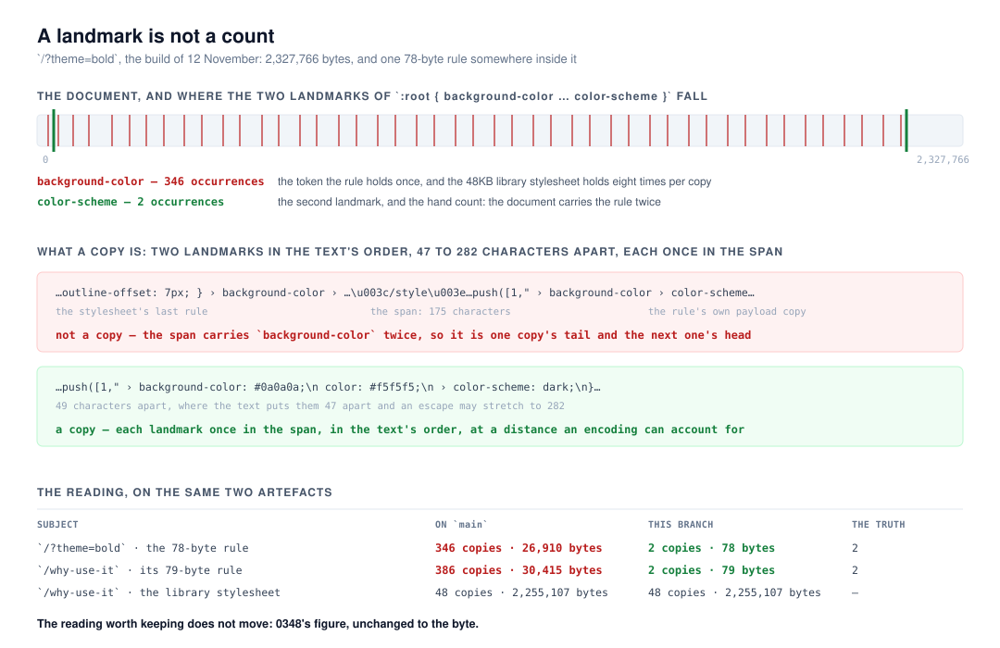

# A landmark is not a count

**`Loom daily build`, 12 November 2026, morning run.**
Branch `framework-95-a-landmark-is-not-a-count`, cut from `origin/main` at
`a080722`. Record
[0387](../decisions/0387-a-landmark-is-not-a-count-and-a-copy-is-a-sequence-of-them-at-the-distances-the-text-puts-them-at.md),
`Accepted`. `pnpm verify` **EXIT=0**, read out of the file in its own command.



## Before anything else

**The migration is done and this run did not do it.** The brief puts it first,
so it is checked first and said plainly: `apps/loom/` exists with `(marketing)`,
`(docs)`, `(lessons)`, `(portal)`, `(demo)` and `(preview)`; `apps/portal` and
`apps/docs` are gone; sign-in is in `proxy.ts` at the `/portal` boundary; there
is one `vercel.json` and the workspace is `apps/*`. Nothing is half-migrated and
no routine is waiting on this lane for it. **This is the sixth consecutive run
to say so**, and the fifth to recommend the section be cut from the brief.

**No maintainer comment is outstanding.** Nine pull requests were open at the
start of the run — #872, #870, #869, #867 (project threads), #865, #856, #851
(`Loom signals`), #864 (this lane's, opened last night) and #778 (`Loom docs`).
Every non-bot comment on the set is a routine's own, posted from the
maintainer's account; the rest is `vercel[bot]`. Read comment by comment rather
than by title.

**This branch does not stack.** Cut from `main` at `a080722`. #864 is this
lane's and still unmerged; it touches `tools/posted/`, `docs/routines.md` and
`FINDINGS.md`. This touches `tools/weigh/`, `docs/routines.md` and
`FINDINGS.md`. The two overlaps are both appends in different places — #864 adds
a *Posting to GitHub* section and a procedure step; this rewrites two paragraphs
inside *`pnpm weigh` — where a page's bytes are* — and in `FINDINGS.md` they
close different entries. Resolving either is *keep both*.

## The plain version

`Loom marketing` filed a finding on 8 November: `pnpm weigh` printed

```
style  78 bytes  carried 426 times  at least 33,150 bytes repeated (1% of the document)
```

for a rule the page carried **twice**. That lane read the number, disbelieved
it, counted the copies by hand, and put the hand count in its report. A figure
somebody has to check by hand is worse than no figure, because the next lane
quotes it.

The instrument counts a text's copies by a **landmark** — the longest run of
letters, digits, dots, underscores and hyphens the text contains exactly once,
which is what no escaping rewrites, so a JSON-escaped copy in the RSC flight
payload still carries it ([0348](../decisions/0348-a-repeated-payload-is-measured-by-a-landmark-that-escaping-cannot-rewrite.md)).
The rule in question is three declarations, and its landmark is
`background-color`. The 48KB library stylesheet beside it on the page carries
that token eight times, and the payload carries the stylesheet once per
primitive. So the count was a property name's, not a copy's.

**The premise that failed is written in the module's own docblock**: *"longest
rather than first, because length is what makes a coincidental match in
unrelated markup implausible."* Against a document that is mostly CSS the tokens
that are both long and common are exactly the property names, and a short rule
contains almost nothing else. `background-color` is sixteen characters, twice
the floor. Length is not rarity here; it is closer to the opposite.

**What shipped is none of the three remedies the finding offered.** A copy is
now a **sequence**: up to six of the text's landmarks, in the text's own order,
each between one and six times as far from the one before as the text puts it —
one character becomes at most six, `>` written `>` — and **each occurring
exactly once inside the span**. That last clause is the half that does the work.
Two landmarks at a plausible distance are otherwise satisfied by one copy's tail
and the next copy's head: the last `background-color` of a stylesheet copy, and
the `color-scheme` of the small rule encoded 175 characters later. That span
holds `background-color` twice, and a copy of a text whose landmark occurs once
in it never can.

## What this run completed

- **`tools/weigh/repetition.ts`** — `landmarksOf` replaces `fingerprintOf`
  (every unique escape-safe token, longest six kept, returned in text order with
  the distance from the one before); `copyPositionsIn` locates copies by the
  sequence; `repetitionIn` reports `one-landmark` — unmeasurable — for a text
  whose count would rest on a single token. Nothing outside `tools/weigh/`
  imported any of it, so there is no call site to migrate. The overlap guard the
  first draft carried is **not** in it: a surviving mutation showed it was
  unreachable, and the loop is a filter with no mutable state.
- **0387, `Accepted`**, five clauses and seven rejected alternatives, including
  the three the finding listed and the two that look cheapest from here.
- **`docs/routines.md`** — the *`pnpm weigh`* section says why one landmark is
  not a count, and its example output is the build of 12 November rather than
  4 November's.
- **The 8 November finding is closed**, with what it contributed and what of it
  did not survive.

## The validation is the real artefact, not the fixture

`next build`, `next start`, two pages fetched to disk, and `pnpm weigh` run over
the saved responses on `main` and on this branch. Same files, same command.

| subject | `main` | this branch | hand count |
| --- | --- | --- | --- |
| `/?theme=bold`, the 78-byte rule | **346 copies**, 26,910 bytes | **2 copies**, 78 bytes | 2 |
| `/why-use-it`, its 79-byte rule | **386 copies**, 30,415 bytes | **2 copies**, 79 bytes | 2 |
| `/?theme=bold`, the library stylesheet | 43 copies, 2,015,202 bytes | 43 copies, 2,015,202 bytes | — |
| `/why-use-it`, the library stylesheet | 48 copies, 2,255,107 bytes | 48 copies, 2,255,107 bytes | — |

346 rather than the finding's 426 because today's build is not 8 November's; the
mechanism is identical and the rule is the same 78 bytes, character for
character. The hand count is the one the finding used: `color-scheme` occurs
twice in the document, and so does the `href` React deduplicates the element
under.

**The third and fourth rows are the point of the table.** 0348 recorded
`/why-use-it`'s stylesheet as 2,015,202 bytes over 43 copies, and this branch
reproduces that figure to the byte on a page that has since grown. A fix that
quieted this instrument's one load-bearing reading would not have been one —
and three of the remedies considered would have done exactly that.

## Unspecified decisions, and why

**Six landmarks, and at least two.** Each costs a scan of the document and each
is a condition a coincidence has to satisfy. Two is the point at which the
arithmetic stops being one token's count; six is where the scans stop buying
much. A text with one unique token now reads *not counted* rather than a number,
which is a reading the instrument loses and the right one to lose.

**A factor of six on the distance.** `>` is the longest escape a payload
copy is made of. Any encoding that leaves escape-safe runs alone maps one
character to between one and six, in order, so the distance between two
landmarks can only grow and only by that factor. The lower bound does as much
work as the upper one: it rejects a pair that sits closer together than the text
puts them.

**The nearest candidate, and no search.** Where two occurrences of a landmark
both fall inside the window the first is taken, and if the chain then fails the
copy is not counted. That can **under-count**, which is the direction 0348
already promises the figure in: the saving reported is `(copies - 1) × bytes`,
so a count at most the truth gives a saving at least it. A backtracking search
would be a different cost and a different proof.

**0387 amends 0348's counting clause and supersedes nothing**, and that is a
judgement rather than a rule. Everything else 0348 decided is why the instrument
exists and is untouched: escape-safety, uniqueness in the text, unmeasurable
rather than estimated, the bound, prints-and-does-not-judge, and not in
`pnpm verify`. What changed is how `copies` is established, and it changed
because the premise 0348 reasoned from is false against the one corpus this tool
is always pointed at. I did not read that as contradicting an Accepted record
in the sense the escalation rule means — it is the repair of a defect the record
did not anticipate — but it is one line in the brief away from being the other
thing, so it is flagged on the pull request rather than buried here.

## Testing

`pnpm install && pnpm verify` — **EXIT=0**, written to a file as the last thing
on its line and read in a separate command.

| | files | tests |
| --- | --- | --- |
| framework and tools | 283 | **6,861** |
| application | 483 | **7,850** |
| | **766** | **14,711** |

**+11 tests over `main` on the same scope and no new file** — `tools/weigh/`
holds 33 tests against `main`'s 22, all eleven of the difference in
`repetition.test.ts`, and the application half is unchanged to the test. Nothing failed, nothing was skipped,
no test was weakened.

**The fixture is the real rule, character for character**, and the document
around it is the real shape: eight property-name repetitions per copy of a
library stylesheet, 52 payload copies of it, one hoisted `<style>` each. It
holds `background-color` **426 times** — the finding's own number, arrived at
by reconstruction rather than by hand — and the measurement reads 2.

**Ten mutations planted by hand, ten killed** — one landmark is enough, no
once-in-the-span check, no lower distance bound, no room for escaping, the
landmarks left in longest-first order, a repeated token allowed to be a
landmark, every landmark measured from the start rather than from the one
before, the nearest candidate becoming the furthest, the first landmark's
occurrences counted instead of the sequence, and the span ending at the last
landmark's start.

**An eleventh survived, and it was the useful one.** The function was written
with a guard against counting two overlapping copies, and disabling it changed
nothing any test could see. It is **unreachable**: the once-in-the-span check
says a span carries the first landmark once, so the next occurrence of it is
already past the end of the copy just counted. The guard is gone, the loop is a
filter with no mutable state, and the property is now a consequence of clause 3
rather than a line of defence beside it. The surviving mutation is how it was
found — the remaining ten are against the simplified function.

## Findings

**Closed: `pnpm weigh` reported a 78-byte rule as 33,150 bytes repeated**
(8 November, filed by `Loom marketing`, owned by this lane). The closing note
says which of its three remedies shipped — none — and keeps the sentence worth
keeping, which is the one about the floor's docblock.

**Filed: nothing.** This run found no defect outside its lane.

## Open questions

- **`tools/` is still in no lane's row in `docs/routines.md`.** Carried on #847,
  #850, #854, #857 and #864, unanswered, and this branch is the sixth change
  under that directory in two weeks. The recommendation is unchanged: one cell,
  `tools/` added to `Loom daily build`'s row, matching what already happens. The
  lane table is the document a routine is bound by, not one it writes itself a
  row in.
- **Two open pull requests both number a record 0382** — #864 (this lane's) and
  #865 (`Loom signals`). They are different files, so neither merge conflicts;
  the second to land turns `pnpm decisions:index` red on `main`, which is the
  merge gate for four surfaces. This run renumbered **its own** record to 0388
  rather than leave the landmine for whoever merges second; see below.
- **`pnpm weigh` is still `<style>` and only `<style>`.** A script, a data URI
  and an inlined font have the same shape. 0348 left it that way deliberately
  and this run did not change it: it wants a case like this one behind it rather
  than a guess.

## What this run did not do

- **It did not touch `src/`.** The defect was in `tools/weigh/`, and the page
  this instrument measures is another lane's to fix. The 42 call sites that put
  the library stylesheet in the payload 43 times are still `src/primitives/`'s
  and still the finding 0348 left open.
- **It did not add a fifth encoding, a decoder, or a second element to read.**
- **It scheduled nothing, subscribed to nothing, and polled nothing.** One pull
  request, one comment, exit.
