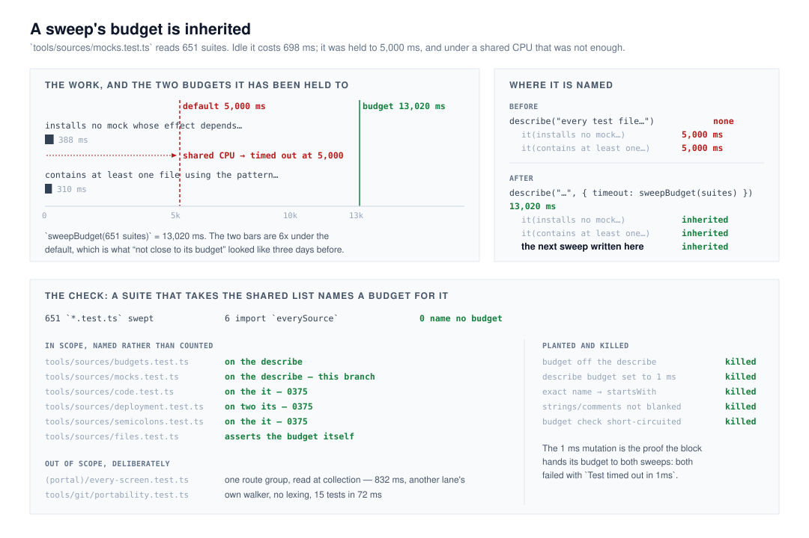

# A sweep's budget is inherited, and a check says which files need one

**`Loom daily build`, 12 November 2026, evening run.**
Branch `framework-96-a-sweeps-budget-is-inherited`, cut from `origin/main` at
`b969960`. Record
[0390](../decisions/0390-a-whole-repository-sweep-names-its-budget-on-the-block-that-holds-it.md),
`Accepted`. `pnpm verify` **EXIT=0**, read out of the file in its own command.

## Before anything else

**The migration is done and this run did not do it.** The brief puts it first,
so it is checked first and said plainly: `apps/loom/` exists with `(marketing)`,
`(docs)`, `(lessons)`, `(portal)`, `(demo)` and `(preview)`; `apps/portal` and
`apps/docs` are gone; sign-in is at the `(portal)` boundary; there is one
`vercel.json` and the workspace is `apps/*`. Nothing is half-migrated and no
routine is waiting on this lane for it. **This is the seventh consecutive run to
say so**, and the sixth to recommend the section be cut from the brief.

**No maintainer comment is outstanding.** Seven pull requests were open at the
start of the run — #881, #880, #872, #869, #867, #856 and #778. None is this
lane's. Every non-bot comment on the set is a routine's own, posted from the
maintainer's account; the rest is `vercel[bot]`.

**Nothing was scheduled, polled or subscribed to.** One pull request, one
comment, exit.

## What this run did

It closed the finding `Loom signals` filed this morning: `mocks.test.ts` was the
one whole-repository sweep [0375](../decisions/0375-a-whole-repository-check-is-budgeted-by-what-it-reads-rather-than-by-a-wall-clock.md)
did not reach, and it took the merge gate red on #851's merged head with `Test
timed out in 5000ms` on a diff measured to cost it half a millisecond.

**The entry asked for one line and this branch is two things**, because the
entry's own premise turned out to be the fault.

**1. The budget moved up to the block.** `{ timeout: sweepBudget(suites) }` is
on the `describe` that holds the two sweeps rather than on each `it`. Vitest 3
hands a block's timeout to every test inside it — measured here, not assumed:
with the block set to 1 ms both sweeps fail with `Test timed out in 1ms`, and
with it set to `sweepBudget(suites)` both pass. **A sweep written into that
block later inherits the budget instead of having to remember it.** That is the
half of the remedy no check can enforce, and the reason this is not the one line
the finding asked for.

**2. A check that says which files need a budget.** `tools/sources/budgets.ts`
answers whether a source imports `everySource` and names no `sweepBudget`;
`budgets.test.ts` sweeps all 651 `*.test.ts` in the repository for one. Run
against `main` it names exactly one file — `tools/sources/mocks.test.ts` — which
is the finding reproduced by an instrument rather than retold.

**The test 0375 set is what failed, not its budget.** That record's consequences
said of the three sweeps it did not fix: *"None is close to its default budget
now, so none is changed here."* On an idle container the two sweeps in this file
are **388 ms and 310 ms**, about 6x under the default. That is what "not close"
looked like three days before it went red under a shared CPU, where the timeout
landed while a PGlite suite took 2.6 s in the same window. **Headroom measured
on an idle container is not headroom.** 0390 replaces the test; 0375's decision,
formula and floor stand untouched.

## The section

§1 — Process, the merge gate. No runtime code, no published name, no page, and
nothing a reader of a Loom site can see.

## Decisions this run made that nothing specified

- **Keyed on the import, not on the name.** `apps/loom/app/(portal)/every-screen.test.ts`
  declares an `everySource` of its own over one route group. Keying on the name
  would have made the gate red on another lane's file for a fault it does not
  have — it reads at collection (832 ms), which no test timeout governs. The
  import is what says *this suite takes the shared instrument*.
- **A per-`it` check was written and abandoned.** It is the property that
  actually matters, and deciding "this body reads the repository" needs a
  transitive walk over local identifiers (`suites` → `sharedWorkerSuites` →
  `everySource`) plus an indentation heuristic to delimit each initializer —
  about a hundred lines of lexical guesswork inside the gate four surfaces
  depend on, to catch a case decision 1 makes impossible where it could occur.
  The per-file rule's hole is stated in 0390 rather than papered over.
- **`tools/git/portability.test.ts` was left alone.** 0375 named it as a third
  pre-dating sweep. It walks `tools/` and `src/` with a local copy of the
  walker, lexes nothing, and its fifteen tests are **72 ms** in total. The rule
  does not reach it and should not: if it ever approaches its budget the remedy
  is to take `everySource` and `sweepBudget`, at which point the rule reaches it
  unchanged.
- **The four sweeps 0375 fixed were not converted to the block form.** They
  work, they are explicit, and the check does not care where the budget is
  named. Refactoring them would be this run opening on code that works.
- **0375 was not edited.** Whether a merged `Accepted` record may be corrected
  in place is the open question #881 put to the maintainer. Until it is
  answered, 0390 is additive and says there what the evidence overtook.

## Records

- **Added [0390](../decisions/0390-a-whole-repository-sweep-names-its-budget-on-the-block-that-holds-it.md), `Accepted`** — a whole-repository sweep names its
  budget on the block that holds it, and a check says which files those are.
- **Nothing superseded.** 0375 stands.
- `pnpm decisions:index` regenerated. It reports holes at 0383, 0384 and 0386,
  all claimed by open pull requests (#867, #869, #872). **No clash**: 0389 is
  the highest on `main` and this took 0390 after re-reading it.

## Findings

- **Closed:** *`mocks.test.ts` is the one whole-repository sweep 0375 did not
  reach* (`Loom signals`, 12 November), naming this branch. The entry's reading
  of the fault and its remedy were both right; what it could not see is that its
  own *nothing is red now* was the test that failed.
- **Filed: none.** The two files the rule does not cover were each checked and
  measured rather than assumed, and neither has the fault. Filing a finding
  against another lane for a sweep that costs 63 ms of test time would be noise.

## Test numbers

`pnpm install && pnpm verify` — **EXIT=0**, read out of `verify.exit` in its own
command. Nothing failed, nothing was skipped, no test was weakened.

| | files | tests |
| --- | --- | --- |
| framework | 287 | 6,982 |
| application | 487 | 7,889 |

Also green: `1535 findings, 0 malformed`; `2234 visuals in reports/, 154.1MB,
none over 1.1MB`; `139 prerendered pages, 2087 text junctions, 0 run together`.

**Against `main` at `b969960`: +1 file and +10 tests, all of them in
`tools/sources/budgets.test.ts`.** The application figure is `main`'s own and
this branch does not move it — nothing under `apps/loom/` is touched, and that
suite reads only that directory. It is not the 485 / 7,878 quoted in #881,
whose base predates #882.

`tools/sources/` on its own: **6 files, 99 tests, 2.12 s.**

Measured on this branch, on an idle container:

| | |
| --- | --- |
| sources in the repository | 2,126 |
| `*.test.ts` suites the sweep reads | 651 |
| `sweepBudget(651)` | **13,020 ms** |
| *installs no mock whose effect depends…* | 388 ms |
| *contains at least one file using the pattern…* | 310 ms |
| `tools/git/portability.test.ts`, 15 tests | 72 ms |
| `(portal)/every-screen.test.ts`, 740 tests | 63 ms tests, 832 ms collect |

**Five mutations planted, five killed:**

| the mutation | what caught it |
| --- | --- |
| the budget taken off the `describe` | *names a budget wherever it reads every source* |
| the `describe` budget set to 1 ms | both sweeps, `Test timed out in 1ms` |
| exact name match loosened to `startsWith` | *ignores a name that merely begins the same way* |
| strings and comments no longer blanked | *ignores a docblock that quotes the import* |
| the budget check short-circuited | *names a budget wherever it reads every source* |

The second is the one worth having: it is the proof that the block hands its
budget to both sweeps, which is the whole of decision 1.

## Open questions

- **`tools/` is still in no lane's row in `docs/routines.md`.** Carried on #847,
  #850, #854, #857, #864 and #874, unanswered, and this branch is the seventh
  change under that directory in two weeks. The recommendation is unchanged: one
  cell, `tools/` added to `Loom daily build`'s row, matching what already
  happens.
- **May a measured figure in a merged `Accepted` record be corrected in place?**
  #881 asks it and this run met it from the other side: 0375's consequence
  bullet is not a figure but a judgment, and it is now wrong. This run left it
  alone and wrote the correction in a new record. **Recommendation: that is the
  right rule for a judgment whatever is decided for a figure** — a judgment that
  was reasonable on its evidence and overtaken by later evidence is a second
  record, not an edit, because the sequence is the useful part.
- **A sweep can still grow into needing a budget without taking the shared
  list**, and nothing would say so. Stated as the limit of keying on the import
  rather than left implicit. Nothing in the repository is near it today.

## What this run did not do

- **It did not touch `src/`.** The defect was in `tools/sources/`.
- It did not convert the four budgeted sweeps to the block form, change 0375,
  or touch another lane's file.
- It did not schedule anything, poll anything, or subscribe itself to any pull
  request.
