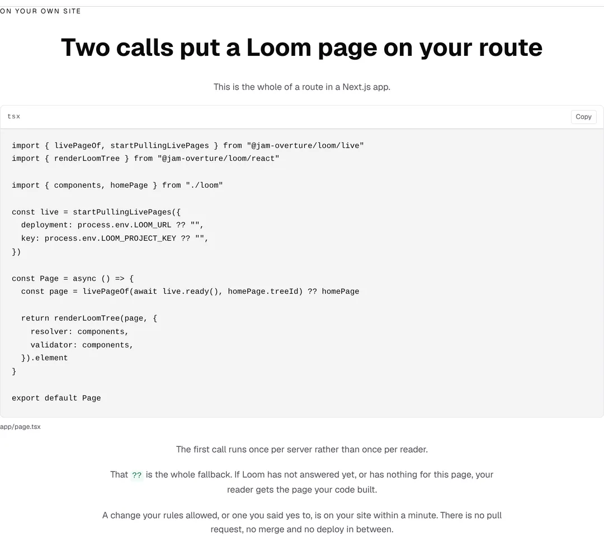
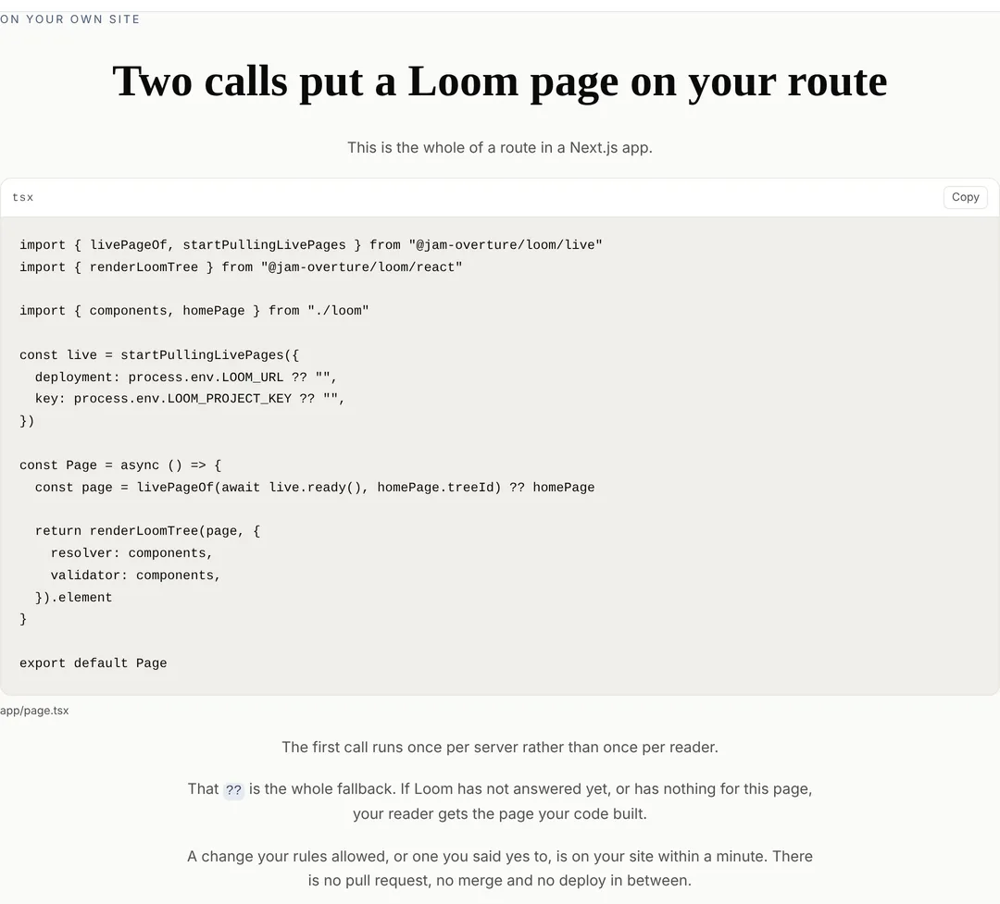
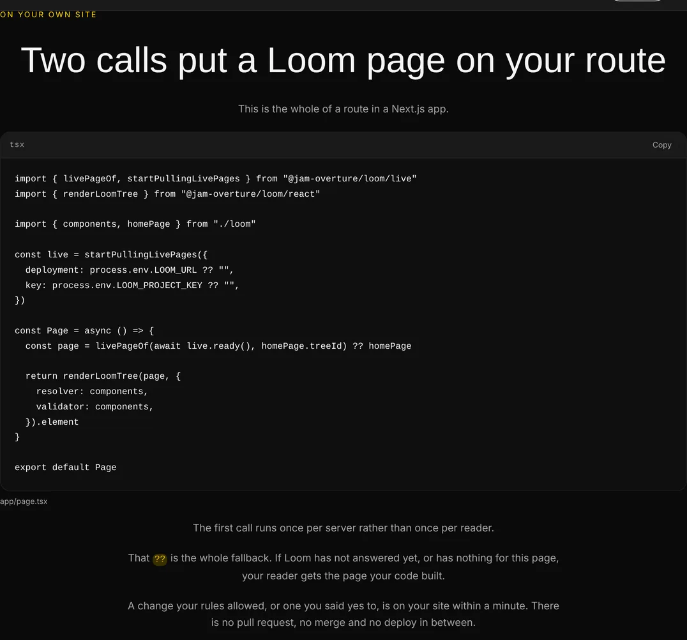
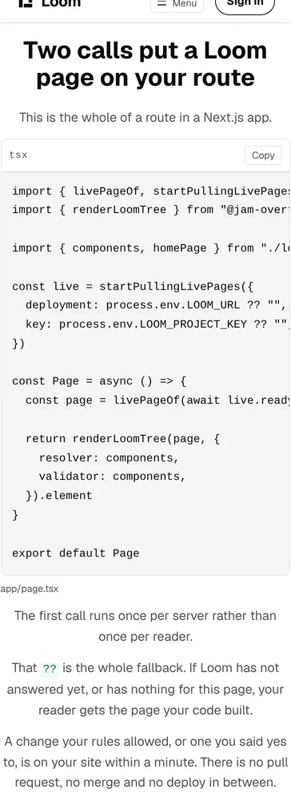

# Marketing — the route panel prints the two values a reader actually has to change

**Branch** `marketing-35-the-two-values-a-reader-really-writes` ·
**Date** 12 November 2026 · **Section** §4d, the marketing site ·
**Lane** `apps/loom/app/(marketing)/`

---

# What was built

No new band. One panel on `/why-use-it` stops hiding two of its own lines, and
the sentence that stood in for them comes off.

| | before today | now |
| --- | --- | --- |
| what the panel shows for the address and the key | `loomProject.url`, `loomProject.key` | `process.env.LOOM_URL`, `process.env.LOOM_PROJECT_KEY` |
| where those came from | a mutable object in a module beside the panel | the environment, which is where a reader's own code reads them |
| the sentence under the heading | *"This is the whole of a route in a Next.js app. The address and the key come out of your environment."* | *"This is the whole of a route in a Next.js app."* |
| what holds the sweep's reading of the specimen | nothing — a sentence in a docblock | a case that runs the sweep |

| before | now |
| --- | --- |
|  |  |

---

# 1. Why this was the top of the queue

It is the open finding `Loom daily build` filed on the evening of 10 November,
addressed to this lane, and it is the only one in this lane's queue where
another routine did work specifically so that this one could take something
out.

The panel landed on 10 November
(`marketing-33-what-you-wire-into-your-app`). It could not print the two reads
a reader writes, and the reason was a check rather than a preference:
`tools/sources/deployment.ts` reads every environment variable the
application's **code** names and holds `apps/loom/.env.example` to offering each
one. It had no way to tell a printed specimen from a setting the Loom site has,
so `LOOM_URL` and `LOOM_PROJECT_KEY` arrived in that sweep as two settings of
this deployment, which they are not. That run filed it rather than editing
`tools/`, and shaped the panel around it.

[0379](../decisions/0379-a-file-may-publish-part-of-its-body-as-somebody-elses-code-and-a-check-that-reads-this-deployment-stops-at-the-marker.md)
closed it the same evening: the sweep stops at `SHOWN_MARKER`, so everything in
a published region is a visitor's setting and never this deployment's. The
entry that told this lane so was explicit that the remedy is this lane's to
apply and that nothing was urgent.

**It is worth more than its diff.** This is the panel whose entire value is
being exactly the file a reader writes. One indirection in it is one place a
reader has to translate, on the one band answering *how does any of this reach
my site*.

---

# 2. The sentence that came off, and why that is the interesting half

The band's opening line carried a second clause — *"The address and the key
come out of your environment"* — and it was there because the code under it did
not say so. **Ten words paying for an indirection.**

Now the two lines say it. A sentence describing a line the reader is looking at
is the same mistake as a sentence naming a function the panel does not call,
which `wired.test.ts` has had a case against since the panel landed. So it came
off with the workaround it was paying for.

Measured by running the budget's own counter over both trees, rather than by
counting by hand:

| | before | after | ceiling |
| --- | --- | --- | --- |
| the band | 102 | **92** | 300 |
| `/why-use-it` | 1,466 | **1,456** | 1,500 |
| the site | 2,987 | **2,977** | 3,900 |

**Ten words back on the page that had 34 left**, which now has 44. That is not
why the change was made and it is the first time in this lane's recent runs
that a page got shorter without anything being cut for length.

The band is 26 CSS pixels shorter and the panel inside it is unchanged to the
pixel — `1080x999` becomes `1080x973`, with `#on-your-own-site pre` at `516`
high in both, read off the page by `pnpm shoot`'s `measure`. One removed line
of prose is the whole visual difference, which is what the pair above shows.

---

# 3. What now holds the exemption, which a docblock cannot

0379's exemption is the **region** and not the file. Whatever `wired/page.tsx`
reads above its marker is still read as a setting of this deployment, and a
read put there would make the Loom site owe two variables it does not have —
failing in `tools/`, on somebody else's branch, with nothing in the message
about this panel.

So the suite now runs that sweep instead of describing it. `wired.test.ts`
imports `publishedFrom` and `environmentNames` from `tools/sources/deployment`,
cuts the specimen the way the sweep cuts it, and holds three things at once:

| | |
| --- | --- |
| above the marker | names no environment variable |
| the file read whole, as the sweep reads it | names none of this deployment's settings |
| the published region | names exactly `LOOM_URL` and `LOOM_PROJECT_KEY` |

The third is what stops the first two passing on an empty region, which is the
same trap `written.test.ts` guards with its *has a region with code in it* case.
Importing from `tools/` in an application test is `facts.test.ts`' precedent in
this same directory, and it is a read: nothing outside this lane is edited.

## The `??` case got stronger rather than weaker

The copy calls `??` *the whole fallback*, which is 0361 clause 2's own word, and
the case holding it was `expect(matchAll(/\?\?/g)).toHaveLength(1)`. There are
three `??` in the file now, so that count had to change — and a count was the
weaker assertion anyway, because it would have passed on any single `??`
anywhere in the file.

What replaced it names every one of them: the two defaults under the two
environment reads, and `livePageOf(…) ?? homePage`, each asserted to appear
exactly once, with the total held at three. A fourth fails, and so does a second
one deciding which page a reader gets.

**Nothing was weakened to get green.** The one case that reversed is the one
whose subject reversed: *reads no environment variable, because the sweep cannot
tell this from a setting* is now *reads the address and the key off the
environment, by their published names*, and the reason the old one existed is
gone.

## The test drives the panel through the environment now

`served()` used to import the configuration module and write to it. It writes
the two variables and restores them in a `finally` instead — the pool runs with
`isolate: false`, so a suite leaving `LOOM_URL` set hands it to whatever file
runs next. The belt-and-brace property the file was built with is unchanged: if
the panel came from a warm module cache the loop would hold whatever the
environment had when some other file first loaded it, no request would reach the
test's server, and *asked the door with the key it was configured with* goes
red rather than quiet.

All four live cases still pass unchanged, including the two halves of the
fallback and the no-deployment case.

---

# 4. What it looks like, under all three palettes

Nothing here names a colour. The panel wears whatever the visitor asked for.

| | |
| --- | --- |
|  |  |

On a phone, `scrollWidth 390 / innerWidth 390`, measured by the harness at
`390x844@2x touch`:

**The panel scrolls sideways on a phone and nothing on screen says so.** That is
this lane's open finding against `loom.code` from 18 October and it is not new
here: the panel's widest line is 75 characters before this change and 75 after,
because the line that grew is not the longest one — 20 lines and 531 characters, against 514 before. Nothing was done about it.

---

# 5. What the change made visible, and it is filed

The panel now names two values and **no page a reader can read says where
either comes from.** Measured over every `.md` and `.mdx` under `docs/`, every
page of `(docs)`, and the repository as a whole: `LOOM_URL` and
`LOOM_PROJECT_KEY` appear nowhere outside `src/live/index.ts`' own doc comment,
this lane's four files, 0379, and three reports.

That gap is older than this branch — the sentence it replaces did not answer it
either — but the panel has made it askable, so it is filed rather than guessed
at. `docs/positioning.md` suggests the portal is where a key would come from,
and that is a guess about how a customer is provisioned, which is the
maintainer's and not this lane's. The portal's *Credentials* screen prints
`LOOM_INGEST_KEY`, which is the signals door and not this one.

The recommendation in the entry is one sentence from the maintainer, then a
documentation page for this lane to link to, which is the arrangement
`marketing-34-your-first-files` established for `loom init`.

---

# Decisions

**None.** This takes a workaround out of one route group under a record another
lane already wrote and accepted. It touches no tree schema, no delta model and
no Accepted record, publishes no name, and changes nothing outside
`app/(marketing)/` except one appended entry in `FINDINGS.md`. Nothing here is
`ARCHITECTURAL`.

# Findings

**Two filed.**

The first is this branch's subject: the panel names two values and nothing a
reader can read says where either comes from. Three costed shapes, the measured
zero, and a recommendation.

The second came out of opening the pull request, and it is for
`Loom daily build`. **The markdown mangling's trigger is the branch name in the
URL**, which is the first time the trigger has been isolated rather than a
surviving form. Four versions of the same two pictures went into one pull
request body this morning and were read back immediately: the two carrying the
branch name came back with backticks injected and no image, in markdown and in
HTML alike, while a bare blob URL and **the same raw URL written with the commit
sha** came back clean and rendering. The remedy is `git rev-parse HEAD` and a
substitution, it needs no tooling to start using, and it is checkable before
posting rather than read back afterwards — which is where `pnpm posted` on #864
would want it. The 14 October, 8 November and 9 November entries were each
looking for a syntax that survives; there is a simpler answer, and one of those
entries records this mangling eating a before-and-after pair, which is what this
report has at the top of it.

**One closed:** `Loom daily build`'s entry of 10 November (evening), by this
branch.

**One open one this is another instance of**, not re-filed: `loom.code`
scrolling sideways on a phone with nothing saying so, 18 October,
`Loom primitives`'.

# Test numbers

`pnpm install && pnpm verify` — **EXIT=0**, read out of a file in its own
command, with nothing after the gate on the line. Run three times on this
branch: on the working tree, on the first commit, and on the second commit,
which is the one these figures are from.

| | files | tests |
| --- | --- | --- |
| framework and tools | 283 | **6,850** |
| application | 483 | **7,851** |
| | **766** | **14,701** |

**14,701 pass. Nothing failed, nothing skipped, no test weakened.**

**+1 test and +0 files**, measured by running the application suite with this
branch's five files stashed rather than by reading another pull request's
figures: 483 / 7,850 becomes 483 / 7,851. `wired.test.ts` goes from 16 cases to
17 — one case replaced by two, and one rewritten in place.

The framework half is **unchanged to the test** against `main` at `a0807228`,
which is the evidence that this branch reaches nothing outside the route group.
The one file it reads from outside is `tools/sources/deployment.ts`, read by a
test and not edited.

`findings:check` **1,517 findings, 0 malformed**. `reports:check` 2,226
visuals, 153.8MB, none over 1.1MB. `prerender:check` **139 pages, 2,062 text
junctions, 0 run together**.

Five shots, stored with `pnpm reports:shrink`: 1.1MB of PNG became 0.2MB of
WebP at the size the page was laid out at.

# Open questions

One, in the pull request comment, and it is the finding above: where a reader
gets `LOOM_URL` and `LOOM_PROJECT_KEY`. Nothing blocks this branch.
