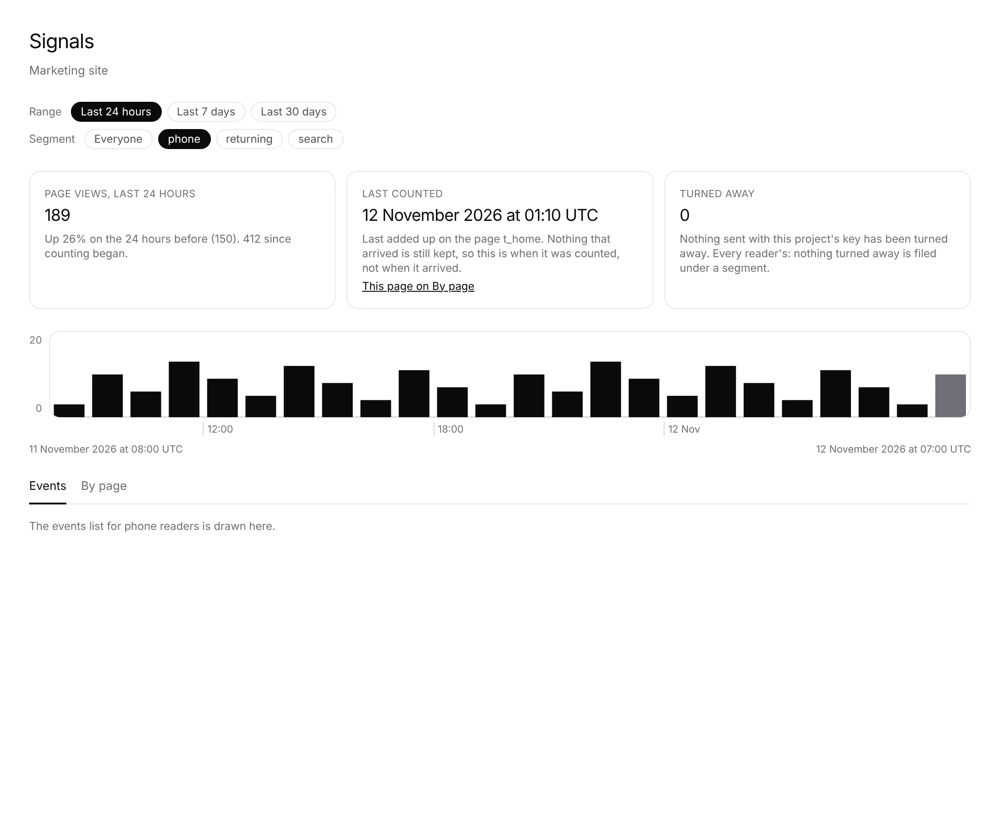
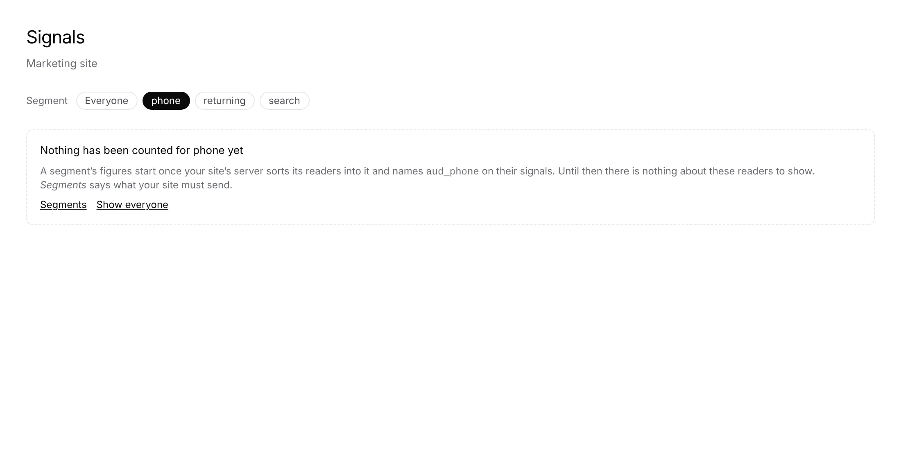

# Unit 9, piece 3: a segment picker on *Signals*, *By page* and *Goals*

**Lane:** `Loom portal` · **Date:** 12 November 2026 ·
**Branch:** `claude/project-thread-4zdhjx` ·
**Records:** none new ·
**Plan:** [`docs/portal.md`](../docs/portal.md) row 9 ·
**Target:** [`docs/portal-wireframes.md`](../docs/portal-wireframes.md)
*6 · Segments* (*a segment filter on Signals*), under
[0371](../decisions/0371-a-segment-is-an-audience-the-site-sorts-its-readers-into-and-loom-keeps-only-its-rules-and-its-name.md)
clauses 6 and 7.3

Claimed by a portal run at 2026-11-12 01:22 UTC (#868).

## Why this, and why now

No portal pull request or branch was claimed by a run still going: the newest
portal work, #866 (piece 2), merged at 23:28 UTC yesterday. The plan's row 9
named piece 3 as next, its inputs (piece 1's rules store, the counters by
audience of 0284 and 0356) are on `main`, and no maintainer comment on an open
pull request outranks it. Piece 4 waits on its own record and the maintainer's
answer on the Gate.

## What shipped

- **`_lib/segments/segment-pick.ts`** (pure). The address's `?segment=` read as
  a segment's word (the same schema *Segments* writes with, so `everyone`,
  `aud_phone` and two words are all *Everyone*), the audience the counters are
  read for, and the picker's chips: *Everyone* first, then each segment
  alphabetically, none at all for a project with no segment.
- **`readSegmentWords`** in `_lib/segments/rules.ts`: the words of every
  audience any page's rules name, `undefined` where the rules cannot be read.
- **`_components/segment-picker.tsx`.** The picker (*Segment*, a row of chips
  like the range's), a line where the segments could not be read, and the
  notice drawn in place of a segment's figures while nothing was ever counted
  under it, with the way to *Segments* and back to *Everyone*.
- **Signals.** The picker sits under the range picker for both tabs and every
  link on them keeps it (tabs, range, kind and page filters, search, pager,
  drawer). With a segment, page views, their hours, the primary goal's figure
  and the last arrival are its audience's alone; *Events* lists the deliveries
  filed under it; *By page* reads its rows, the drawer's range and where readers
  stopped for it. `readGoalCounters` and `readPageStops` take the audience.
- **Goals.** The picker sits above the list; each goal's 7 days and what it
  counted since counting began are read for the segment, and the footnote says
  whose readers they are.

## Decisions taken, and why

- **The address carries the word, not the id.** A segment's audience is
  `aud_` and its word (piece 1), so the word is enough and reads as the screen
  names it. A word the rules no longer name still narrows to what was counted
  under it and is offered beside the others, so the screen never shows one
  segment's figures under another chip.
- **A segment nothing was counted under draws no figures.** 0371's
  consequences say a segment's figures are shown only once it has page views of
  its own; until a site sorts its readers that is every segment, and a row of
  noughts would read as *nobody in it*. Signals decides by the segment's page
  views (none ever counted), Goals by the same.
- **The last arrival, for a segment, is its last counted page view.** The
  journal's newest delivery could be any reader's, so it is not read; the
  segment's own page-view rows say when it last moved, which the figure already
  words as *last counted*.
- **What stays the project's, and says so.** What the door turned away is
  never filed under an audience, so that figure keeps its count and adds that it
  is every reader's. The changes waiting and shipped on *Goals* and the badge on
  *By page* stay the project's, since no change is for one segment until piece
  4. *New goal* always reads every reader: a goal is the project's.
- **No new table, no `pnpm db:push`, no record.** Everything is read through
  stores already on `main`; 0371 settles the behaviour.

## Tests

- `segment-pick.test.ts` (new): 6 tests (the word read and tidied, everyone
  for the rest, the audience, chips in order with the one shown, none for no
  segment, the shown one kept when the rules drop it or cannot be read).
- `rules.test.ts`: 1 new (the words read once each, alphabetically; none where
  the rules cannot be read).
- `goal-counters.test.ts`: 1 new (both reads narrowed to the audience).
- `page-stops.test.ts`: 1 new (the window read for the audience).
- `events.test.ts`: 2 new (the filter by segment, the address keeping it).
- `signals-frame.test.tsx`: 3 new (picker with tabs keeping the segment and
  the turned-away note; no picker with no segment, the line when unreadable;
  the uncounted notice in place of figures and tabs).
- `by-page.test.tsx`: 1 new (the drawer's links keep the segment).
- `pnpm verify` exit 0: the package 283 files, 6,848 tests passed (2
  skipped); the app 482 files, 7,827 tests passed; findings, reports and
  prerender checks clean. The notice's body was wrapped in one span after the
  screenshot showed it broken across lines; the frame tests were re-run on it.
- Screenshots are the frame rendered from its component with sample figures
  and the portal's stylesheet, not the live deployment.

## Toward the wireframe

*6 · Segments* now has *Segments*, the rules at the door and the segment filter.
Still missing from it: the split of before and after on *Page history* and
*only for: <segment>* on a change, which are piece 4 and wait on its own record
and the maintainer's answer on whether a segment's form is judged by the Gate.
Nothing a reader sees changes until `Loom daily build` closes its half of the
finding of 11 November evening (the pull client sorting readers and naming the
segment on their signals).
