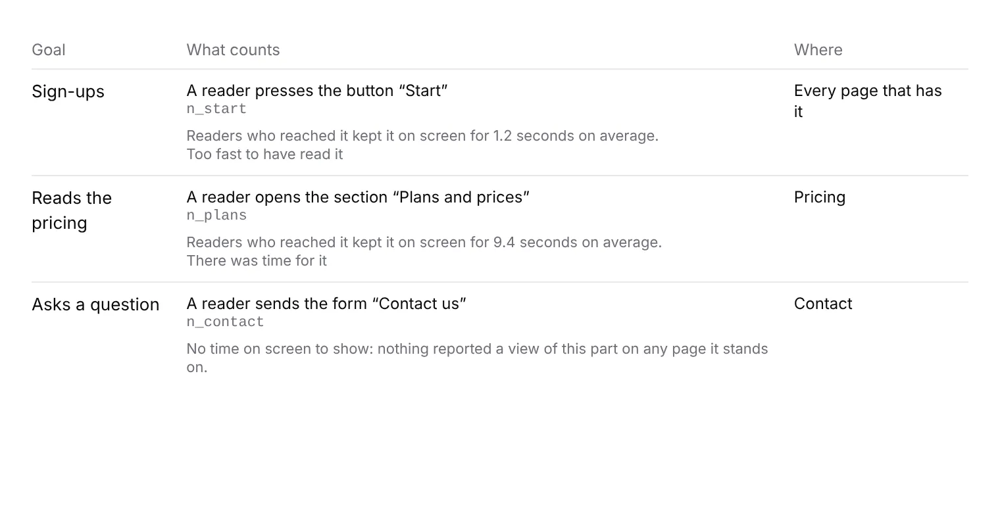

# Portal 8b: each goal says how long readers stay on its part

**Run:** portal, 12 November 2026, from 17:19 UTC · **Pull request:** #882 ·
**Unit:** 8b, *Goals*; closes the signals finding of 12 November (*Stays on it
is answerable now*)

## What shipped

Under what each goal counts on *Goals*, a line says how long readers who
reached its part kept it on screen:

- *Readers who reached it kept it on screen for 4.5 seconds on average*, the
  time the typical page view that reached the part had it there, pooled across
  the pages the goal covers with each page's readers on its own door's scale
  (`partPaceOf`, [0381](../decisions/0381-a-parts-pace-across-pages-is-one-pooled-quotient-and-a-goals-part-is-a-reading-of-its-own.md)).
- Beneath it, the plain verdict on that time against what the part's words
  take, in the words the portal already uses for a pace (*Too fast to have read
  it*, *There was time for it*, *Is this where people get stuck?*), with the
  meaning on hover. A verdict that cannot be claimed (*unknown*) is left out.
- A part with no time says why, in 0381's own sentences (*No time on screen to
  show: nothing reported a view of this part on any page it stands on*), never
  a nought.
- Counters that did not answer say so on that line alone.

A segment (`?segment=`) narrows it with the rest of the list, because the
counters are read once, as one window, with the segment's audience.

## Decisions taken, and why

- **A figure beside the goal, not the *Stays on it* goal kind.** The
  wireframe's *Stays on it* counts readers who stayed past a threshold.
  [0350](../decisions/0350-a-project-sets-goals-from-signals-already-collected-and-one-of-them-is-primary.md)
  (Accepted) declined to offer it measured from an average, because an
  average above ten seconds can be one open tab. This run does not reopen
  that: it shows the average as what it is. Counting readers past a threshold
  from the 30-day events (0349) would be a new goal kind and needs its own
  record first.
- **On the version each page serves now.** `partPaceOf` takes page readings,
  and a reading needs the tree of its revision. The portal holds only the
  trees the site publishes now, so older revisions' counters are left out
  rather than joined to the wrong tree. The footnote says so.
- **One window read instead of two.** The page used to read page views and
  tallies separately; it now reads them with `readReaderWindow`, which also
  gives what `windowReadingsOf` needs. A failed read now costs both the
  since-counting-began figure and the time on screen, which were always read
  from the same counters.

No decision record added. No table, no column, no `pnpm db:push`.

## Tests

- `goal-stay.test.ts`: 5 tests (the time and its verdict, only the named
  pages, pooled across every page with the part, *unread*, *unplaced*).
- `time-on-it.test.tsx`: 4 tests (verdict shown, no verdict for *unknown*, a
  silence said, counters unreadable).
- `pnpm verify`: see the pull request description for the numbers on the
  merged head.
- The screenshot is the row's component rendered with sample figures and the
  portal's stylesheet, not the live deployment.

## Toward the wireframe

*3 · Goals* now has every figure its data can answer. Still missing: the
*Stays on it* kind itself (readers past a threshold), which needs a record on
counting it from the kept events and a threshold the maintainer picks.
