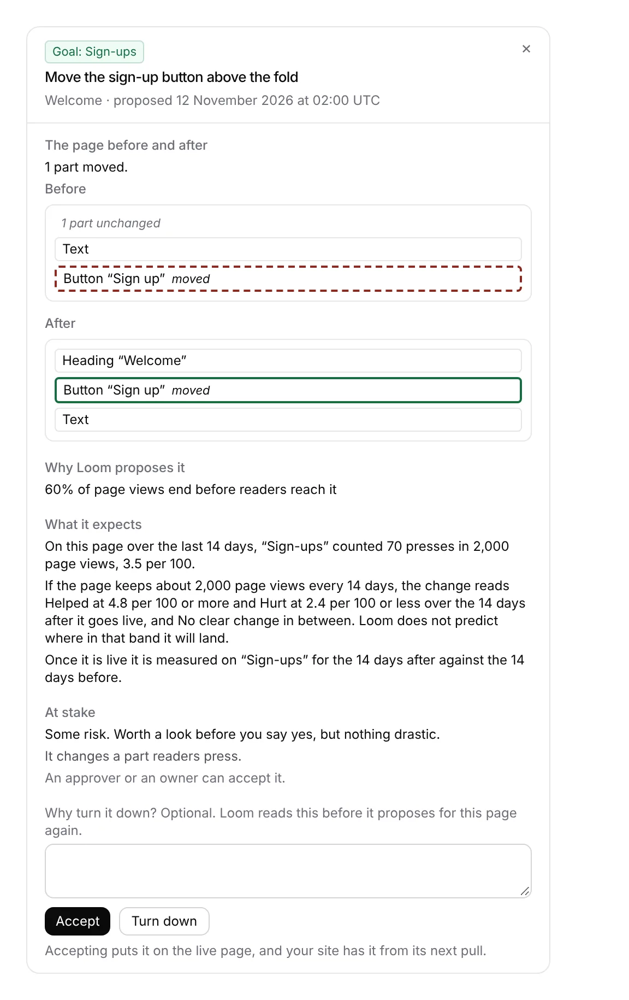

# Portal 8b: *What it expects* reads the goal's own figures

**Run:** portal, 12 November 2026, from 03:18 UTC · **Pull request:** #871 ·
**Unit:** 8b, *For review*'s last owed piece

## What shipped

The drawer for a change waiting on *For review* used to say only that Loom
predicts no effect yet and how the change will be measured. It now says, from
the page's own hourly counters:

- **Where the goal stands on the page now**: *On this page over the last 14
  days, “Sign-ups” counted 70 presses in 2,000 page views, 3.5 per 100.* Where
  counting began inside the 14 days, it says *since counting began on …* and
  the page views are scaled to 14 days for the next line.
- **The band a result has to leave at that traffic**: *If the page keeps about
  2,000 page views every 14 days, the change reads Helped at 4.8 per 100 or
  more and Hurt at 2.4 per 100 or less over the 14 days after it goes live, and
  No clear change in between. Loom does not predict where in that band it will
  land.* An edge no result could reach is said (*No fall could read Hurt at
  that traffic* on a page where nobody did it), and an edge that would print as
  the rate now gets a second decimal.
- **Why there is no band**, where there is none: a page too quiet for 1,000
  page views a side would read *Too early*; a figure that is not a share of
  page views cannot be weighed by the agreed test.
- **How it is measured**, as before.

A goal removed since, goals that did not answer, or counters that did not
answer cost those lines alone, and the drawer still says how the change is
measured.

## Decisions taken, and why

- **No predicted effect.** The wireframe asks for *a predicted range on its
  goal*, and `docs/portal.md` has always listed it as *new data, and a choice
  of how to predict it*. That choice is the maintainer's, and the rules with
  teeth say no screen renders invented data. What the counters can say without
  inventing anything is where the goal stands and what the fixed verdict rules
  would need to see, so that is what shipped, and the drawer says in words that
  it is not a prediction.
- **The edges come from `verdictOf` itself.** `edgesOf` halves its way to the
  first after-side count that reads *Helped* and the last that reads *Hurt*
  against a before side of the page's current figures, rather than restating
  the two-proportion test's arithmetic. The band cannot drift from the result
  the change is later given. The tests check it against every count by brute
  force for five before sides, including nobody and everybody doing it.
- **The last 14 days now stand in for the 14 days before it goes live.** The
  real before side is not known until *Accept*; the nearest the counters hold
  is the same length of time ending now, and the after side is assumed to get
  as many page views. The words say *if the page keeps about N page views*.
- **One read, through `readGoalCounters`**, narrowed to the page and the
  goal's part, the read every other goal figure goes through, so this screen
  cannot disagree with the others about where counting began.

No decision record: nothing here chooses how to predict, and every rule used
is already settled (0350, 0356, the 5 November measuring rules).

## Tests

- `expectation.test.ts`: 21 tests (the range, the edges against every count,
  the reading over the 14 days and clipped, no band when too quiet or not a
  share, and the words).
- `change-drawer.test.tsx`: 10 tests, two new (the figures and band shown and
  no prediction; unreadable and removed goals).
- `pnpm verify`: see the pull request description for the run's numbers.
- The screenshot is the drawer rendered from its component with sample
  figures and the portal's stylesheet, not the live deployment.

## Toward the wireframe

*2 · For review* is complete except **the predicted effect itself**, which
waits on the maintainer's choice of how to predict one. Two ways seemed
reasonable to the run: Loom's own record of past verdicts on the project's
goals (honest, empty until changes have been measured), or a range the model
gives with each proposal (available now, a model's guess). The recommendation
is the first, shown as *Changes like this on your pages: 2 helped, 1 no clear
change*, once there is a record to show.
