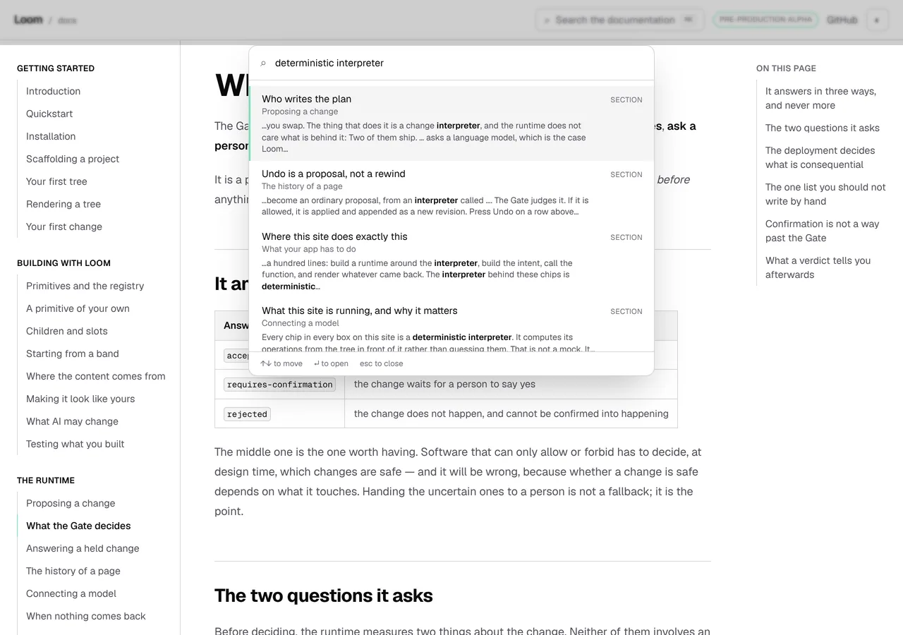
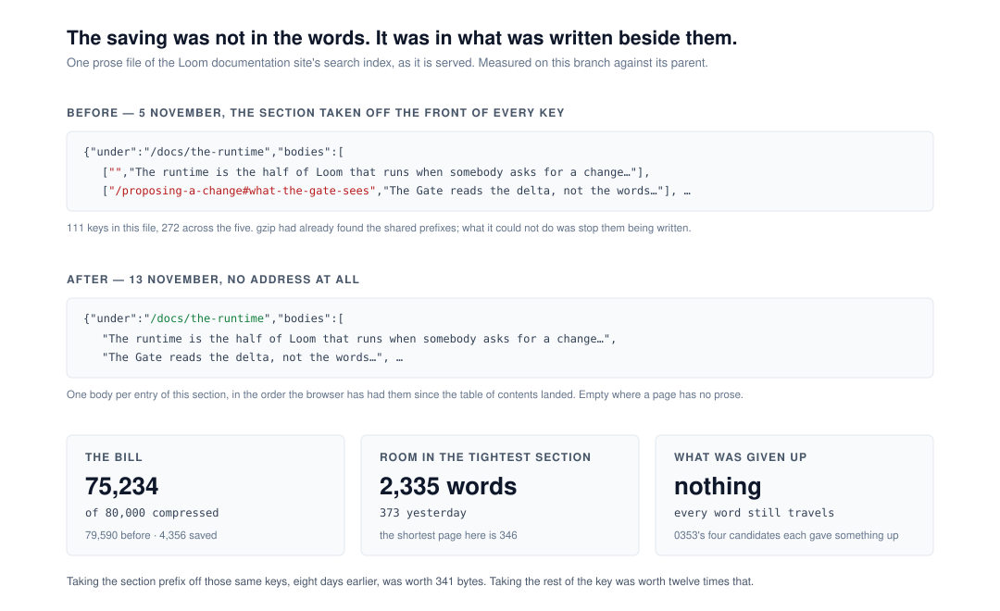

# 13 November 2026 — the saving was not in the words, and the site has room for seven more pages

**Routine:** `Loom docs` · **Branch:** `docs-78-no-room-for-another-page` ·
**Section:** §4c

> **The gate is green.** `pnpm install && pnpm verify` — **EXIT=0**, read out of
> the file the status was written to rather than off the harness notification
> that reported the same thing. 286 files / **6,972** framework tests and
> 489 files / **7,923** application tests, **14,895** in all, 0 failed,
> 0 skipped. **Sixteen mutations planted, sixteen killed**; six survived a
> first pass, two wanted a test and four wanted a deletion.



## The plain version

For nine days this site could not take another page. Not *should not* — the
gate went red. The search box sends a reader the sentences of every page on the
site, there is a ceiling of 80,000 compressed bytes on that, and the site was
spending 79,590 of it. What was left was about **373 words of prose for every
page this site will ever add**. The shortest page already written here is 346.

That question went to the maintainer as [0353](../decisions/0353-the-search-box-sends-a-reader-the-sentences-of-their-own-section-and-the-rest-of-the-site-by-title.md),
`Proposed`, with four candidates and a recommendation. It has been waiting
eight days, and five findings are waiting behind it.

**It did not need answering.** A prose file was writing an address beside every
body — the address of an entry the browser was already holding, in a list it had
been searching since before the words arrived. It does not write them any more:
the file says once what its bodies are `under`, and then it says the words, in
the order those entries are already sitting in.

```
prose  79,590 → 75,234 gzipped of 80,000     saved 4,356
raw   254,057 → 240,860 of 260,000           saved 13,197
room      373 → 2,335 words in the tightest section
```

**Nothing was given up.** Every word of this site still travels to every
reader. The four candidates in 0353 each gave something up, and the five
savings priced in `savings.ts` each took words out of the sentence a result
quotes back. This one took out something nobody reads.



## Why nine reports missed it

This is the part worth more than the bytes.

`savings.ts` on this branch prices five ways to make the stored **words**
smaller and refuses all five, run rather than argued — each candidate's words go
into a real index and a real query comes back with the excerpt it would have
shown, and every one of them damages it. 0353's four candidates are four ways to
send **fewer words**. Nine reports carried the question.

Every one of those is a saving over the text. **The text was never where the
slack was**: 272 addresses, 4,005 compressed bytes of them, in a file whose
reader already holds every one.

And this lane had its hand on the whole thing eight days ago. On 5 November a
prose file stopped writing the *section* at the front of each key and kept the
rest of the key — 341 bytes, and `model.ts`'s own docblock called it *small,
which is stated here rather than left to be inferred from the absence of a
number*. The rest of the key was worth **4,356**, twelve times as much. The
sentence that run was working from was *the browser knows the section*. The true
one was *the browser has the list*.

**A table of candidates is a table of the places somebody looked.** Five priced
savings and four lettered alternatives read as a search that had been
exhaustive. What they were was thorough inside one axis.

## What a reader gets, and what they now risk

The picture at the top is the check that matters, taken against a real server
rather than a test double: four results, each quoting a sentence from a
different page, each with the reader's own words marked in it. Those sentences
arrived in a file with no addresses in it and found their way back onto the
right four titles.

The same query on a phone is
`2026-11-13-docs-the-saving-that-was-not-in-the-words-phone-found.webp`:
`scrollWidth 390 / innerWidth 390`, the dialog inside the viewport, and the
excerpts wrapping rather than taking the page sideways.

What the shape costs is a rule instead of a lookup. A keyed file could be read
against an index it disagreed with and quietly drop whatever did not match. A
positional one cannot: one body too few and every body after the gap is on the
wrong page. So `withProse` counts the entries a file names and **refuses a file
that does not carry exactly that many bodies**.

**It threw, at first, and the component's own suite answered within one run** —
33 of its 41 cases failed with `<body><div /></body>`. A reader who had been
searching titles since the contents file landed would have lost those too,
because one of the four files that arrive afterwards did not line up. It
refuses the file and returns the index as it arrived now; the reader loses that
section's sentence band and keeps everything they already had. That argument
was not reasoned to — it was a fixture that had not been updated, failing the
way the real thing would fail.

## Decisions taken that were not specified

- **Positional rather than an index per body.** Writing `[0, "…"]` instead of
  the href was measured too: it saves 3,402 against positional's 4,356, and it
  keeps a lookup. Front-coding the keys the way the names file was front-coded
  on 12 November saves **769** — gzip had already found the shared prefixes;
  what it could not do was stop them being written. The three were measured
  before any of them was built.
- **`under` survives the parse, where the keys it used to be stripped from did
  not.** It stopped being a fact about how the file was written down the moment
  the bodies lost their keys: it is the only thing left that says which entries
  the words belong to.
- **A malformed body empties rather than drops.** Dropping was right while a
  body was a pair carrying its own address. It is wrong now — a dropped body
  shifts every body after it one entry up, and the count guard would then refuse
  the whole file over one bad value.
- **0353 is left `Proposed` and is not quietly answered.** What it poses is
  still a real question about what the box is. What it is no longer is the thing
  holding this lane's queue. Its candidate table is deliberately **not**
  re-priced: each would have to be built to be re-priced honestly, and none is
  worth building today.
- **This went on the open branch rather than on a `docs-85`.** The unit changes
  `_lib/search/model.ts`, `build.ts` and `build.test.ts`, and so does #778 —
  two open branches from one lane touching the same three files is the conflict
  `docs/routines.md` names. The cost is real and is in *Needs your input*: this
  saving does not land while that record sits on this branch.

## Mutations

**Sixteen planted, sixteen killed.** Six survived the first pass, and the split
between what they wanted is the interesting half: **two wanted a test, four
wanted a deletion.**

**The one that wanted a test.** `isUnder` reads three ways for an address to be
in a section — the section itself, a heading on it, a page inside it — and
replacing all three with a bare `startsWith(under)` killed nothing. No section
slug on this site is a prefix of another, so there is no real address the two
answers disagree about, and the docblock's claim that the two functions were
held against each other over every entry was **true and empty**. The
disagreement is constructed now: a section called `the-runtime-extras` is one
`nav.ts` entry away.

**The four that wanted a deletion**, which is the shape worth filing:

| what survived | why it could not fire |
| --- | --- |
| the empty-body clause in `withProse` | the five files partition the entries, so a body only arrives for an entry in the file it came in |
| the `kind === "export"` check beside it | it guarded a name's address colliding with a heading's, which this site does not have |
| the empty-body filter in `room.ts` | everything downstream joins the bodies and counts words |
| the fallback to an entry's own body in `savings.ts` | `storedAs` answers for every body it is given, and is given every entry |

Each read as a rule — *empties are special*, *names might collide*, *a candidate
may rewrite only some pages* — and none of them was one. The export check was
replaced by the invariant that makes it unnecessary, held as a case that fails
if an anchor scheme changes. **A mutation to a guard finds a rule nobody has**,
which is the 12 November entry's *a mutation to a constant finds a field nobody
draws* seen from the other side. In both, the fix that looked right was to write
a test, and a test over a branch that cannot fire is a test that cannot fail.

**And one that found a behaviour rather than a hole.** Nothing held what the
parse does with a body that is not a string, and the answer it had — drop it —
had been correct until this unit changed what a position means.

## The tests that flipped, and the one that was two tests in one

Three cases in `room.test.ts` went red, and all three were right to.

- **Two sections could not take a page as short as this site's shortest.** Now
  none of them is in that state, and the case says so as a count rather than as
  a named section.
- **The case above it asserted `binding.cap` was the compressed total** — a
  state assertion inside the case written to hold the *property*, which is
  exactly the mistake its own docblock was written about on 11 November. It is
  out. The property is now proved both ways off a constructed `Room`, because
  over the real site the clause's absence would be asserted five times and its
  presence never.
- **`savings.ts`'s largest candidate bought thirty times the room and now buys
  about five.** The candidate did not move; the room did. *A ratio is a fact
  about both of its numbers*, and that one was mostly a fact about how little
  room there was.

## Records

**None added, none superseded.** 0353 gains a dated note and keeps its status
and its candidate table. Nothing here touches the tree schema, the delta model
or an `Accepted` record, and nothing is escalated as `ARCHITECTURAL`.

## Cross-lane diff

**None.** Nine files, all inside `apps/loom/app/(docs)/`, plus `FINDINGS.md`,
`decisions/0353`, `decisions/README.md` regenerated after merging `main`, this
report and its three visuals. Nothing in `src/`, nothing in `docs/`, nothing in
another surface's route group. `git diff origin/main --stat` is the check rather
than the intent.

## Findings

**Five closed, three filed.**

- **Closed:** 12 November's *the prose budget has 165 bytes left*, 11
  November's *373 words*, and the two entries of 10 November that said this
  lane's queue was waiting on a cap. The cap is relieved and the figure a future
  run should hold against is 75,234 of 80,000.
- **Filed:** the axis this lane searched for nine reports, and the sentence
  that would have found the other one.
- **Filed:** four branches that mutation could not reach, and the general shape.
- **Filed and closed in the same run:** the throw that took the search box down,
  and the question to ask of a guard that runs in a browser.
- **Still open, untouched:** 8 November's seven names for the inside reading.
  It is a unit of its own and there is now room to write the paragraph it wants.

## Token discipline

**How this report's figures were checked.** The gate ran on the tree at the
commit before this file, which is the only order in which a report can quote its
own gate. What changed after it is this report, its visuals, `FINDINGS.md` and
0353's dated note; `pnpm findings:check` and `pnpm reports:check` — the two
parts of `pnpm verify` that read them — were re-run over the final tree. Nothing
under `apps/`, `src/` or `tools/` moved after the gate.

**The application was started to take the picture at the top**, which is the one
thing in this run that leaves `.next/dev/types` behind on a dev server. It was
`next start` over the production build the gate had just made rather than
`next dev`, so there are none, and `pnpm clean` was not needed. Checked rather
than assumed.

**A third measurement of the link mangling, since this run made one anyway.**
The body carries a markdown link and a bare URL on its own line; the comment
carries the same two. **Four URLs, none mangled**, read back through the API and
put through `pnpm posted`, both surfaces on the first attempt. That does not
settle the 12 November entry — which saw an autolink and a bare URL mangled in a
comment while a markdown link in a body survived — but it is one more reading
against the idea that the *surface* is the variable. Recorded here rather than
filed, because that entry is `Loom daily build`'s and its own advice is that
nobody should spend a run on this.

**No check-in is armed and this session unsubscribed from nothing, because it
subscribed to nothing.** Ninth time this lane has said it would not arm one.
