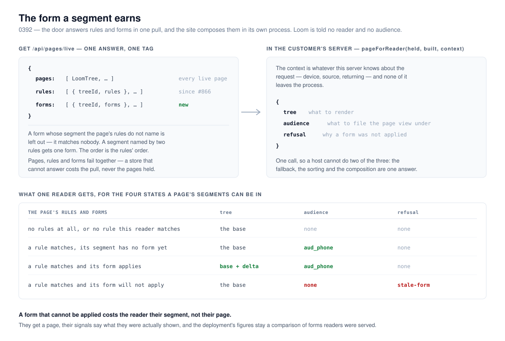

# The form a segment earns

**`Loom daily build`, 13 November 2026, morning run.**
Branch `framework-97-the-form-a-segment-earns`, cut from `origin/main` at
`b969960`. Record
[0392](../decisions/0392-a-segments-form-arrives-in-the-same-pull-as-its-rules-and-a-form-that-cannot-be-applied-costs-the-reader-their-segment.md),
`Accepted`. `pnpm verify` **EXIT=0**, read out of the file in its own command.

## Before anything else

**The migration is done and this run did not do it.** `apps/loom/` exists with
`(marketing)`, `(docs)`, `(lessons)`, `(portal)`, `(demo)` and `(preview)`;
`apps/portal` and `apps/docs` are gone; sign-in is in `proxy.ts` at the
`/portal` boundary; there is one `vercel.json` and the workspace is `apps/*`.
Nothing is half-migrated and no routine is waiting on this lane for it. **This
is the seventh consecutive run to say so**, and the sixth to recommend the
section be cut from the brief.

**No maintainer comment is outstanding.** Nine pull requests were open at the
start of the run — #884, #883, #881, #880 (`Loom signals`, except #883), #872,
#869, #867 (project threads), #856 (`Loom signals`) and #778 (`Loom docs`).
Every non-bot comment on the set is a routine's own, posted from the
maintainer's account; the rest is `vercel[bot]`. Read comment by comment rather
than by title. #883 is this lane's, opened last night, and the three questions
on it are still open.

**This branch does not stack**, and it does not touch #883's files. #883 is
`tools/sources/`; this is `src/live/`, `src/audience/` and
`apps/loom/app/_lib/pages/`. The overlaps are `FINDINGS.md` (different entries,
*take both*) and `decisions/README.md` (generated, *regenerate*).

## A correction to #883 before anything was built

**#884 took record number 0390 nine minutes after #883 did**, which is the
fourth instance in six days of the clash `Loom signals` filed on 12 November. It
is not a merge conflict — two files, two paths, git merges them silently — it is
`duplicate-number` from `checkNumbering`, held to `blocking`, so **the second of
the two to land turns `pnpm verify` red on `main`** for all four surfaces.

The convention that entry set is that the rename belongs to the branch's own
lane, before the merge. #883 is this lane's, so **this run moved it to 0391 and
left #884 alone** — one commit: `git mv`, the heading, four references, the pull
request's title and body, `pnpm decisions:index`. That is the same resolution
#864 took on 12 November, and it is the whole of what the clash costs when it is
done before the merge rather than after.

This run's own record then took **0392**, after re-reading `main` and the open
branches.

## The plain version

Since 12 November a deployment can make a segment, sort its readers into it, and
count what they did. It could not serve them anything different. `src/live/`
said so in its own docblock — *"a segment's form of a page is not something the
door answers yet, so sorting a reader names their segment and changes nothing
they see."*

Everything needed to serve one has existed for weeks and nothing joined it up:
`composeTreeForContext` since 0263, and `loom_audience_forms` — one delta per
audience per page — since 0376. **This run wrote the wire**, which is the serve
half of 0371 clause 7's piece 4:

- **The door answers `{ pages, rules, forms }`.** One read of 0376's store per
  page now answers both halves, replacing the rules-only read, because rules
  and forms have to describe one moment.
- **The client holds the forms beside the pages** and loses neither without the
  other, which is what a failed pull already did for the rules.
- **`pageForReader(held, built, context)`** answers the tree to render, the
  segment to file the page view under, and — where a form would not apply —
  the refusal. It is one call where a host used to write two and an `?? built`.

**A site wiring a context now changes what readers see.** Before today it only
changed what they were called.

## The three decisions this needed, and why each went the way it did

### 1. A form that cannot be applied costs the reader their segment, not their page

This is the decision in the unit. A delta authored against a revision the base
has moved past is **the ordinary end state of every form** — 0359's own
consequences say *a base edit stales every audience delta*. Two rules this
repository already holds point opposite ways at exactly that moment:

| | says |
| --- | --- |
| 0358 clause 4 | a failed pull costs freshness, **never the page** — there is always something to render |
| 0263 clause 4 | a composition **refuses** rather than falling back to the base |

0263's reason is a measurement one and it is right: a reader served the base
whose page views are filed under `aud_eu` turns *compare these two audiences*
into a comparison between one audience's form and another audience's **name over
the base**. A figure that is quietly wrong is worse than one that is missing.

**Dropping the audience keeps both rules.** The reader gets the base page, their
signals say what they were actually shown, and the deployment's figures stay a
comparison of forms readers were served. The `ComposeError` is handed back
rather than swallowed, because a stale form is otherwise silent — and silently
serving the base under a segment's name is the one thing 0263 clause 4 refuses.

The alternative that reads smallest — *serve the base and keep the name* — is
precisely that fault. A segment whose form went stale would compare as **worse
than the base for ever**, and the only trace would be that somebody once
authored a delta.

### 2. A rule whose segment has no form is left out, not refused

`composeTreeForContext` calls that `no-form` and refuses the request. Taking it
at face value would have made **every segment unserveable between being named
and being given a delta** — which is the state pieces 1 to 3 shipped, and the
state a project is in for as long as somebody is deciding what to put in it. It
would have been a regression on behaviour already on `main`.

So the client narrows the overlay to the rules whose audience has a form. The
reader is still sorted — `segmentOf` reads every rule — and is served the base,
which is what they were served on the day the segment was named. `no-form` is
right for an overlay one writer assembled, where a missing delta is a lost
write; a live pull assembles its overlay from two lists the door answers
independently, and the absence there is ordinary.

### 3. The door sends only the forms the page's rules name

0376 keeps a form until somebody removes the rule that serves it — *"an audience
stops being served by leaving the rules, not by having its form removed"* — so a
project accumulates forms that match nobody. Sending them would ship
work-in-progress to a customer's server on every pull for as long as the row
existed. The store keeps a formless audience's work on purpose; that is a reason
to keep the row, not a reason to broadcast it.

The order is the **rules'** and not the store's, because two deltas reaching one
part resolve by the order they are applied in (0359 clause 3) and that order is
the deployment's to set. A segment named by two rules is sent **one** form, for
`audiencesFor`'s reason: its delta is one delta, and applying it twice doubles
whatever it inserted.

## What it cost in the shape of things

**The door's `rulesOf` became `overlaysOf`**, and `PageRulesHead` became
`PageOverlay`. Both were two days old and entirely inside `app/_lib/pages/`.
This is the one piece of churn in the unit and it is cheaper than the
alternative: a second read for the forms is three store queries a page per pull
where two will do, and it loses the property that pages, rules and forms
describe one moment. Two requests can straddle an accepted change, and a form
authored against a revision the client does not hold is indistinguishable, at
the point of composition, from a stale form nobody rebased.

The reading itself moved out of `(portal)/_lib/segments/rules.ts` and into
`app/_lib/pages/overlays.ts`, which is the shell's own file, because the door is
the shell's. The portal's `readPageRules` is untouched and still serves its
screens.

## Numbers

`pnpm install && pnpm verify` — **EXIT=0**, read out of `verify.exit` in its own
command. Nothing failed, nothing was skipped, no test was weakened.

| | files | tests | over `main` at `b969960` |
| --- | --- | --- | --- |
| framework | 286 | 6,992 | +0 files, +20 tests |
| application | 488 | 7,901 | +1 file, +12 tests |

Also green: `1538 findings, 0 malformed`; `2234 visuals in reports/,
154.1MB`; `139 prerendered pages, 0 run together`.

**One test failed on the way and is worth recording**, because it is a rule a
run meets rather than reads: `src/documentation.test.ts > never makes a
decision-record number part of a published sentence`. Two new member comments
cited *(0263 clause 4, 0371 clause 5)* and *(0371 clause 5)*. The maintainer's
rule allows a record number in a doc comment **only as a bare parenthetical** —
`(0371)`, `(0263, 0371)`, `(see 0371)` — because a declaration is published
whole and every paragraph of an indented comment lands on the reference page.
Both were shortened. Nothing else about either comment changed.

**The API reference was regenerated in the same commit as the exports**, which
is `docs/routines.md`'s standing instruction and the answer to a red build no
source change explains: `pnpm build && pnpm --filter @loom/app docs:api`, in
that order. Three names are new to the package — `pageForReader`, `ServedPage`
and `LivePageForms` — and three are carried onto `/live` from `/store`:
`describeComposeError`, `ComposeError` and `AudienceForm`. `/live` shared a name
with no other door until today and now shares three with `/store`, so its
`doorsSharingNothing` moves from 18 to 17. The published-names cap has 12,795
bytes spare as of #859, so there was room.

**Five mutations planted, five killed.**

| what was changed | what caught it |
| --- | --- |
| `pageForReader` keeps the audience on a refusal | *serves the base and no segment at all when a form cannot be applied* |
| the overlay composes over every rule, formed or not | *applies the forms there are and skips the segment that has none* |
| `liveFormsOf` also sends the forms no rule names | *leaves out a form whose segment the page's rules do not name* |
| `liveFormsOf` keeps the store's order | *puts the forms in the rules' order rather than the store's* |
| `readPerPage` drops an entry it cannot read instead of refusing | *keeps the last pages and forms when one list cannot be read* |

## Records

- **Added [0392](../decisions/0392-a-segments-form-arrives-in-the-same-pull-as-its-rules-and-a-form-that-cannot-be-applied-costs-the-reader-their-segment.md),
  `Accepted`** — a segment's form arrives in the same pull as its rules, and a
  form that cannot be applied costs the reader their segment rather than their
  page.
- **Nothing superseded.** 0263, 0358, 0359 and 0371 all stand; 0392 settles the
  question 0371 clause 5 left to piece 4's record about **how a form reaches a
  reader**, and deliberately leaves the other half — whether a form is judged by
  the Gate — where the 10 November finding put it. See *Open questions*.
- **#883's record moved from 0390 to 0391**, on its own branch, for the clash
  described above.
- `pnpm decisions:index` regenerated on both branches. On this one it reports
  holes at 0353, 0383, 0384, 0386, 0390 and 0391, each claimed by an open pull
  request (#778, #867, #869, #872, #884, #883).

## Findings

- **Advanced, not closed:** *segments are written in the portal now, and no site
  sorts its readers by them* (11 November). All four points the entry asked of
  this lane are now built. It closes when a site wires a context, which is
  `Loom marketing`'s three lines — so the entry stays open and now says so.
- **Filed for `Loom docs`:** `@jam-overture/loom/live` has twenty-nine published
  names and **no written page at all**, and `pageForReader` is the one call a
  site's render path makes. The generator asked for this itself. The module
  docblock in `src/live/index.ts` is already a page's worth of prose.
- **Filed for `Loom marketing`:** loomjs.org passes no context, so the only
  deployment anybody can look at serves every reader the base. One expression in
  `app/(marketing)/_lib/live.ts`.
- **Filed for this lane:** the door's answer now grows with how much a project
  has **authored** rather than with how many pages it has published, and nothing
  measures it. Filed with an explicit *do not build a bound before there is a
  number*.

## Open questions

1. **Whether a form is judged by the Gate is still open, and this record
   deliberately does not settle it.** 0371 clause 5 left it to piece 4's record;
   the 10 November finding put it to the maintainer with a recommendation to
   *leave it, and write the asymmetry down*. The reason it is safe to build
   without the answer: **judging a form is a condition on `setForm`**, in the
   portal, at the moment somebody writes one. 0392 governs the path a written
   form takes to a reader, which is the same path either way.
2. **Piece 4's other two halves are the portal's** — *Only for: &lt;segment&gt;*
   on a change, and the split of before and after on *Page history*. Neither is
   started, and both now have a door to read from.
3. **`tools/` is still in no lane's row in `docs/routines.md`.** Carried on
   #847, #850, #854, #857, #864, #874 and #883, unanswered.
