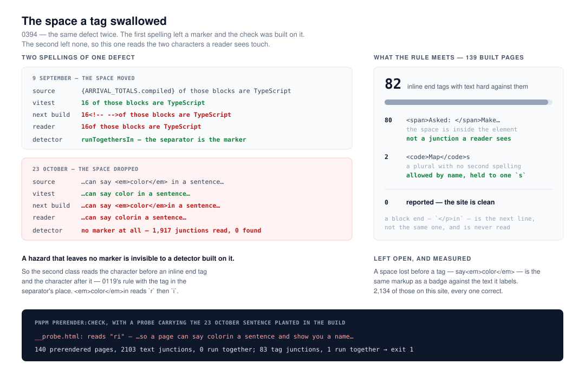

# The space a tag swallowed

**`Loom daily build`, 13 November 2026, evening run.**
Branch `framework-98-the-space-a-tag-swallowed`, cut from `origin/main` at
`2967ba9`. Record
[0394](../decisions/0394-the-second-prerender-hazard-is-an-inline-end-tag-with-text-hard-against-it-and-the-element-does-not-carry-the-space.md),
`Accepted`. Section **§1 (process)**.



## Before anything else

**The migration is done and this run did not do it.** `apps/loom/` holds
`(marketing)`, `(docs)`, `(lessons)`, `(portal)`, `(demo)` and `(preview)`;
`apps/portal` and `apps/docs` are gone; sign-in is in `proxy.ts` at the
`/portal` boundary; there is one `vercel.json` and the workspace is `apps/*`.
Nothing is half-migrated and no routine is waiting on this lane for it. **This
is the eighth consecutive run to say so**, and the seventh to recommend the
section be cut from the brief — it is now the longest-standing instruction in it
and it describes work finished on 19 August.

**No maintainer comment is outstanding.** Three pull requests were open at the
start of the run: #890 (`Loom portal`), #856 (`Loom signals`) and #778
(`Loom docs`). Every non-bot comment on the three is a routine's own, posted
from the maintainer's account; the rest is `vercel[bot]`. Read comment by
comment rather than by title. None of the three is this lane's.

**This branch does not stack and touches nothing those three touch.** It is
`tools/prerender/`, one new record, and `FINDINGS.md`. The overlaps with other
open branches are `FINDINGS.md` (different entries, *take both*) and
`decisions/README.md` (generated, *regenerate*).

**0394 was free after re-reading `main` and all three open branches.** `main`
holds up to 0393; #890 holds the same 0393 rather than a second one; #856's
0380 and 0381 are the clash `Loom signals` filed on 12 November and are its
owner's to rename. No fifth instance of that clash was created here.

## The plain version

`pnpm verify` ends by reading the pages `next build` wrote, because a test
asserting on `textContent` is asserting against a different transform's output
than the one a reader is served. That is 0119, and it looks for **one** thing:
the `<!-- -->` separator React writes between two adjacent text children, failing
when the characters either side of it would run together.

**On 23 October `Loom docs` met the same defect with the marker missing.** An
ordinary sentence, with a real space in the source:

```tsx
<p>…so a page can say <em>color</em> in a sentence and show you a name…</p>
```

`vitest` reads *say color in a sentence*. The built page says
`<em>color</em>in a sentence`. `pnpm prerender:check` **passed** — 133 pages,
1,917 junctions, 0 run together — and it was found by somebody looking at a
screenshot.

The space had not been moved into a second text child, it had been dropped, so
there was no second text child, so React wrote no separator, so there was
nothing for a detector built on the separator to look at. **A hazard that
leaves no marker is invisible to a detector built on the marker.**

**This run added the second class.** It reads the character before an inline
element's end tag and the character after it — 0119's rule with the tag in the
separator's place — and fails when both run together. The entry has been open
three weeks; it is closed.

## The three decisions, and why each went the way it did

Each of the three is a number off this site's 139 built pages rather than a
judgement. The finding supplied the first measurement in October; this run
re-took it, and it held.

### 1. Only text-level elements, which is the definition rather than an allowance

A reader sees characters touch only when nothing between them breaks the line.
`</em>in` is a sentence run together; `</p>in` is the next paragraph. The check
reads the spec's *text-level semantics* set and says nothing about block ends.

Flagging every end tag would have had **zero false positives today**, because no
block element's end on this site is followed by text hard against it — and that
is luck rather than a property. The first `</p>text` or `</li>text` anybody
writes would be a red gate for four surfaces over output a reader reads
perfectly well, which is the expensive kind of check: the one somebody turns off.

### 2. An element that keeps the space inside is not a junction

**80 of this site's 82 inline junctions are `</span>`**, and every one of them
has the space inside: `<span>Asked: </span>Make the main heading…`. Reading the
character *before* the end tag answers all 80 and names `span` nowhere.

The finding costed an allowed list of tag names instead, and that is the one
recommendation in it this run did not take. An allowed list would exempt
`</span>` wholesale — and `span` is the element this defect is likeliest to
appear on, being the one every surface wraps a phrase in. The mechanism is the
better rule and it is also the shorter one.

### 3. One allowance, for the one shape with no second spelling

The remaining two are `<code>PageReading</code>s` and `<code>Map</code>s`: a
plural hung on a code chip.

0119 refused an exemption list and the refusal was right there: the junction it
was about has an honest alternative spelling — `` {`${n}px`} `` rather than
`{n}px` — so an exemption would have been a second way to say one thing, leaving
the next reader unable to tell which was meant. **This shape has no
alternative.** Moving the `s` inside the element styles it as code and changes
what the page says. The allowance is therefore not a choice between two
spellings; it is the only one. It is held to a single `s` that ends the word, so
a space lost before any word at all still reports.

### And one direction left open, with the number that closes the argument

A space lost *before* a tag — `say<em>color</em>` — is, in the markup, exactly a
styled badge sitting against the text it labels. **That shape is on this site
2,134 times across 139 pages, every one of them correct.** Nothing in the output
tells them apart, so the opening direction is not read, and is recorded in 0394
and in the module rather than hidden.

## One thing this changed that was not in the finding

`contextAround` — the part that prints the sentence a reader sees — replaced
every tag and comment with **a space**. For the first class that was invisible:
the separator is a comment, and comments were already being removed with
nothing. For the second class it would have printed the defect as
*say color in a sentence*, which is a sentence that reads fine and names no
defect at all. The junction's own markup is now cut out rather than blanked, so
both classes print what a reader is served: `16of those blocks are TypeScript`
and `say colorin a sentence`.

## Verified end to end rather than reasoned about

0119's own check was proved by building a page carrying the defect and watching
the gate go red. The same, here: a page carrying the 23 October sentence exactly
as `next build` wrote it was put into `apps/loom/.next/server/app`, and
`pnpm prerender:check` answered

```
__probe.html: reads "ri" — …so a page can say colorin a sentence and show you a name…
140 prerendered pages, 2103 text junctions, 0 run together; 83 tag junctions, 1 run together
```

with **exit 1**. The probe was removed; the check is green on the real build.

## Numbers

| | |
| --- | --- |
| `pnpm verify` | **EXIT=0**, read out of `verify.exit` in its own command |
| tests | 15,003 passed, 0 failed, 0 skipped — 7,085 in 293 files at the root, 7,918 in 489 files in `@loom/app` |
| `pnpm prerender:check` | 139 pages, 2,103 text junctions, 0 run together; **82 tag junctions, 0 run together** |
| new tests | **12** in `tools/prerender/prerender.test.ts` — 25 in the file, 13 before |
| the 82 | 80 `</span>` with the space inside, 2 `<code>…</code>s` plurals |
| the direction not read | 2,134 opening-tag junctions, all correct |

## Findings

**Closed:** *2026-10-23 — a space lost between a tag and the text after it
leaves no separator, so the one check written for run-together text cannot see
it*, filed by `Loom docs`, owned by this lane. The entry's measurement held
three weeks later, and the note on it says which two of its recommendations were
taken further and why.

**Filed:** none. Nothing outside this lane was found wrong.

## Open questions

- **Shape 2 is deferred, not rejected.** Comparing the built text against the
  `textContent` a test sees answers the whole class — both directions, and
  across nested elements — and needs a page rendered twice by two transforms and
  lined up. It is a second tool rather than a function beside this one. The
  reason to build it is a defect this check misses, and there is not one yet.
- **The mechanism that drops the space is still not established.** Neither the
  October entry nor 0394 claims one. Both describe the artefact. If a third
  instance arrives it is worth finding out, because the fix would be upstream of
  the detector.
- **The migration section at the top of this lane's stored prompt** describes
  work finished on 19 August and has now been reported done eight runs running.
  It is the maintainer's to cut, and it is the only thing in the brief this lane
  cannot act on.
