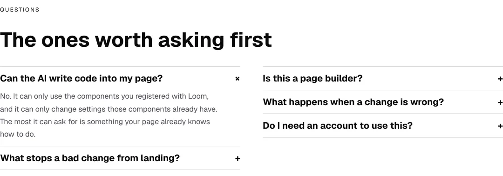
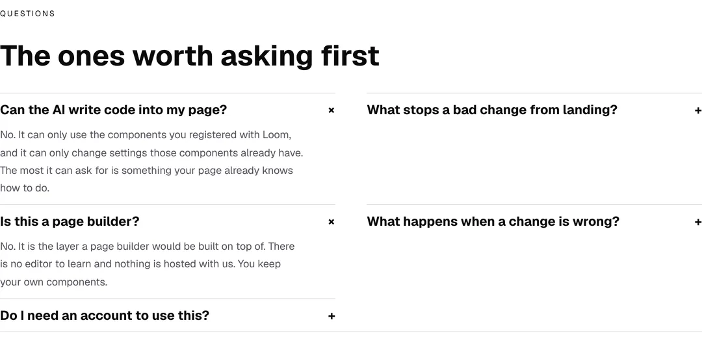
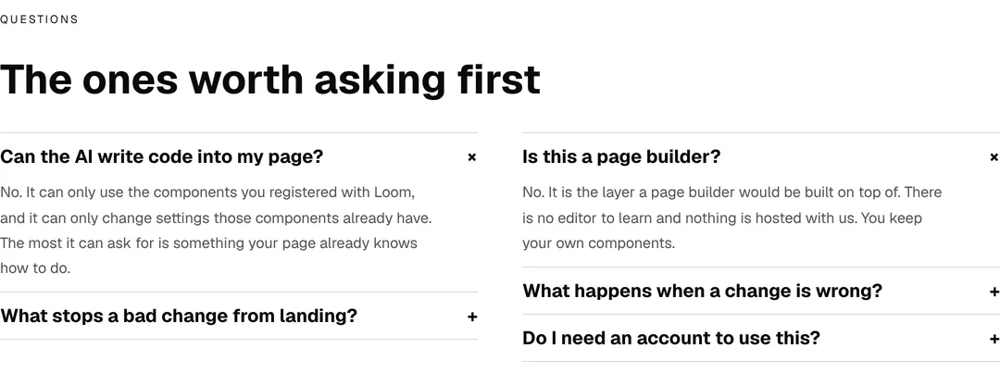
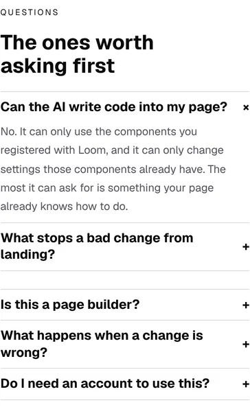
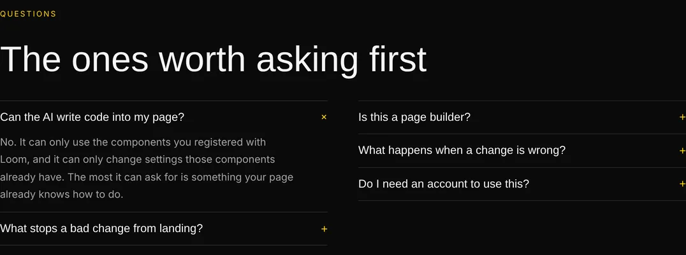
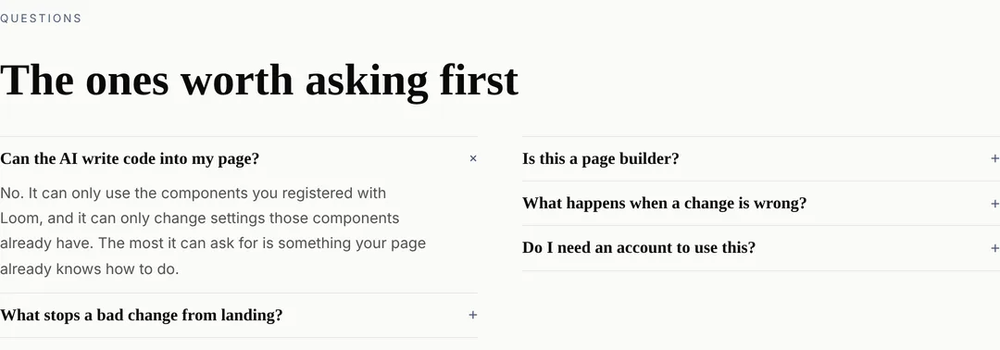
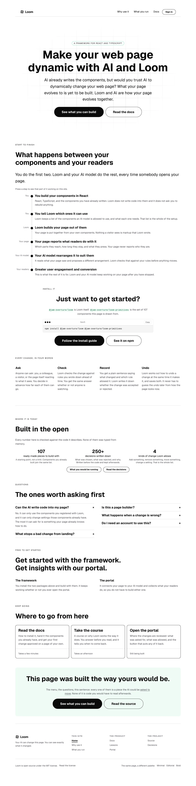

# Marketing — the hole beside the open question, and the check that was looking at the wrong half of the element

**Branch** `marketing-36-the-hole-beside-the-open-question` ·
**Date** 13 November 2026 · **Section** §4d, the marketing site ·
**Lane** `apps/loom/app/(marketing)/`

---

# What was built

No new band and no new copy. The front door's questions band stops drawing a
hole, and the two checks that should have reported it stop being blind to the
prop that drew it.

| before | now |
| --- | --- |
|  |  |

---

# 1. The defect, measured

The band is five questions with the first one open, so that a reader arrives at
an answer rather than at five headings. It was one `loom.faq-list` with
`columns: "two"`, which is a CSS grid — five cells in three rows — and **a grid
row is as tall as the tallest cell in it.**

Read off the page by `pnpm shoot`'s `measure`, on a production build at 1280:

| | its box | its content | empty |
| --- | --- | --- | --- |
| *Can the AI write code into my page?* (open) | 172px | 172px | 0 |
| *What stops a bad change from landing?* (closed, beside it) | **172px** | 51px | **121px** |

`loom.faq` draws a rule along the bottom of its box, so the rule belonging to
the closed question sat 121px under the words it belongs to. **That is the band
as the page loads**, before a reader does anything.

**And it moved under the reader**, which is the half nothing could have been
designed around. Pressing *Is this a page builder?* in the left column took
*What happens when a change is wrong?* in the right column from 51px to 145px:

**94px of empty space opened inside a closed question by a press on the other
side of the page.**

---

# 2. Why nothing on this site caught it

`(marketing)/_lib/balance.test.ts` is a whole file about this exact failure. Its
first paragraph:

> *"a card that says less than its neighbour carries the difference as empty
> space, and the empty space is at the bottom, under the last line, where a
> reader reads it as a card that is missing something."*

It ran green over this band every day since the band got a second column, for
two reasons that are the same reason twice.

**It classifies a run by its container's type.** `loom.faq-list` is on its
exempt list, with the reason *rows open and close* — which is true of a list
read downward and false of the same primitive with `columns` set. One type, two
layouts, and the classification could not see the prop.

**And its instrument is a word count**, which cannot see a question that is
about to open. There was no threshold that would have reported this band, so the
remedy is not a better number.

---

# 3. What is on the page now

Two `loom.faq-list`s side by side in a `loom.grid` with `align: "start"`. Each
list is read downward, which is the arrangement the exemption was written for;
the grid holding the two columns does not stretch them to each other either.

Every box is now its own height, measured on the same build:

| | before | now |
| --- | --- | --- |
| *What stops a bad change from landing?*, closed | 172px | **51px** |
| the band | 429px | **378px** |
| the open question's own box | 172px | 172px |

**The band is 51px shorter and nothing was cut.** The same five questions, the
same words, the same two columns, the same 22rem collapse point and the same
`space(6)` between the columns — `loom.grid`'s `two` is the floor
`loom.faq-list`'s own `two` uses, so the columns are where they were.

After one press, with *Is this a page builder?* opened:

It grows to 145px and the two questions beside it stay at 51px each.

## The split is two and three, and the smaller half is first

That is the one judgement in the band, and it is about the open answer rather
than about the count: the first question arrives open and is four lines taller
than any heading beside it. Measured at 1280, three and two put a 274px column
beside a 102px one; two and three put **223px beside 153px**.

It is derived — `Math.floor(asked.length / 2)` — so a sixth question needs no
decision from whoever adds it.

## Reading order changed, and that is an improvement

A two-column grid is read **across**: one, two, then three, four. Two lists are
read **down**. `siteQuestions()` is still the one order, so the `FAQPage` handed
to a search engine is unchanged, and `questions.test.ts` holds the band to
asking every question in that order.

---

# 4. What it costs, which is a phone and 27px

`loom.grid`'s `gap` is one value for rows and columns, so the space holding the
two lists apart at 1280 is also the space between them once they stack. At 390
the band is one column of five questions with a **27px break between the second
and the third**, where before it was a continuous run of ruled rows — the third
question now starts at y 4489 against 4462.

Two rules with nothing between them is a smaller blemish than a rule floating
121px under its question, and **it is a blemish.** It exists only because of the
workaround: nothing in the library offers a column gap that is not also a row
gap once the columns stack (`loom.split` makes the same call, `gap: space(5)` on
its wrapping flex). It is in the finding with the rest, and fixing
`loom.faq-list` removes the second element and the seam with it.

`scrollWidth 390 / innerWidth 390` at `390x844@2x touch`. Nothing overflows.

---

# 5. The checks, which are the part worth keeping

## A run now carries its container's props

`measure.ts`' `Run` had the container's **type** and its cells. It now carries
the container's props as well, because the type does not decide the layout and
the props do. Two files read it and both needed the half that was missing.

## `balance.test.ts`: the exemption is conditional, and a grid can say it is not a row

Two changes, both about the same blindness:

| | before | now |
| --- | --- | --- |
| which runs are rows | `ROWS.includes(container)` | that, **and** the container does not say `align: "start"` |
| which are exempt | a list of types | that, **and** a new case: a container exempted for being *read downward* may not be laid out in columns |

The second is the case that would have caught this band. **Proved rather than
asserted**: with the old band put back, it fails and names the page and the
prop — `/ — loom.faq-list with columns: "two"` — while every other assertion in
the file stays green, which is the whole argument for adding it.

The first is what keeps the new band honest. A `loom.grid` with `align: "start"`
does not stretch its cells, so it is not a row for this file's purposes; the
same primitive holding four cards still is. Taking `align: "start"` off would
move the hole up a level rather than removing it, and `questions.test.ts` has a
case against exactly that.

`ONLY_WHILE_ONE_COLUMN` names five containers and **only one of them can be
given a second column today** — the other four are `.strict()` schemas that
would refuse the key. They are named anyway: the exemption each of them has is
*the run is read downward*, and the day one of them grows the prop the exemption
stops being true, which is precisely what happened to the one that already had
it.

## `budget.test.ts`: a list of cells is not a cell

The new band made a run whose cells are **containers**, and the cell ceiling —
110 words, *a card, a rung, a question and its answer* — read a column of three
questions as one cell and went red at 125.

A column of questions is not something a reader meets in one go, so the ceiling
is the wrong instrument for it. `A_LIST_RATHER_THAN_A_CELL` takes it out, and
**nothing stops being checked**: the questions are the cells of the run inside
each list and are held to the same 110 they always were, the band as a whole is
held to `MOST_WORDS_IN_A_BAND`, and a new case holds every exempted container to
still holding a run for the ceiling to read.

It is a named list rather than *any cell that holds a run of its own*, because
that generalisation would quietly stop checking a wordy card the day somebody
gave it two paragraphs.

---

# 6. Under the other two palettes

Nothing in this band names a colour.

| | |
| --- | --- |
|  |  |

The front door, whole, at 1280:

---

# Decisions

**None.** This changes the arrangement of one band inside one route group under
primitives that were all registered before the run started. It touches no tree
schema, no delta model and no Accepted record, publishes no name, adds no
primitive and edits nothing outside `app/(marketing)/` except one appended entry
in `FINDINGS.md`. Nothing here is `ARCHITECTURAL`.

# Findings

**One filed**, for `Loom primitives`: a two-column `loom.faq-list` sets no
`align-items`, so it takes the grid default of `stretch` and every host that
uses the documented prop gets this hole. The remedy is one line —
`alignItems: "start"` — and it changes nothing for a one-column list. The entry
carries both measurements, the 27px the workaround costs a phone, and the
instruction that this band goes back to being one list the day it lands.

**None closed.** This lane's three open entries are each waiting on one sentence
from the maintainer — where a reader gets `LOOM_URL` and `LOOM_PROJECT_KEY`
(12 November), whether a section of a page called *Pricing* may be printed in a
table of the twenty-two (9 November), and whether `npx loom add primitive …`
can be printed when *primitive* is a reserved word (11 November). Nothing this
run could do moves any of them.

# Test numbers

`pnpm install && pnpm verify` — **EXIT=0**, read out of a file in its own
command, with nothing after the gate on the line.

| | files | tests |
| --- | --- | --- |
| framework and tools | 286 | **6,972** |
| application | 488 | **7,898** |
| | **774** | **14,870** |

**14,870 pass. Nothing failed, nothing skipped, no test weakened.**

`findings:check` **1,536 findings, 0 malformed**. `reports:check` 2,241
visuals, 154.6MB, none over 1.1MB. `prerender:check` **139 pages, 2,087 text
junctions, 0 run together; 3 metadata conventions, 0 unserved**.

**+9 tests and +1 file**, all on the application half and all in this lane,
counted off the files rather than off another pull request's figures:
`questions.test.ts` is new and is 6, `balance.test.ts` goes from 6 to 8, and
`budget.test.ts` from 15 to 16.

**The framework half is untouched**, which `git diff --stat` against `main`
shows directly: this branch edits no file under `src/` or `tools/`. The one
thing it reads from outside the route group is nothing at all — the new cases
are stated over trees this lane builds.

## The first run of the gate was red, and it is worth saying why

**EXIT=2**, on `tsc --noEmit`, with every test green. `isRow` was typed against
`measure.ts`' `Run` while `balance.test.ts` applies it to its own `Row`, which
is `Run` without the cells — so `vitest` ran it happily and the typechecker did
not. It is now typed against the two fields it reads.

**The harness's own completion notice for that run said exit code 0.** The file
said `EXIT=2`. That is the fourth instance recorded in *Reading the merge gate*
and it cost nothing, because the file was read as well as the notice.
