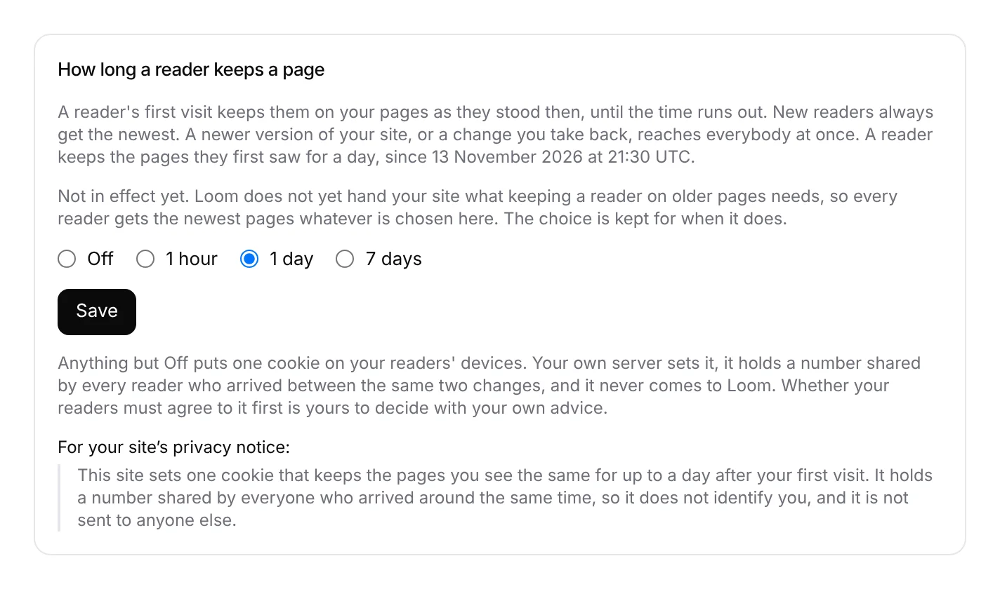

# Portal 10: Settings keeps how long a reader keeps the pages they first saw

**Run:** portal, 13 November 2026, from 21:17 UTC · **Pull request:** #891 ·
**Unit:** 10, *A reader keeps the pages they first saw*
([0383](../decisions/0383-a-reader-keeps-the-pages-they-first-saw-for-a-window-the-project-sets-and-their-browser-holds-one-number-many-readers-share.md)),
first piece

## Why this unit

Unit 9's next piece (measuring per segment) builds on #890, which is finished
but waits on the maintainer's `pnpm db:push` and is not on `main`; its branch
was pushed under three hours ago, so it is a live claim either way. Unit 10's
record was Accepted on 13 November (#867) and nothing of it was started, so it
was the first free piece in the order.

## What shipped

- *Settings* has a part, *How long a reader keeps a page*: what a window does
  (clauses 2 and 4), the window the project has and since when, the choice
  *Off · 1 hour · 1 day · 7 days* for an owner of an open project, the
  sentence about the cookie (clauses 3 and 7), and, for a window that sets
  one, a sentence to paste into the site's privacy notice.
- It says, every time, that it is **not in effect yet**: the door does not
  answer what a pin needs and the package a site runs cannot read one. The
  choice is kept meanwhile.
- `loom_reader_windows` keeps the choice, one row per application, with a
  check constraint on the four values and row level security. No row is
  *Off*.
- The pin itself is filed for `Loom daily build` (FINDINGS, 13 November), with
  what the door will answer so the two halves meet.

## Decisions taken, and why

- **A table, not a column on the project.** 0383 and `docs/portal.md` say *a
  column on the project*; `loom_projects` is the framework's table in `src/`,
  which this lane never edits. A table keyed by the application, as the model
  key is, is the same fact in the portal's lane and the read door (which is
  handed an application) can read it without a join. Same `pnpm db:push`.
- **The setting before the door.** A door that answers a window has nothing to
  answer until a project can set one, and the choice is the piece with its own
  data. The screen says plainly it does nothing yet, so nobody reads it as a
  promise.
- **A store that does not answer offers no choice.** The radios would start on
  a window nobody read, and saving them could undo one. Before `pnpm db:push`
  the part says the store did not say, and nothing else on *Settings* changes.
- **The privacy sentence names no cookie.** Its name is the framework's to
  choose in the finding; the sentence says what it does and how long.

## Records

None added. 0383 is Accepted and this follows it; the one departure (table
rather than column) is recorded in `docs/portal.md` row 10 and above.

## Tests

- `reader-windows.test.ts`: 10 (the four choices read, seven refusals, the
  lengths in order and capped at seven days).
- `reader-windows.contract.ts` against memory (4) and PGlite (4), plus 4
  Postgres specifics: migration twice, row level security, the check
  constraint, and a missing table reading as unavailable rather than *Off*.
- `reader-window.test.ts` (portal words): 7.
- `reader-window-section.test.tsx`: 6 (an owner's four choices on the kept
  one, *Off* where nobody chose, *not in effect yet* and the cookie, the
  privacy sentence for a window, a viewer's sentence, no choice on a store
  failure).
- `pnpm verify`: see the pull request.
- The screenshot is the part rendered from its component with sample values
  and the portal's stylesheet, not the live deployment.

## Toward the wireframe

*Settings* in `docs/portal-wireframes.md` lists *how long a reader keeps a
page*; it is there now. Still missing from unit 10: the door's answer (window,
floor, current number, each page's versions inside the window), the pin in
`src/live` (framework), *Held for returning readers until …* on the
*Accept*-to-live timeline, and measuring a held change from when the window
has run out (clause 6).
