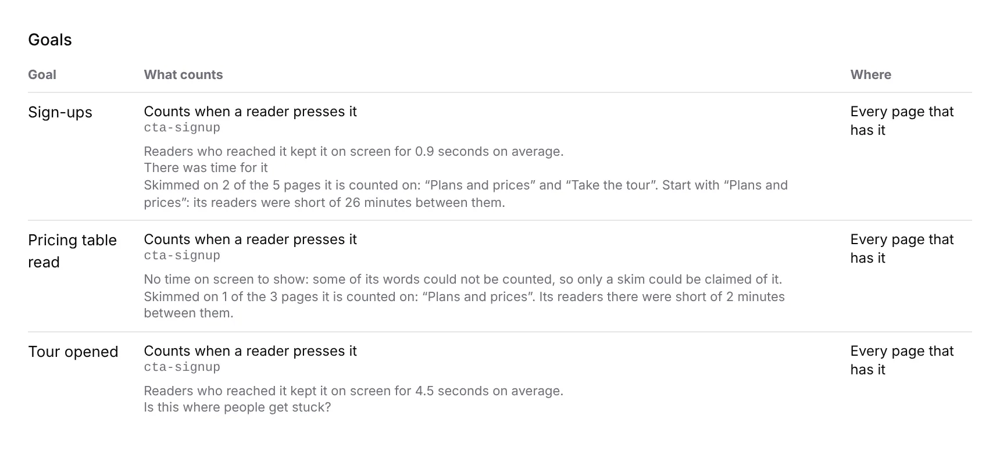

# Portal 8b: each goal says which page its part is skimmed on

**Run:** portal, 13 November 2026, from 17:18 UTC · **Pull request:** #888 ·
**Unit:** 8b, *Goals*, the portal half of the 12 November finding *which page a
part is skimmed on is published*

## What shipped

Under each goal's *Readers who reached it kept it on screen for …* and its
plain verdict, the *Goals* list now says where the part is skimmed:

- *Skimmed on 2 of the 5 pages it is counted on: “Plans and prices” and “Take
  the tour”. Start with “Plans and prices”: its readers were short of 26
  minutes between them.*
- One skimmed page: *… Its readers there were short of 2 minutes between them.*
- More than three: the first three named, *and 2 more*.
- Skimmed nowhere: nothing added, since the pooled verdict has said it.

It is said even where the pooled time is withheld (a part whose words are a
floor), because 0390 keeps the rows exactly so a person can still see where to
look.

## Decisions taken, and why

- **The pages are the rows whose own `standing` is `skimmed`, in `ranked`'s
  order.** `ranked` orders by the reading time readers did not have, so the
  first skimmed row is the page to start with. The finding pointed at `worst`;
  `worst` can be a *paced* page with a small shortfall over many readers, and
  telling a person to start with a page the sentence did not just call skimmed
  would contradict itself. The first skimmed row is `worst` wherever `worst` is
  skimmed.
- **The finding's two prohibitions are kept**: no row's `pace` is read (only
  `standing`), and the shortfall named is that one page's own `shortMs`, never
  a sum of rows.
- **Counted out of distinct pages**, not revisions. *Goals* hands in one
  revision a page, and a page is what a person goes and fixes.
- **Page names are quoted.** A page's name is its own heading (*Take the
  tour*) and reads as part of the sentence otherwise.
- **`pageNameIn`** in `goal-view.ts` names a page by tree id; `whereSentence`
  now uses it too, so the two lines on a row cannot name one page two ways.

No decision record: every rule used is 0381's and 0390's.

## Tests

- `goal-stay.test.ts`: 12 tests, 7 new. The pages ranked by shortfall and not
  by rate (a page whose 10 readers had nothing is listed after one whose 400
  readers had a fifth of the time), one page's own shortfall in the sentence,
  nothing said when skimmed nowhere, one page, one of several, three named and
  the rest counted.
- `time-on-it.test.tsx`: 5 tests, one new (the skimmed pages shown beneath a
  withheld pooled time).
- `pnpm verify`: see the pull request.
- The screenshot is the component rendered with sample figures and the
  portal's stylesheet, not the live deployment.

## Toward the wireframe

*3 · Goals* is complete except the *Stays on it* goal kind (readers past a
threshold), which 0350 leaves unoffered and which needs a record and a
threshold the maintainer picks.
