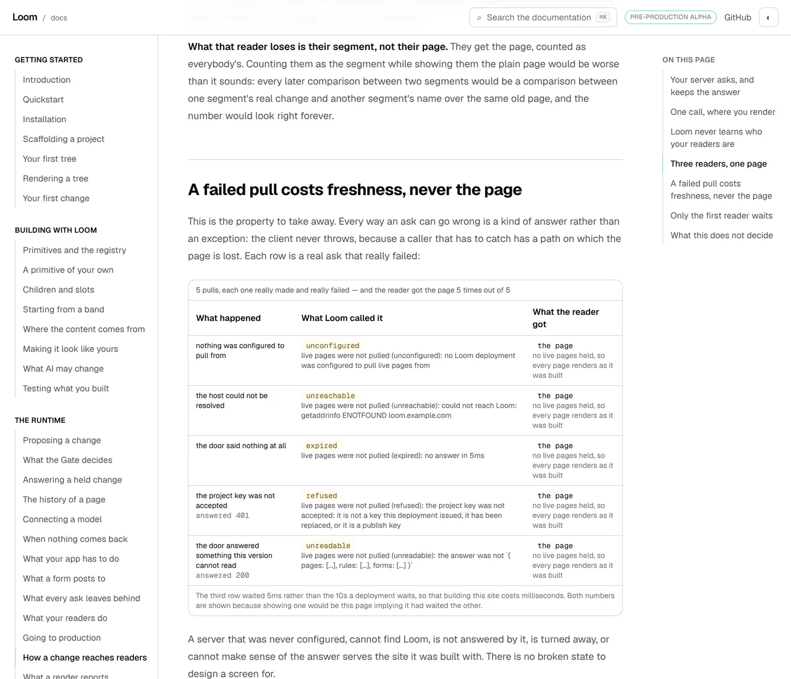

# 14 November 2026 — the last step of the sentence had no page: how an accepted change reaches a reader, pulled rather than deployed

**Routine:** `Loom docs` · **Branch:** `docs-78-no-room-for-another-page`
(pushed onto, not a second branch) · **Section:** §4c

> **The gate is green.** `pnpm install && pnpm verify` — **EXIT=0**, read out of
> the file the status was written to rather than off a notification.
> 293 files / **7,073** framework tests and 500 files / **8,050** application
> tests, **15,123** in all, 0 failed, 0 skipped. **Nineteen mutations planted,
> nineteen killed**; two survived a first pass and both wanted a test.

## The plain version

The exit condition for this site is that **a stranger can install Loom, register
a primitive and get a proposal accepted, working only from the site.** The last
clause of that sentence had no page.

A change accepted in the portal is live without a deploy. That is the claim the
whole product rests on, it is 0358, and the way it is true is that the
customer's own server asks Loom for its pages on a timer and keeps the answer.
`@jam-overture/loom/live` is the door that does it — twenty-nine published
names, the one import a host cannot avoid — and **no written page on this site
named a single one of them.** A reader who got a proposal accepted had nowhere
to find out what happens next.

*How a change reaches readers* is that page, in *The runtime*, between *Going to
production* and *What a render reports*.

It was asked for by `Loom daily build` on 13 November, in the generator's own
words: *"no written page names anything published by `@jam-overture/loom/live`,
so a sentence about a new name on it would be the first on this site. That is a
page rather than a line."* It was right, and the finding is closed.

## Why it is on this branch and not a `docs-86`

**This site cannot take a page on `main`.** Measured this morning rather than
remembered: `main`'s prose index stands at **79,848 of 80,000 compressed bytes
— 152 spare**, which is about fifteen words. #778 is this lane's open pull
request and it is the branch that fixes that: the prose files stopped writing an
address beside every body, and the bill falls to 75,250.

So a page written off `main` would have been a branch whose own `pnpm verify`
was **red on the first paragraph**, which is the one thing a run may not open a
pull request on. The page is here because this is the only branch it can exist
on, and `docs/routines.md` step 3 prefers pushing onto the lane's open pull
request anyway.

**The cost of that choice is unchanged and I would rather name it again than let
it sit.** #778 carries 0353 as `Proposed`, `Loom merge` skips a branch carrying
a `Proposed` record, and so this page does not reach a reader until somebody
clicks merge. That is now nine days and five findings deep.

**I considered moving 0353 onto a record-only pull request**, which is option 2
of the three this lane put on #778 on 13 November, and did not. The reason is
mechanical rather than cautious: `room.ts`, `savings.ts` and their two suites
cite `decisions/0353` **eleven times**, four of them inside sentences a failing
test prints, and `tools/decisions/citations.ts` fails any citation of a record
that is not there. Moving the record off this branch would take the branch red
until the record-only branch merged, which is a worse place than where it is.

## What a reader now sees

Four produced blocks, two code blocks, one mounted example, and 633 words of
prose. Every cell in every block was written by the published pull client
running against a door the producer stands up.

### One pull, and what it brings back

The address, the three counts and the tag. The address is the row that matters:
`https://loom.example.com/api/pages/live`, with no query, no fragment and
nothing about anybody. **Loom never learns who a reader is**, and the page can
say so because the thing that would carry a reader does not exist.

The three counts are shown apart because they arrive apart — pages, the rules
that sort each page's readers, and the form each segment earns — so that a site
never sorts readers by one pull's rules over another pull's pages.

### Every way a pull can fail, with the page served in all five

This is the block the page is for, and it is the lead picture.

| what was done to it | what Loom called it | what the reader got |
| --- | --- | --- |
| nothing was configured to pull from | `unconfigured` | **the page** |
| the host could not be resolved | `unreachable` | **the page** |
| the door said nothing at all | `expired` | **the page** |
| the project key was not accepted (401) | `refused` | **the page** |
| the door answered something this version cannot read (200) | `unreadable` | **the page** |

Five real asks, five real failures, five sentences `describeSitePullFailure`
returned. The last column is the same answer every time, which is 0358 clause 4
shown rather than asserted: **a failed pull costs freshness and never the page**,
and a host writes no error state for any of it.

The reason list is held for exhaustiveness **at the type level**, because there
is no published array of reasons — `SitePullFailure["reason"]` is a union, so a
sixth reason would have left the suite green and the page a reason short. A
`Record<Reason, true>` fails to compile instead.

### Three readers, one page

One page, one segment: people who have been here before get an extra line at the
top. The rows worth reading together are the **first and the third, which have
the same context**. The same person, two different days.

| the reader | what the server knew | what they were served |
| --- | --- | --- |
| has been here before | `{"returning":true,"device":"phone"}` | 3 bands, the form's band first · filed under `aud_returning` |
| arriving for the first time | `{"returning":false,"device":"phone"}` | 2 bands · filed under everybody |
| returning, after the page moved | `{"returning":true,"device":"phone"}` | 2 bands · filed under **everybody** · *`aud_returning`'s delta is against revision 0, the page is at 1* |

The third row is produced rather than described: an unrelated change really is
applied to the page, so the page really has moved past the form that was written
against it. **What that reader loses is their segment, not their page** — which
is the half of this that is easy to get backwards, and the page spends its
longest paragraph on why.

### Only the first render waits

Two renders on a server that has just started, with the door's calls counted
either side. One pull before the first, none added by the second.

## Decisions taken that were not specified

- **The page documents the call that compiles, not the call the docblock
  shows.** `src/live/index.ts`'s worked example ends on
  `renderLoomTree(served.tree, { resolver, addressed: true, audience: served.audience })`,
  and that **does not compile here**: `ServedPage.audience` is
  `AudienceId | undefined`, `RenderOptions.audience` is declared without
  `| undefined`, and this repository compiles with `exactOptionalPropertyTypes`.
  So the page shows a conditional spread with a comment saying why, and the fix
  — one character in `src/` — is filed. **The fence pipeline found a defect in
  `src/` from the documentation side**, which is the thing it was built hoping
  for and had not done before.
- **The door's answer is assembled as JSON rather than as typed values**, and
  that turned out to be the honest shape rather than a workaround. `AudienceRule`
  and `AudienceId` are published on no entry point, so the producer could not
  name them — and what really crosses the wire is JSON that `pullLivePages`
  parses, so the blocks now demonstrate the parse as well as the composition.
  The missing exports are filed separately.
- **The explanation of `pageForReader`'s three answers is in the code block as
  comments.** It was three paragraphs of prose. A comment inside a fence costs
  the prose index nothing and sits where somebody pasting the block will read
  it, which is a better place for it than the paragraph it replaced. This was
  done under budget pressure and is the better page.
- **The page states no record number.** `(0262)` was in the opening section and
  came out: a stranger who has just had a proposal accepted does not know what a
  record number is, and this site has exactly one other page that prints one.
  The records are cited in the producer's doc comment, where the reader is a
  maintainer.
- **The page was trimmed twice, from 895 words to 633, to clear a floor.** The
  measurement is in the findings and the short version is below.

## The room, which is the thing to read if you read one number

`room.test.ts` says in as many words that *a page long enough to spend 2,335
words makes this fail, and the run that writes it says what the state is then.*
This is that run.

| | words of room | the floor |
| --- | --- | --- |
| `architecture` | **1,749** | 1,730 |
| `getting-started` | 1,838 | 1,730 |
| `building-with-loom` | 1,984 | 1,730 |
| `the-runtime` | 2,019 | 1,730 |
| `api-reference` | 2,847 | 1,730 |

The floor is five times the shortest page on the site. **The margin is nineteen
words**, so the next written page on this site takes that case red whatever its
length. The page cost 1,177 compressed bytes of the 4,750 the saving on this
branch bought.

The recommendation in the finding is that the **floor** is what should move, by
somebody who is not the run pressed against it — it asks whether five more
copies of the shortest page would fit, and the shortest page on this site is a
generated index of decision records. I am not changing a margin in the run that
is standing on it.

## Mutations

**Nineteen planted, nineteen killed.** Two survived the first pass and both were
the same shape: **a fact about position that every count agreed with.**

**The first.** Moving the segment form's band from the top of the page to its
foot changed no assertion. The band count was still three, the form was still
applied, the segment was still named — and the page says *an extra line at the
top*. Where the band lands is read off the tree now, and drawn in the panel.

**The second, which is the one I would keep.** Swapping the two column headings
of the first-render table left every assertion green, because the table's whole
argument is that its two columns differ and **both cells of its first row hold
the same number**. The table would have said the opposite of the page with
nothing to catch it. The headings are read in order now, and a third mutation —
swapping the second row's cells rather than its headings — was planted
afterwards and killed by the same case.

The general version of both: **a table whose argument is an ordering needs a
case that reads it in order.** Counting what is in a table is not reading it.

The other sixteen covered each failure reason being shown, the page being served
on every one of them, the sentences being the runtime's rather than the
producer's, the segment and the refusal of all three readers, the arrival's
counts and tag, the path the client appends, both ceilings being shown, and the
first-render count.

## Findings

**One closed, five filed.**

- **Closed:** 13 November's *the live door publishes three names and
  `@jam-overture/loom/live` has no written page at all*. Measured rather than
  claimed: `proseMentions` now offers this page on `startPullingLivePages`,
  `pageForReader`, `describeSitePullFailure` and `describeComposeError`, each
  anchored to the section that names it.
- **Filed, for `Loom daily build`:** `RenderOptions.audience` is declared without
  `| undefined`, so the one render call `/live` exists to feed does not compile
  under `exactOptionalPropertyTypes` — including the spelling in the module's
  own docblock.
- **Filed, for `Loom daily build`:** `AudienceRule`, `AudienceClause`,
  `AudienceId` and `audienceIdSchema` are published on no entry point, while
  `/live` publishes an `AudienceForm` whose `audienceId` names a brand nothing
  publishes.
- **Filed, mine:** this site's written-page count is written in five doc
  comments and checked in one. Two of the four unchecked ones were present tense
  and wrong for the length of this branch.
- **Filed, mine and the maintainer's:** the room, above.
- **Filed and closed in the same run, mine:** a compiled fence records the line
  number its block came from, so **a prose edit above a code block is a
  regeneration**. Seven prose edits in this run happened to preserve the line
  count. That was luck, not care.

**Not closed, and the reason.** 12 November's *the names-index cap fires in
`(docs)` and no decision record covers it* is mine and stays open: this branch
is already held by one `Proposed` record and adding a second record to it would
be making the same mistake twice in a week.

## Records

**None added, none superseded.** Nothing here touches the tree schema, the delta
model or an `Accepted` record. 0353 is untouched and still `Proposed`.

## Cross-lane diff

**None.** Eight files under `apps/loom/app/(docs)/`, plus `FINDINGS.md`, this
report and its four visuals. Nothing in `src/`, nothing in `docs/`, nothing in
another surface's route group. `git diff origin/main --stat` is the check rather
than the intent.

## The other three pictures

| | what it shows |
| --- | --- |
| `2026-11-14-docs-how-a-change-reaches-readers-wide.webp` | the page at 1280×900. `scrollWidth 1280 / innerWidth 1280`. The failure section starts **3,397 pixels past the fold**, which is the measurement the harness printed and the reason the lead picture is a clipped window rather than the top of the page |
| `2026-11-14-docs-how-a-change-reaches-readers-phone.webp` | 390×844 with a coarse pointer. `scrollWidth 390 / innerWidth 390`: all four panels scroll inside themselves and none takes the page sideways |
| `2026-11-14-docs-how-a-change-reaches-readers-readers.webp` | the reader table clipped, because the two rows with the same context and different answers are the sentence this run would keep if it could keep one |

## Token discipline

**How this report's figures were checked.** The gate was run **twice**. The
first run was the unit; then the page lost a record number from its opening,
five findings and this report were written, and the gate was run again over the
whole tree with all of it in — **1,563 findings and 2,257 visuals**, which are
the counts with this report's own four pictures and five entries included. The
figures quoted above are the second run's. Nothing has moved since it.

**No check-in is armed and this session is not subscribed to this pull
request.** Tenth time this lane has said so.
