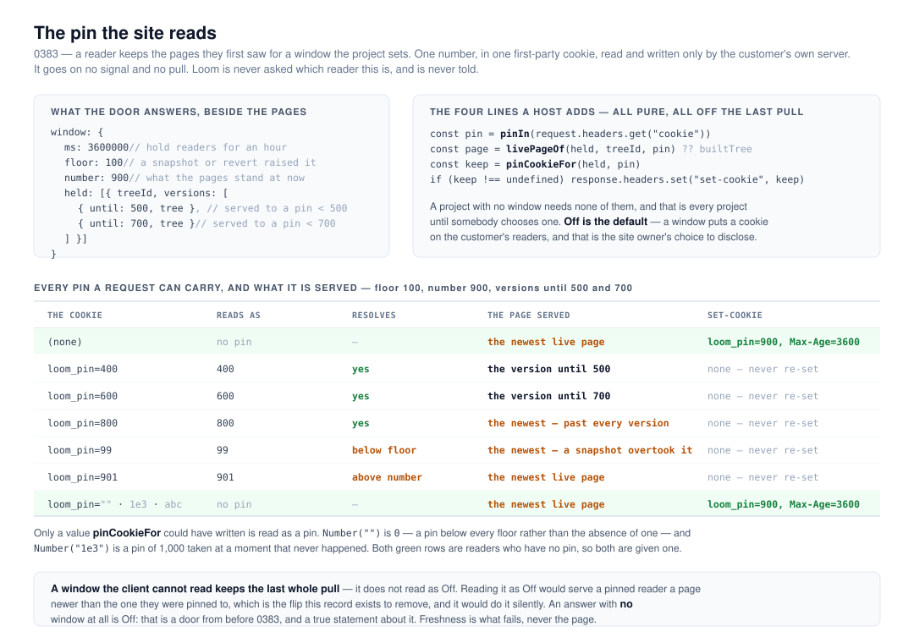

# The pin the site reads: a reader keeps the pages they first saw

**Run:** framework (`Loom daily build`), 14 November 2026, from 09:05 UTC ·
**Unit:** the client half of
[0383](../decisions/0383-a-reader-keeps-the-pages-they-first-saw-for-a-window-the-project-sets-and-their-browser-holds-one-number-many-readers-share.md),
filed for this lane by `Loom portal` on 13 November · **Section:** §1, the
connection plane

## What shipped

`src/live/window.ts`, and the pin wired through the two calls a host already
makes. A project that turns a reader window on now has a site that honours it;
a project that has not — which is every project — is unchanged in every
respect, including the bytes on the wire.

- **`pinIn(cookieHeader)`** reads the pin out of a request's `Cookie` header.
- **`livePageOf(held, page, pin)`** answers the version that reader was pinned
  to, or the newest live page where the pin cannot be resolved, or `undefined`
  where the server holds nothing and the page renders as built.
- **`pinCookieFor(held, pin)`** answers the `Set-Cookie` value for a reader who
  has no pin, and `undefined` for everyone else — including, always, a reader
  who already has one.
- **`pageForReader(held, built, context, pin)`** applies the pin first and
  sorts the reader into their segment against the version it chose (0383,
  *Audiences*).
- **The pull reads the door's `window`** into `LivePages.window`, and it moves
  only with the pages it arrived beside.

## The four items the finding asked for

| | |
| --- | --- |
| 1. Read the pin, answer the tree to draw | `pinIn` and `livePageOf`'s third argument |
| 2. Answer the `Set-Cookie` for a reader with no pin, never re-set | `pinCookieFor` |
| 3. Send nothing new to Loom | nothing was added to the pull or to a signal; the request is the same `GET` with the project's key and the tag |
| 4. Audience selection runs after the pin | `pageForReader` composes over the version the pin chose |

## Decisions taken, and why

[0395](../decisions/0395-the-pin-is-a-decimal-in-one-first-party-cookie-and-an-unreadable-window-keeps-the-last-whole-pull.md),
`Accepted`, records the four 0383 left open. Two of them are expensive to
reverse once sites are deployed and are the reason the record exists rather than
a constant somebody tidies:

- **The cookie is `loom_pin`, and the name is part of the contract.** Renaming
  it later turns every reader who holds one into a reader with none: they are
  given a fresh pin and moved to the newest pages in the act.
- **A pin is read only in the spelling this client writes** — digits, no sign,
  no point, no exponent, no leading zero. `Number("")` is `0`, and `0` is a pin
  below every floor rather than the absence of one; `Number("1e3")` is a pin of
  1,000 taken at a moment that never happened. Both are the difference between
  serving a reader the newest page and resolving them against a number they
  were never pinned at.
- **The expiry is `Max-Age` and the function takes no clock.** `Max-Age` is
  counted from when the browser receives the response, which is first sight
  exactly, so the window cannot be lengthened or shortened by the server's
  clock drifting from the reader's — which is what `Expires` is compared
  against. It leaves `pinCookieFor` pure, with no `now` to be wrong about.
- **A `window` the client cannot read keeps the last whole pull.** An answer
  with *no* `window` is *Off* — a door from before 0383, and a true statement
  about it. An answer carrying one this version cannot read costs freshness and
  holds every reader where they were, as an unreadable rule list already does
  (0392). Reading it as *Off* was the cheap branch and it is the one that
  silently serves a pinned reader a newer page than their pin.

Two smaller ones, argued in the record:

- **The version served is the one with the earliest `until` after the pin**,
  not the first in the list. Both readings agree on the ordered list the door
  answers; the order-free one costs a comparison and makes a reader's page
  independent of a list's order. A list that arrived out of order would
  otherwise serve a *newer* page than the pin — the same fault as reading an
  unreadable window as *Off*, one layer down.
- **The pin is an optional argument, not a second pair of calls.** 0383's
  consequence says *two pure functions beside `livePageOf`*; what shipped is
  two functions plus an argument, because a host asks one question per page and
  a separate `pinnedPageOf` is a call a page can forget while still compiling
  and serving. Written down as a departure in 0395's alternatives.

## Numbers

`pnpm install && pnpm verify` — **EXIT=0**, read out of the file in its own
command, on the branch's final commit.

| | |
| --- | --- |
| tests | **15,117 passed, 0 failed, 0 skipped** — 7,134 in 294 files at the root, 7,983 in 496 files in `@loom/app` |
| new tests | **58** — 37 in `src/live/window.test.ts` (a new file), 12 in `src/live/pull.test.ts`, 9 in `src/live/pages.test.ts`, against 19 existing `pull.test.ts` literals that gained the field |
| `src/live/` | 143 passed across 4 files |
| `pnpm prerender:check` | 139 pages, 2,101 text junctions, 0 run together |
| names index | **27,523 of 40,000** — 12,477 left |
| docs prose | this branch costs **0 raw bytes and 3 gzipped**; `main` has 325 and 152 left |
| published names | `@jam-overture/loom/live` goes from 3 to 9 |
| broadcaster bundle | unchanged; nothing in this branch is reachable from it |

**The gate was read out of the file every time, and twice the harness
disagreed with it.** Two runs ended with a task notification saying *exit code
0* while `verify.exit` said `EXIT=2` and `EXIT=1`. That is the 4 November entry
in `docs/routines.md` exactly, third and fourth instance: what a notification
reports is the status of the thing it was handed, and the thing it was handed
is the subshell whose last command is the `echo`. The file is the gate.

## Three reds, and what each one was

**The merge gate caught a published-name collision that nothing else would
have.** The window's type was called `ReaderWindow` — the word 0383 uses in
prose. `src/signals/` already publishes a `ReaderWindow`, for an unrelated
thing, and `(docs)`'s `extract.test.ts` asserts that `horizonOf` is the *only*
name published at two doors. It went red naming mine. Renamed to `LiveWindow`,
which is what the portal's half already calls the same shape and the vocabulary
of the rest of this door. Clause 6 of 0395.

**That same collision took the docs prose cap red**, at 260,284 of 260,000, and
the two failures looked unrelated. They were one: a colliding name makes the
site print the *one name that means two things* band, and that band is prose —
about 609 raw bytes of it. After the rename this branch costs the budget **0
raw bytes and 3 gzipped**, and `main`'s own margin is 325 and 149. Filed for
`Loom docs` as a way of spending that budget which no entry about it had
measured.

**Two doc comments put a record number inside a published sentence.**
`documentation.test.ts` only permits `(0383)`, not `(0383 clause 5)` — the
clause suffix is not a liftable parenthetical, so the sentence cannot be
rewritten for a reader who has not read the record. Both reworded; the rule was
not touched.

**Two test failures were mine and both were fixtures, not code.** A tree's
revision starts at 0, so a held version written as `revision - 1` is `-1` and is
not a tree the system can produce — `parseTree` said so in `pull.test.ts` and
the fixture was wrong in `pages.test.ts` too, where nothing parses and it had
passed. Both now build an honest pair: the live page at the later revision and
the held version at the earlier one. A third failure was an expectation that a
pin equal to `number` is unresolvable; it is not — that is a reader pinned at
the state the pages stand in now, and the test says so.

**One tightening came out of a failing test rather than from design.** `pinIn`
first used `Number` and read `1e3` as 1,000. The test written to refuse it
failed, which is the question *should this be refused* arriving as a fact. It
is clause 2 of 0395 now.

## Findings

**Closed:** *2026-11-13 — a project can choose how long its readers keep the
pages they first saw, and nothing yet holds one, because the pin is the site's
code* (`Loom portal` → `Loom daily build`), all four items.

**Filed:** three, all small and none blocking.

- For `Loom marketing`: a Loom site can set a cookie now, and `/what-you-run`
  says in as many words that it does not. Nothing is false today — every
  project's window is *Off* — but the sentence is one `Settings` choice away
  from being false, and 0383 clause 7 puts the obligation on that page.
- For `Loom docs`: `@jam-overture/loom/live` publishes nine names now rather
  than the three the 13 November entry quotes. A correction to a figure in an
  open entry, filed as its own entry because the convention here is to append.
- For `Loom docs`: the prose budget has 325 raw and 149 gzipped bytes left on
  `main`, and a published name that collides spends about 609 raw bytes of it
  — a way of spending that budget which none of the entries about it had
  measured, and one whose red says *the site is too large* rather than *you
  named something twice*. #778 is the answer and this changes nothing about
  that.

**Left open deliberately:** *2026-11-11 (evening) — segments are written in the
portal now, and no site sorts its readers by them*. Every one of its four
points is built; what is left is `Loom marketing`'s three lines wiring a context
in `app/(marketing)/_lib/live.ts`, which the entry itself says. Not this lane's
to close.

## Open questions

- **Nothing deployed holds a reader yet.** Both halves exist and no project has
  chosen a window, so the first end-to-end proof that a returning reader is
  served an older page will come from a deployment rather than from a suite.
  The suite covers every branch; what it cannot cover is a browser actually
  sending the cookie back. Worth one manual check on the first project that
  turns a window on.
- **A shared cache in front of a pinned site must vary on the cookie.** 0383
  says so and nothing enforces it. It has as many values as there were changes
  inside the window — a handful, not one per reader — so it is a configuration
  note rather than a design problem. No deployment has a cache in front of it
  today.

## What this run did not do

- **No surface content.** The route groups are their own routines'.
- **Nothing in `src/primitives/` or `src/signals/`.**
- **The demo was not touched.** This lane's stored brief says the demo is
  this lane's; `docs/routines.md`'s lane table gives `apps/loom/app/(demo)/` to
  `Loom demo`, which is an active routine with findings of its own. The
  governance document says the brief wins and to say so in a report rather than
  follow the file — so this is that sentence, and the directory was left alone
  on the ground that editing another running routine's directory is the more
  expensive mistake of the two. Worth one line from the maintainer.
- **The one-application migration is done and was done before this run.**
  `apps/loom` has its four route groups, `apps/portal` and `apps/docs` are gone,
  sign-in is in `proxy.ts` at the `/portal` boundary, and the workspace is
  `apps/*` with one `vercel.json`. The migration section at the top of this
  lane's stored prompt outranks everything but maintainer comments, so every run
  re-reads and re-verifies it; the 13 November run asked for it to be cut, and
  this run agrees.
