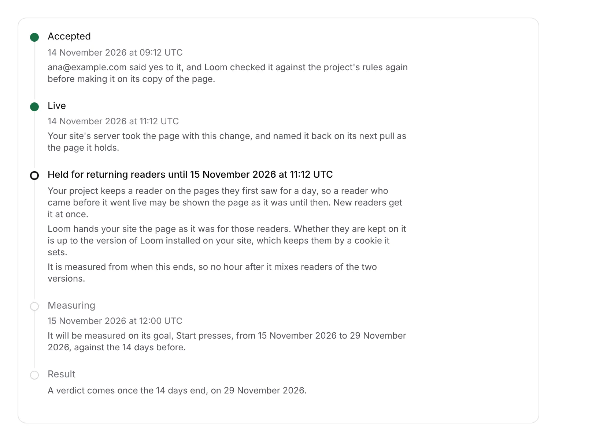

# Portal 10: the timeline says how long returning readers were held, and measures from then

**Run:** portal, 14 November 2026, from 01:18 UTC · **Pull request:** #895 ·
**Unit:** 10, the last two pieces of
[0383](../decisions/0383-a-reader-keeps-the-pages-they-first-saw-for-a-window-the-project-sets-and-their-browser-holds-one-number-many-readers-share.md):
*Held for returning readers until …* on the *Accept*-to-live timeline, and a
held change measured from when the window has run out (clause 6)

## What shipped

- **A step between *Live* and *Measuring*** on an accepted change's timeline,
  for a change that went live under a window: *Held for returning readers
  until 15 November 2026 at 11:12 UTC*, ringed until then and green after. It
  says the window in words (*for a day*), that new readers get the change at
  once, that Loom hands the site the page as it was and keeping a reader on it
  is up to the Loom installed there, and that measuring starts when it ends.
- **It ends early, and says why,** at the first of: the site publishing a
  newer version of any of the project's pages (a copy started), or a change
  taken back going live (clause 4).
- **The after side starts when the hold ends** (clause 6). `Bounds` gains
  `heldUntil`; `windowsOf` starts the after side at the hour after it, for 14
  days, still ending at the page's next change. The before side is unchanged.
  Every screen that reads `readMeasurement` (the timeline, *Pages*, *Page
  history*) follows, since the hold is worked out there.
- ***Measuring* is grey until its after side starts**, saying *It will be
  measured … from …*, rather than ringed with a *So far* that reads nothing.
  That is also true of the hour a change went live in, which was never on
  either side; one existing test moved its clock past that hour to keep
  testing the ringed state.
- **A window changed since the change went live** leaves the one it went live
  under unknown, since *Settings* keeps one choice. The step says so (*Whether
  returning readers were held is not known*) and it is measured from when it
  went live.

## Decisions taken, and why

- **The hold runs from when the change went live, not from *Accept*.** A pin
  is taken at a reader's first page view and runs out the window later, never
  renewed (clause 3), so the last reader who saw the page before it went live
  is held at most the window after that.
- **The window is the one kept now, when it was set at or before the change
  went live.** Settings replaces its row, so an older choice is gone; saying
  it is not known beats guessing. Reversible: a history of choices would need
  a table and `pnpm db:push`.
- **A window nobody chose, or that cannot be read, is *Off*,** the same reading
  the read door makes, so the door and the timeline never disagree about
  whether the site was handed held pages.
- **Ending early uses the records the screen already reads**: every copy
  started (all pages) and every revert that went live. A snapshot that
  changed no page raises the door's floor without starting a copy; the screen
  cannot see one, so the hold it says can be later than the real one, never
  earlier. That costs hours from the after side, never mixes the versions.
- **Loom says only what it did.** The site's pin tells Loom nothing (clause 3),
  and no released `@jam-overture/loom` reads one yet (FINDINGS, 13 November,
  `Loom daily build`), so the step says the site's Loom decides whether a
  reader is kept.

No decision record added; no table; no `pnpm db:push`; no environment
variable.

## Tests

- `holding.test.ts`: 6 (Off and never chosen, held for the window, changed
  since, ended early by a newer version or a change taken back, a withdrawal
  after the window ignored, `heldUntilOf`).
- `measuring.test.ts`: 2 new (`windowsOf` starts the after side once the hold
  ended; no after side where the page changed again first).
- `going-live.test.ts`: 4 new under *where a reader window held returning
  readers* (the step and its place, done and ended early, not known, nothing
  for a change that came off the page); every `timelineOf` call now passes a
  holding.
- `pnpm verify` on the final head: exit 0. Framework 7,071 passed and 2
  skipped (293 files); app 7,983 passed (496 files); prerender check 139
  pages, 0 run together.
- The screenshot is the timeline component rendered with sample values and the
  portal's stylesheet, not the live deployment.

## Toward the wireframe

`docs/portal-wireframes.md` section 4, *Accept to live to result*, now carries
everything 0383 adds to it, and with this unit 10 is done in the portal. What
is left of 0383 is the pin in `src/live` (`Loom daily build`), and the
`/what-you-run` sentence that must change in the pull request that turns a
window on for loomjs.org.
