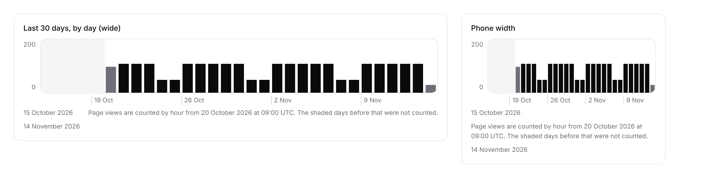

# Portal 8a: the 30-day Signals chart draws one bar a day

**Run:** portal, 14 November 2026, from 15:17 UTC · **Pull request:** #899 ·
**Unit:** 8a, *1 · Signals*, closing half of the `Loom signals` finding of
10 November (*the thirty-day range the portal already offers can be drawn by
day*)

## What shipped

- **Thirty days are drawn by the day.** The chart under the figures was one bar
  an hour for every range, so *Last 30 days* was 720 bars, under half a pixel
  each on a phone. It now draws one bar for every UTC day the range touches
  (31), folded by `arrivalDaysOf` from the same hourly reading the figure
  comes from, so the bars add up to the figure. *Last 24 hours* and *Last 7
  days* stay by the hour.
- **A day not wholly counted is lighter and says why** (the finding's point 3):
  today says *so far*; a first day the range or the start of counting cut short
  says *in the 8 of its 24 hours this range counted*. A short bar at either
  edge never reads as a quiet day.
- **Days before counting by hour began are shaded**, as hours are, and the note
  under the chart says *The shaded days before that were not counted*. The
  summary a screen reader hears says *by day* and *at most N in one day*.
- **The shaded band was black on the live portal.** It was filled with
  `fill-surface-muted`, a colour the portal's stylesheet does not define, so the
  SVG fell back to black and the *Not counted yet* label on it could not be
  read. It is now `fill-surface-hover` (#f4f4f5). This affected every range
  where counting began inside it.

## Decisions taken, and why

- **Only thirty days change.** A week by the hour is 168 bars, about two pixels
  each on a phone, and its shape within a day is what a week is looked at for.
  Thirty days by the hour shows nothing a person can point at.
- **UTC days.** The finding leaves the reader's offset to the portal or the
  maintainer. Every time the portal prints is UTC (`when.ts`), and a chart cut
  at another midnight than its labels would disagree with them, so the days are
  cut at UTC midnight. A project-level offset would be a setting with its own
  unit; nothing asks for one yet.
- **The day shape (`arrivalDayShapeOf`, busiest and quietest hours) is not
  drawn.** No screen of `portal-wireframes.md` has a place for *a reader's day*,
  and *no surface without a unit* binds. The finding stays open for that half.
- No decision record: the wireframe asks for this chart, and the change is in
  how it is drawn, not what it says.

## Tests

- `signals-range.test.ts`: 5 new under *the chart of thirty days, by day* (one
  bar a day adding up to the figure, a cut-short first day, *so far* for today,
  shading before counting began, a day and a week still by the hour). The
  existing Monday-marks test passes unchanged on day slots.
- `pnpm verify` on the branch: exit 0. App 7,988 passed (496 files);
  prerender check 139 pages, 0 run together.
- The screenshot is the chart component rendered with sample values and the
  portal's stylesheet, not the live deployment.

## Toward the wireframe

*1 · Signals* asks for *a bar chart of page views by hour across the range*;
with this every range is drawn at a size a person can read. Nothing on the
screen is left from the wireframe. No table, no `pnpm db:push`, no environment
variable.
